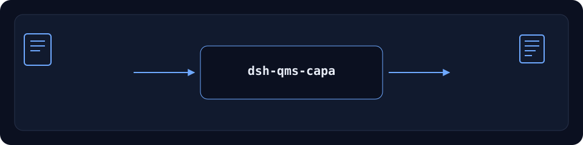

<div align="center">

# dsh-qms-capa

> **Repositório oficial.** O único repositório oficial deste pacote, mantido por PerryLink. Repositórios com o mesmo nome em outras contas não são afiliados. Apache-2.0.

[](https://www.npmjs.com/package/dsh-qms-capa)
[](https://github.com/PerryLink/dsh-qms-capa/actions)
[](LICENSE)
[](https://github.com/topics/dsh-plugin)
[](https://perrylink.github.io/dsh-plugins/)
[](https://gitee.com/perrylink/dsh-plugins)
[](https://dshfind.com/plugins/PerryLink/dsh-qms-capa?ref=badge)
[](https://dsh.market/)
[](#)
[](https://www.npmjs.com/package/dsh-qms-capa)

**Ingestão de NCR, alias de lotes, avaliação de impacto, CAPA e estado 8D.**

> **Status: alpha / sintético público / parcial / não contabilizado / não GA.** Sem evidência de clientes, dados de clientes ou promessa de produção.

> 🧊 **CONGELADO — 2026-10-31. Sem novos recursos.** Instalável; apenas falhas reais são corrigidas.

## Status de manutenção: 🧊 CONGELADO

Congelado em 2026-10-31; o pacote continua instalável, mas não recebe novos recursos.

[English](README.md) · [简体中文](README-zh.md) · [Español](README-es.md) · [Português](README-pt.md) · [हिन्दी](README-hi.md)

```sh
dsh plugin --profile <profile> add dsh-qms-capa
```

</div>

> ⭐ Se isso ajudar, uma estrela facilita a próxima pessoa encontrar. Nada fica bloqueado por ela.



*Fluxo: entrada local → plugin → saída local. Não exige chamada a modelo.*

## Instalação

Instalar e verificar:

```sh
dsh plugin --profile <profile> add dsh-qms-capa
dsh --profile <profile> --dump-config | grep dsh-qms-capa
```

Desinstalar:

```sh
dsh plugin --profile <profile> remove dsh-qms-capa
```

## O que faz

Ingestão de NCR, alias de lotes, avaliação de impacto, CAPA e estado 8D. Executa localmente no DeepSeek Harness. A tabela abaixo é a superfície exata de ferramentas; os exemplos usam a interface real.

Entrada e saída permanecem locais; nada é enviado.

## Ferramentas

Nomes e descrições de ferramentas ficam em inglês para corresponder à saída runtime.

| Ferramenta | Finalidade (em inglês) | Risco |
|---|---|---|
| `qms.ncr` | Ingest and dedupe NCR rows | R1 local write |
| `qms.batch_alias` | Resolve batch aliases | R0 |
| `qms.impact` | Evaluate affected batches/orders | R0 |
| `qms.capa` | Open/classify/advance a CAPA | R1 local write |
| `qms.8d` | Track D1–D8 evidence and state | R1 local write |

## Início rápido

```sh
dsh plugin --profile <profile> add dsh-qms-capa
dsh --profile <profile> --dump-config | grep dsh-qms-capa
```

## Limites

- Apenas público/sintético; sem dados ou evidência de clientes.
- Alpha/parcial, não contabilizado, sem GA ou promessa de produção.
- Sem modelo ou rede, a menos que uma ferramenta indique.
- Os limites exatos estão na tabela e em `ACCEPTANCE.csv`.

## Amostra pública

As fixtures públicas/sintéticas ficam em `test/fixtures/`; `ACCEPTANCE.csv` registra as verificações com `counted=false`.

## Desenvolvimento

```sh
pnpm install --frozen-lockfile
pnpm build && pnpm lint && pnpm typecheck && pnpm test
```

## Compatibilidade

| Superfície | Status |
|---|---|
| Harness | `dsh >=0.2.1-rc.3 <0.3.0` |
| Node | `>=24.9.0 <25` |
| Platforms | All; local files only |
| Dados | No network, no model call, no upload |

## Permissões e dados

- Executa localmente; sem rede, sem modelo, sem upload.
- Apenas fixtures públicas/sintéticas; sem dados ou evidência de clientes.
- Alpha/parcial; não contabilizado, sem GA ou promessa de produção.
- Pacotes congelados continuam instaláveis; sem novos recursos, apenas falhas reais.

## Trabalho relacionado

Pacotes irmãos e índices da família: [dsh-ghg](https://github.com/PerryLink/dsh-ghg) · [dsh-policy-ledger](https://github.com/PerryLink/dsh-policy-ledger)

- [Índice de domínio](https://perrylink.github.io/dsh-plugins/)
- [Família de checkers](https://perrylink.github.io/zh/checkers/)
- [Família principal](https://github.com/PerryLink/dsh-kit)

## Família

<details>
<summary>Família de plugins DSH (15 pacotes + 2 suites)</summary>

| Package | npm |
|---|---|
| **[dsh-einvoice](https://github.com/PerryLink/dsh-einvoice)** | [npm](https://www.npmjs.com/package/dsh-einvoice) |
| **[dsh-docx-redline](https://github.com/PerryLink/dsh-docx-redline)** | [npm](https://www.npmjs.com/package/dsh-docx-redline) |
| **[dsh-policy-ledger](https://github.com/PerryLink/dsh-policy-ledger)** | [npm](https://www.npmjs.com/package/dsh-policy-ledger) |
| **[dsh-ghg](https://github.com/PerryLink/dsh-ghg)** | [npm](https://www.npmjs.com/package/dsh-ghg) |
| **[dsh-bankrec](https://github.com/PerryLink/dsh-bankrec)** | [npm](https://www.npmjs.com/package/dsh-bankrec) |
| **[dsh-ap-three-way](https://github.com/PerryLink/dsh-ap-three-way)** | [npm](https://www.npmjs.com/package/dsh-ap-three-way) |
| **[dsh-ifc-qto](https://github.com/PerryLink/dsh-ifc-qto)** | [npm](https://www.npmjs.com/package/dsh-ifc-qto) |
| **[dsh-qms-capa](https://github.com/PerryLink/dsh-qms-capa)** | [npm](https://www.npmjs.com/package/dsh-qms-capa) |
| **[dsh-legal-intake](https://github.com/PerryLink/dsh-legal-intake)** | [npm](https://www.npmjs.com/package/dsh-legal-intake) |
| **[dsh-legal-clause](https://github.com/PerryLink/dsh-legal-clause)** | [npm](https://www.npmjs.com/package/dsh-legal-clause) |
| **[dsh-freight-audit](https://github.com/PerryLink/dsh-freight-audit)** | [npm](https://www.npmjs.com/package/dsh-freight-audit) |
| **[dsh-hs-candidate](https://github.com/PerryLink/dsh-hs-candidate)** | [npm](https://www.npmjs.com/package/dsh-hs-candidate) |
| **[dsh-travel-recon](https://github.com/PerryLink/dsh-travel-recon)** | [npm](https://www.npmjs.com/package/dsh-travel-recon) |
| **[dsh-pim-lint](https://github.com/PerryLink/dsh-pim-lint)** | [npm](https://www.npmjs.com/package/dsh-pim-lint) |
| **[dsh-eval-pack](https://github.com/PerryLink/dsh-eval-pack)** | [npm](https://www.npmjs.com/package/dsh-eval-pack) |
| **[dsh-finops-suite](https://github.com/PerryLink/dsh-finops-suite)** | [npm](https://www.npmjs.com/package/dsh-finops-suite) |
| **[dsh-contract-suite](https://github.com/PerryLink/dsh-contract-suite)** | [npm](https://www.npmjs.com/package/dsh-contract-suite) |

</details>

## Licença

Apache-2.0. See `LICENSE`, `NOTICE`, `THIRD-PARTY-NOTICES`.
