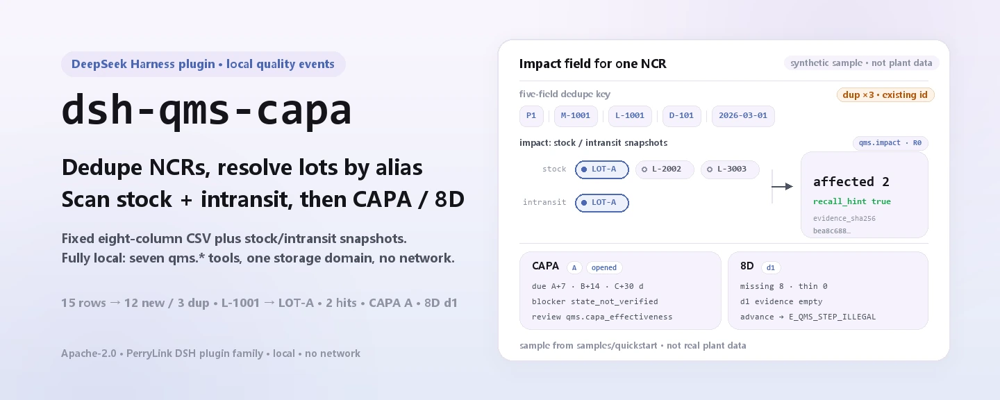
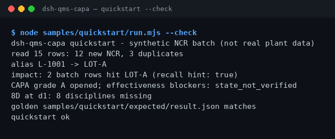

<div align="center">

<picture>
  <source media="(prefers-color-scheme: dark)" srcset="docs/assets/dsh-qms-capa-hero-en-dark.webp">
  
</picture>

# dsh-qms-capa

**Deduplicate NCR rows into a local store, find the affected batches, then open a CAPA or an 8D.**

A local quality-event plugin for DeepSeek Harness: it reads a fixed-header CSV ledger, dedupes rows, resolves batch aliases, evaluates stock and in-transit impact, and advances CAPA and D1–D8 state — no network, no model calls.

[Install](#three-step-setup) · [Configuration](#configuration) · [FAQ](#faq) · [简体中文](README.md) · [English](README.en.md) · [Español](README.es.md) · [Português](README.pt.md) · [हिन्दी](README.hi.md)

[](LICENSE)
[](#compatibility)
[](https://www.npmjs.com/package/dsh-qms-capa)
[](https://github.com/PerryLink/dsh-qms-capa/actions/workflows/ci.yml)
[](#compatibility)

[](https://github.com/PerryLink/dsh-qms-capa/stargazers)
[](https://www.npmjs.com/package/dsh-qms-capa)
[](https://dshfind.com/plugins/PerryLink/dsh-qms-capa?ref=badge)
[](https://dsh.market/)
[](https://gitee.com/perrylink/dsh-qms-capa)

```sh
dsh plugin --profile <name> add dsh-qms-capa
```

</div>

<sub>Community plugin, not affiliated with DeepSeek. Canonical repository: <https://github.com/PerryLink/dsh-qms-capa> (Gitee is a mirror). Alpha, public/synthetic only, partial, not counted, not GA; no customer evidence, no customer data, no production-readiness claim.</sub>

## What it is

`dsh-qms-capa` runs a fully local quality-event pipeline inside DeepSeek Harness: it deduplicates NCR rows into the store (the key is `plant`+`material`+`lot`+`defect_code`+`found_date` being identical), resolves batch aliases to canonical lots, evaluates the affected surface against stock and in-transit snapshots, then opens a CAPA or an 8D and advances it through its states. Tool names are the stable API (`qms_*`): call them as ingest → alias → impact → CAPA/8D → review. Input and output stay on the machine; there are no network requests and no model calls.

<picture>
  <source media="(prefers-color-scheme: dark)" srcset="docs/assets/dsh-qms-capa-flow-v5-dark.svg">
  
</picture>

**Good fit**: a fixed-schema NCR ledger (CSV) with tens to hundreds of rows, where duplicate rows and the affected batches should be confirmed before a CAPA/8D is opened. **Not a fit**: handwritten records with no lot or date; a direct MES/ERP connection (this package talks to no external system); replacing a quality engineer's root-cause judgement.

**Input**: UTF-8 CSV with the fixed header `plant,material,lot,defect_code,found_date,quantity,source,recurrence_of`; dates use `YYYY-MM-DD`. Designed for batches up to about 1 MB (the bundled sample is 15 rows, roughly 1 KB). Export from MES or Excel and save as CSV; the source file is never modified.

**Output**: a terminal summary (rows read, new NCRs, duplicates, alias resolution, affected batches, CAPA/8D state) plus store records under `$DSH_HOME/storages/qms/` (separate NCR/CAPA/8D tables); source files are untouched. The sample golden file is `samples/quickstart/expected/result.json`, produced by a real run.

In DSH you can simply say:

> I have a batch of NCR defect records; ingest and dedupe them, then tell me how many stock and in-transit rows this lot hits.

## Three-step setup

1. **Install** (pick one; npm is the recommended channel):

   ```sh
   # npm (recommended, 0.2.0 is published)
   dsh plugin --profile <name> add dsh-qms-capa
   # git channel (follows main; lib/ is a build artifact and not committed, so run pnpm install && pnpm build in the checkout first)
   dsh plugin --profile <name> add github:PerryLink/dsh-qms-capa
   # tarball channel: after pnpm install && pnpm build && pnpm pack in the checkout
   dsh plugin --profile <name> add ./dsh-qms-capa-<version>.tgz
   # 1024 store channel
   npm i -g dsh1024
   dsh1024 plugin --profile <name> add dsh-qms-capa
   ```

2. **Minimal config** (there are no tunable config keys): the bundle inserts one row; the host profile must provide the `tools` and `storageDomain` services, and data lands under `$DSH_HOME/storages/qms/`.

   ```yaml
   - insert:
       - id: dsh-qms-capa
         name: dsh-qms-capa
   ```

3. **Verify it mounts**:

   ```sh
   dsh --profile <name> --dump-config | grep dsh-qms-capa
   ```

Then run the bundled sample from the checkout (after `pnpm install && pnpm build`):

```sh
node samples/quickstart/run.mjs --check
```

```text
dsh-qms-capa quickstart - synthetic NCR batch (not real plant data)
read 15 rows: 12 new NCR, 3 duplicates
alias L-1001 -> LOT-A
impact: 2 batch rows hit LOT-A (recall hint: true)
CAPA grade A opened; effectiveness blockers: state_not_verified
8D at d1: 8 disciplines missing
golden samples/quickstart/expected/result.json matches
quickstart ok
```

**Uninstall**: `dsh plugin --profile <name> remove dsh-qms-capa` (or remove the row from the profile patch).

## Core capabilities

- **NCR ingest and dedupe** — `qms_ncr` validates that `plant`/`material`/`lot`/`defect_code`/`found_date` are non-empty, then dedupes on the key built from those five fields; a duplicate returns the existing `ncr_id` and never overwrites or changes the quantity. One call returns the new ids, the duplicate ids, and `field_f1`.
- **Batch aliases** — `qms_batch_alias` points an MES-side temporary lot (such as `L-1001`) at a canonical lot (such as `LOT-A`); `set` requires `canonical`, `resolve` returns the alias unchanged when it misses. Impact evaluation follows aliases automatically.
- **Impact evaluation** — `qms_impact` reads both the `stock` and `intransit` lot lists, merges them through alias resolution, and returns `affected` and `recall_hint`; the SHA-256 of the snapshot JSON is recorded as `evidence_sha256`. A missing snapshot fails with `E_QMS_IMPACT_INCOMPLETE`.
- **CAPA lifecycle** — `qms_capa` supports `open`/`classify`/`advance`; grades A/B/C put `due_date` 7/14/30 days out, and the state advances `opened → contained → root_cause → corrective → verified → closed`. `classify` recomputes the due date for the new grade.
- **8D with an evidence gate** — `qms_8d` supports `open`/`update`/`advance` and records D1–D8 evidence per discipline; advancing while the current discipline has no content is refused (`E_QMS_STEP_ILLEGAL`), so no step is skipped.
- **Read-only reviews** — `qms_8d_check` reports missing/thin D1–D8 disciplines and `ready_to_close`; `qms_capa_effectiveness` reports the state gate, overdue flag, and recurrence blocker. Neither writes the store or approves anything.
- **Fully local** — no network, no model calls, no uploads; it reads and writes only its own `qms` storage domain and never modifies the CSV you provide.

### Tool surface

| Tool | Purpose | Risk |
|---|---|---|
| `qms_ncr` | Ingest and dedupe NCR rows (plant/material/lot/defect_code/found_date) | R1 local write |
| `qms_batch_alias` | Set or resolve a batch alias to a canonical lot | R1 local write |
| `qms_impact` | Evaluate affected batches against stock/in-transit snapshots and report a recall hint | R0 |
| `qms_capa` | Open/classify/advance a CAPA and compute the due date from its grade | R1 local write |
| `qms_8d` | Track D1–D8 evidence and state | R1 local write |
| `qms_8d_check` | 8D completeness pre-check: missing/thin disciplines and `ready_to_close` | R0 |
| `qms_capa_effectiveness` | CAPA close-readiness review: state gate, overdue, recurrence blocker | R0 |

R0 = read-only; R1 = writes only the local `qms` storage domain, never the network.

### Example

The input is the public MIT redacted NCR table [`fixtures/public/mit/ncr_register.redacted.csv`](https://github.com/PerryLink/dsh-qms-capa/blob/main/fixtures/public/mit/ncr_register.redacted.csv); `test/public-ncr.test.mjs` maps it to 3 NCR rows and asserts that all of them are ingested with 0 duplicates. The full suite runs with `pnpm test`. One acceptance row:

| req_id | metric | threshold | actual | pass | source | counted |
|---|---|---|---|---|---|---|
| SKU-08-A01 | NCR ingest (30) | 30/30 | 30 | true | public/synthetic | false |

*This is a fixture-backed acceptance row, not a customer run; no output is invented.*

## Measured data

The repo ships one really executed quickstart golden run: 15 synthetic NCR rows in, 12 new and 3 duplicates; alias `L-1001` → `LOT-A`; 2 impact rows hit `LOT-A` (`recall_hint=true`); a grade-A CAPA opened with the effectiveness blocker `state_not_verified`; the 8D sits at D1 with 8 disciplines missing. The golden file `samples/quickstart/expected/result.json` is the real stdout of `--json`, not hand-written; re-run `node samples/quickstart/run.mjs --check`.

The acceptance record lives in `ACCEPTANCE.csv`: all 9 public/synthetic checks are `pass=true`; 8 SKU-08 rows are `counted=false` (`source=public/synthetic`) and 1 quickstart golden check is `counted=true` (`source=synthetic/quickstart`). `EVIDENCE.md` records 0 real plants and 0 real NCRs.

| req_id | metric | threshold | actual | pass | source | counted |
|---|---|---|---|---|---|---|
| SKU-08-A01 | NCR ingest (30) | 30/30 | 30 | true | public/synthetic | false |
| SKU-08-A02 | Duplicate detection (3) | 3/3 | 3 | true | public/synthetic | false |
| SKU-08-A03 | Batch alias | 1/1 | 1 | true | public/synthetic | false |
| SKU-08-A04 | Impact hit | 1/1 | 1 | true | public/synthetic | false |
| SKU-08-A05 | CAPA open | 1/1 | 1 | true | public/synthetic | false |
| SKU-08-A06 | 8D open | 1/1 | 1 | true | public/synthetic | false |
| SKU-08-A07 | 8D completeness pre-check | 8 | 8 | true | public/synthetic | false |
| SKU-08-A08 | CAPA effectiveness review | 1 | 1 | true | public/synthetic | false |
| PS1-QS01 | Quickstart sample matches the golden file | 1/1 | 1 | true | synthetic/quickstart | true |



*Captured from the real `node samples/quickstart/run.mjs --check` terminal run (2026-11-02); the content matches the golden file.*

## Configuration

This plugin has no Schemastery `Config` fields; `cordis.patch.yml` only inserts one row. The knobs are the host environment, the input header, and tool arguments.

| Knob | Default | Meaning |
|---|---|---|
| `DSH_HOME` | unset | Host home; determines the default data root `$DSH_HOME/storages/qms/` |
| Data root | `$DSH_HOME/storages/qms/` | Where the `qms` storage domain lives; decided by the host storage stack |
| Host services | required | `inject = ['tools', 'storageDomain']`; a bare profile without storage never applies |
| CSV header | fixed, eight columns | `plant,material,lot,defect_code,found_date,quantity,source,recurrence_of`; dates are `YYYY-MM-DD` |
| Dedupe key | five fields | `plant+material+lot+defect_code+found_date` identical means duplicate |
| CAPA due date | A=7 / B=14 / C=30 days | `open`/`classify` computes `due_date` from the grade |
| 8D advance gate | current discipline non-empty | Advancing without evidence for the current step is refused (`E_QMS_STEP_ILLEGAL`) |
| Batch size | ~1 MB recommended | The bundled sample is 15 rows, about 1 KB; split larger files |

<details>
<summary>Data model (storage domain qms v1, 4 tables)</summary>

| Table | Key | Fields |
|---|---|---|
| ncrs | `ncr_id` | plant, material, lot, defect_code, found_date, quantity, source, recurrence_of, created_at |
| aliases | `alias` | alias, canonical |
| capas | `capa_id` | ncr_id, grade (A/B/C), owner, due_date, state, created_at, updated_at |
| eightd | `eightd_id` | ncr_id, state (d1…d8/closed), data (D1–D8 evidence), created_at, updated_at |

</details>

<details>
<summary>Error format and common codes</summary>

Every error is "one plain sentence (`E_QMS_*`) | Next: one action"; technical details go to the log only, never to the user-facing text. Triage steps are in [`TROUBLESHOOTING.md`](TROUBLESHOOTING.md).

| Code | Meaning |
|---|---|
| `E_QMS_NCR_FIELD_MISSING` | The NCR record is missing a required field |
| `E_QMS_NCR_DUPLICATE` | This NCR is already in the store |
| `E_QMS_LOT_UNRESOLVED` | The batch alias has no canonical lot |
| `E_QMS_IMPACT_INCOMPLETE` | Impact evaluation is missing the stock or in-transit snapshot |
| `E_QMS_STEP_ILLEGAL` | This step is not allowed in the record's current state |
| `E_QMS_NCR_NOT_FOUND` | No NCR with that id |
| `E_QMS_RECORD_NOT_FOUND` | No CAPA or 8D with that id |

</details>

## FAQ

<details>
<summary>Where is the data stored? Will it modify my ledger?</summary>

Store records go into the `qms` storage domain, default root `$DSH_HOME/storages/qms/` (four tables: NCRs, aliases, CAPAs, 8D). The CSV you provide is read-only; nothing is uploaded and there is no telemetry. Rows enter the store only after `qms_ncr` ingests them.

</details>

<details>
<summary>How are duplicates detected? Why did my quantity change not take effect?</summary>

The key is `plant`+`material`+`lot`+`defect_code`+`found_date` being identical. A duplicate returns the existing `ncr_id` and never overwrites the record, so re-importing with a new quantity does nothing; update the original record or change `found_date` and import again. That is also the "next action" in `E_QMS_NCR_DUPLICATE`.

</details>

<details>
<summary>What if the result looks wrong?</summary>

First run `node samples/quickstart/run.mjs --check` against the golden file, then check the CSV header, date format, and lot casing. A Chinese header or inconsistent casing such as `Plant` fails with `E_QMS_NCR_FIELD_MISSING`; a missing `stock`/`intransit` snapshot fails with `E_QMS_IMPACT_INCOMPLETE`. See items 1–3 in `TROUBLESHOOTING.md`.

</details>

<details>
<summary>Does it call the network or a model? How heavy is it?</summary>

No. Everything is local arithmetic plus storage reads/writes: no model calls, no network requests, no uploads. Tools process rows linearly, and batches up to about 1 MB are recommended; the heaviest step is impact merging (a linear filter over the stock and in-transit lists).

</details>

<details>
<summary>Can it be used for a formal QMS or a customer audit?</summary>

No. The package is alpha / partial / not counted, uses public/synthetic data only, ships no customer evidence or customer data, and makes no GA or production-readiness claim; `qms_8d_check` and `qms_capa_effectiveness` are read-only readiness reviews, not approvals. Never paste real plant data into an issue.

</details>

## Security boundaries

- **Local run.** No network requests, no model calls, no uploads; the read scope is limited to the NCR CSV and the stock/in-transit snapshots the user supplies.
- **Writes only to its own location.** Only the `qms` storage domain (`$DSH_HOME/storages/qms/`); the user's CSV and snapshots are never modified.
- **Readable errors that do not leak data.** User-facing text is "one plain sentence + error code + next action"; technical details go to the log only. Never paste real plant data into an issue (see `PRIVACY.md`, `SECURITY.md`).
- **Data boundary.** Public/synthetic data only; no customer data, customer evidence, or telemetry; `EVIDENCE.md` states this explicitly.
- **No credentials, no external systems.** It reads no credentials and connects to no MES/ERP/cloud service.
- **Write-surface grading.** R1 writers: `qms_ncr`, `qms_batch_alias`, `qms_capa`, `qms_8d`; R0 read-only: `qms_impact`, `qms_8d_check`, `qms_capa_effectiveness`.

## Known limitations

- **alpha / partial / not counted.** No customer evidence, customer data, or production-readiness claim; `EVIDENCE.md` records 0 real plants and 0 real NCRs.
- **Public/synthetic samples only.** `fixtures/` holds a public MIT redacted sample and a synthetic quickstart; no customer data, no customer evidence.
- **No MES/ERP connection.** No external system is contacted; the CSV is exported from MES or Excel by hand, and lot/date correctness is the operator's responsibility.
- **Strict CSV.** Fixed eight-column header; `plant`/`material`/`lot`/`defect_code`/`found_date` must be non-empty; dates use `YYYY-MM-DD`; nothing is rewritten or guessed.
- **No OCR, no handwriting.** Records without a lot or date cannot be processed; convert scans to CSV by hand first.
- **Bounded batch size.** Designed for about 1 MB; split larger batches into several files.
- **Host services required.** The plugin `inject`s `tools` and `storageDomain`; a bare profile without storage never applies.
- **Reviews are not approvals.** `qms_8d_check` only looks at missing/thin D1–D8 disciplines and `qms_capa_effectiveness` only at the state gate, overdue flag, and recurrence blocker; neither replaces a quality engineer's root-cause judgement or sign-off.
- **Duplicate import does not update.** A duplicate only returns the existing id; there is no upsert. Update the original record or change `found_date`.
- **No UI.** Pure host tool surface: no browser half, no interface.
- **Narrow Node range.** Only `>=24.9.0 <25`.

## Interoperability with other DSH plugins

Checked against the source (`src/plugin/index.ts`, `src/plugin/tools.ts`, `src/plugin/storage.ts`); the plugin has no collision surface with commands, tools, slots, HTTP routes, or storage domains:

- **Namespaced tool names.** All 7 tools start with `qms_` and occupy no bare name owned by a built-in tool or another plugin.
- **Consumes services, provides none.** `inject` is only `['tools', 'storageDomain']`; it registers no command, client slot, `webServer` prefix, or service key.
- **Own storage domain.** It uses only its own `qms` v1 domain's four tables (ncrs, aliases, capas, eightd) and reads/writes no other domain.
- **No global mutation.** It patches no prototype, rewrites no `process.env`, and replaces no global fetch.
- **No session events.** The package writes no `*/applied` session event; its evidence chain is `evidence_sha256`, `created_at`, and the hash column in `ACCEPTANCE.csv`.
- **Read-only tools are reentrant.** `qms_impact`, `qms_8d_check`, and `qms_capa_effectiveness` write no state and are safe to call repeatedly.

## Compatibility

| Surface | Status |
|---|---|
| Harness | `dsh >=0.2.1-rc.3 <0.4.0` (`package.json` `engines.dsh`; development and test dependencies are pinned to the `0.2.1-rc.3` line) |
| Node | `>=24.9.0 <25` |
| Tool names | `qms_*` (underscores) since 0.2.0; the 0.1.x dotted names are removed because the provider validates `tools[].name` against `^[a-zA-Z0-9_-]+$` and one dot rejects the whole tools array |
| Host services | Requires both `tools` and `storageDomain` (see `inject` in `src/plugin/index.ts`) |
| Platforms | Anywhere DSH runs; local files only, no browser half |
| Model | Not required; no model calls |
| Data | No network, no uploads; writes only `$DSH_HOME/storages/qms` |
| Maintenance | Active (since 2026-11-01; features and hardening ship in alpha releases) |

## Ecosystem & quality

- [dshfind plugin page](https://dshfind.com/plugins/PerryLink/dsh-qms-capa) (installs and ranking)
- [DSH Market](https://dsh.market/) (listed)
- [Gitee mirror](https://gitee.com/perrylink/dsh-qms-capa) (synced mirror; GitHub is canonical) · [family aggregate mirror](https://gitee.com/perrylink/dsh-plugins)
- [Domain index](https://perrylink.github.io/dsh-plugins/) · [Checker family](https://perrylink.github.io/zh/checkers/) · [Mainline family](https://github.com/PerryLink/dsh-kit)
- **1024 store channel**: `npm i -g dsh1024` once, then `dsh1024 plugin --profile <name> add dsh-qms-capa` (counts toward the [deepseek1024.com](https://deepseek1024.com) install ranking)
- Sibling packages: [`dsh-ghg`](https://github.com/PerryLink/dsh-ghg), [`dsh-policy-ledger`](https://github.com/PerryLink/dsh-policy-ledger)

Related checkers (each is a separate package; install only the ones you need):

| Package | Why it is relevant |
|---|---|
| [`dsh-fmea-table-check`](https://github.com/PerryLink/dsh-fmea-table-check) | FMEA worksheet completeness and RPN consistency. |
| [`dsh-ppap-check`](https://github.com/PerryLink/dsh-ppap-check) | PPAP submission element completeness. |
| [`dsh-spc-gbt-adapter`](https://github.com/PerryLink/dsh-spc-gbt-adapter) | Control-chart constants and Cp/Cpk consistency. |
| [`dsh-sop-sync-check`](https://github.com/PerryLink/dsh-sop-sync-check) | Works-instruction / PFMEA / control-plan version sync. |

## Development

```sh
pnpm install --frozen-lockfile
pnpm build && pnpm lint && pnpm typecheck && pnpm test   # 16 tests
node samples/quickstart/run.mjs --check                  # golden replay
pnpm run gate:sku08                                      # acceptance gate (writes evidence/ and ACCEPTANCE.csv)
pnpm run pack:check                                      # publish tarball content check
```

Current version `0.2.0`.

Directory layout:

| Path | Contents |
|---|---|
| `src/core/` | Pure functions: `qms.ts` (error codes, dedupe key, required-field validation) |
| `src/plugin/` | `index.ts` (apply), `tools.ts` (7 tools), `storage.ts` (storage domain `qms` v1) |
| `test/` | `node --test` cases (qms, capa, eightd, the check tools, plugin-smoke, quickstart, public-ncr) |
| `scripts/` | Mechanical gates: lint, acceptance, gate-sku08, check-pack, sbom, plus the new `gen-readme-assets.py` |
| `fixtures/public/mit/` | Public MIT redacted NCR sample (with `SOURCE.md` and the upstream `LICENSE`) |
| `samples/quickstart/` | 15 synthetic NCR rows, alias/snapshot inputs, and the golden `expected/result.json` |
| `docs/assets/` | README images |
| `evidence/` | Acceptance run snapshots (`sku08-*/result.json`) |

The README images are generated programmatically by [`scripts/gen-readme-assets.py`](scripts/gen-readme-assets.py) (Pillow for the hero, hand-written SVG for the structure figure) and the script can be re-run: `python scripts/gen-readme-assets.py` rewrites `docs/assets/dsh-qms-capa-hero-{zh,en}-{light,dark}.webp` and `docs/assets/dsh-qms-capa-flow-v5-{light,dark}.svg`. The structure figure carries command/bookkeeping tokens only, so all five languages share one pair; the older `docs/assets/dsh-qms-capa-flow.svg` and `docs/assets/dsh-qms-capa-flow-{light,dark}.svg` are kept on disk so old external links keep resolving.

Topics: `dsh`, `dsh-plugin`, `deepseek-harness`, `deepseek`, `cordis`, `qms`, `ncr`, `capa`, `8d`, `manufacturing`

## Family & thanks

This project is part of the DeepSeek Harness plugin family from [PerryLink](https://github.com/PerryLink) (all Apache-2.0). If it is useful, **a star helps the next person find it** — nothing is gated behind it.

- [@PerryLink](https://github.com/PerryLink) — creator and maintainer: NCR ingest/dedupe, batch aliases, impact evaluation, the CAPA and 8D state machines, the read-only review tools, and the five-language docs.

<details>
<summary>Expand the DSH domain plugin family (15 packages + 2 suites)</summary>

| Plugin | npm | Status |
|---|---|---|
| **[dsh-einvoice](https://github.com/PerryLink/dsh-einvoice)** | [npm](https://www.npmjs.com/package/dsh-einvoice) |  |
| **[dsh-docx-redline](https://github.com/PerryLink/dsh-docx-redline)** | [npm](https://www.npmjs.com/package/dsh-docx-redline) |  |
| **[dsh-policy-ledger](https://github.com/PerryLink/dsh-policy-ledger)** | [npm](https://www.npmjs.com/package/dsh-policy-ledger) |  |
| **[dsh-ghg](https://github.com/PerryLink/dsh-ghg)** | [npm](https://www.npmjs.com/package/dsh-ghg) |  |
| **[dsh-bankrec](https://github.com/PerryLink/dsh-bankrec)** | [npm](https://www.npmjs.com/package/dsh-bankrec) |  |
| **[dsh-ap-three-way](https://github.com/PerryLink/dsh-ap-three-way)** | [npm](https://www.npmjs.com/package/dsh-ap-three-way) |  |
| **[dsh-ifc-qto](https://github.com/PerryLink/dsh-ifc-qto)** | [npm](https://www.npmjs.com/package/dsh-ifc-qto) |  |
| **[dsh-qms-capa](https://github.com/PerryLink/dsh-qms-capa)** | [npm](https://www.npmjs.com/package/dsh-qms-capa) |  |
| **[dsh-legal-intake](https://github.com/PerryLink/dsh-legal-intake)** | [npm](https://www.npmjs.com/package/dsh-legal-intake) |  |
| **[dsh-legal-clause](https://github.com/PerryLink/dsh-legal-clause)** | [npm](https://www.npmjs.com/package/dsh-legal-clause) |  |
| **[dsh-freight-audit](https://github.com/PerryLink/dsh-freight-audit)** | [npm](https://www.npmjs.com/package/dsh-freight-audit) |  |
| **[dsh-hs-candidate](https://github.com/PerryLink/dsh-hs-candidate)** | [npm](https://www.npmjs.com/package/dsh-hs-candidate) |  |
| **[dsh-travel-recon](https://github.com/PerryLink/dsh-travel-recon)** | [npm](https://www.npmjs.com/package/dsh-travel-recon) |  |
| **[dsh-pim-lint](https://github.com/PerryLink/dsh-pim-lint)** | [npm](https://www.npmjs.com/package/dsh-pim-lint) |  |
| **[dsh-eval-pack](https://github.com/PerryLink/dsh-eval-pack)** | [npm](https://www.npmjs.com/package/dsh-eval-pack) |  |
| **[dsh-finops-suite](https://github.com/PerryLink/dsh-finops-suite)** | [npm](https://www.npmjs.com/package/dsh-finops-suite) |  |
| **[dsh-contract-suite](https://github.com/PerryLink/dsh-contract-suite)** | [npm](https://www.npmjs.com/package/dsh-contract-suite) |  |

</details>

<details>
<summary>Expand the mainline family (87 current install specs)</summary>

| Plugin | npm | Status |
|---|---|---|
| **[dsh-aqua-input-check](https://github.com/PerryLink/dsh-aqua-input-check)** | [npm](https://www.npmjs.com/package/dsh-aqua-input-check) |  |
| **[dsh-archive-check](https://github.com/PerryLink/dsh-archive-check)** | [npm](https://www.npmjs.com/package/dsh-archive-check) |  |
| **[dsh-bid-ca-precheck](https://github.com/PerryLink/dsh-bid-ca-precheck)** | [npm](https://www.npmjs.com/package/dsh-bid-ca-precheck) |  |
| **[dsh-bid-qual-check](https://github.com/PerryLink/dsh-bid-qual-check)** | [npm](https://www.npmjs.com/package/dsh-bid-qual-check) |  |
| **[dsh-contract-stance](https://github.com/PerryLink/dsh-contract-stance)** | [npm](https://www.npmjs.com/package/dsh-contract-stance) |  |
| **[dsh-customs-doc-check](https://github.com/PerryLink/dsh-customs-doc-check)** | [npm](https://www.npmjs.com/package/dsh-customs-doc-check) |  |
| **[dsh-demurrage-ledger](https://github.com/PerryLink/dsh-demurrage-ledger)** | [npm](https://www.npmjs.com/package/dsh-demurrage-ledger) |  |
| **[dsh-drill-script-check](https://github.com/PerryLink/dsh-drill-script-check)** | [npm](https://www.npmjs.com/package/dsh-drill-script-check) |  |
| **[dsh-eia-guide-check](https://github.com/PerryLink/dsh-eia-guide-check)** | [npm](https://www.npmjs.com/package/dsh-eia-guide-check) |  |
| **[dsh-emergency-plan](https://github.com/PerryLink/dsh-emergency-plan)** | [npm](https://www.npmjs.com/package/dsh-emergency-plan) |  |
| **[dsh-essay-rubric-check](https://github.com/PerryLink/dsh-essay-rubric-check)** | [npm](https://www.npmjs.com/package/dsh-essay-rubric-check) |  |
| **[dsh-evidence-check](https://github.com/PerryLink/dsh-evidence-check)** | [npm](https://www.npmjs.com/package/dsh-evidence-check) |  |
| **[dsh-export-ctl-check](https://github.com/PerryLink/dsh-export-ctl-check)** | [npm](https://www.npmjs.com/package/dsh-export-ctl-check) |  |
| **[dsh-fmea-table-check](https://github.com/PerryLink/dsh-fmea-table-check)** | [npm](https://www.npmjs.com/package/dsh-fmea-table-check) |  |
| **[dsh-forecast-penalty](https://github.com/PerryLink/dsh-forecast-penalty)** | [npm](https://www.npmjs.com/package/dsh-forecast-penalty) |  |
| **[dsh-gongwen-flow-check](https://github.com/PerryLink/dsh-gongwen-flow-check)** | [npm](https://www.npmjs.com/package/dsh-gongwen-flow-check) |  |
| **[dsh-gongwen-word-check](https://github.com/PerryLink/dsh-gongwen-word-check)** | [npm](https://www.npmjs.com/package/dsh-gongwen-word-check) |  |
| **[dsh-guard-plan-qc](https://github.com/PerryLink/dsh-guard-plan-qc)** | [npm](https://www.npmjs.com/package/dsh-guard-plan-qc) |  |
| **[dsh-hazchem-check](https://github.com/PerryLink/dsh-hazchem-check)** | [npm](https://www.npmjs.com/package/dsh-hazchem-check) |  |
| **[dsh-hazplan-check](https://github.com/PerryLink/dsh-hazplan-check)** | [npm](https://www.npmjs.com/package/dsh-hazplan-check) |  |
| **[dsh-hidden-risk-map](https://github.com/PerryLink/dsh-hidden-risk-map)** | [npm](https://www.npmjs.com/package/dsh-hidden-risk-map) |  |
| **[dsh-hs-classify](https://github.com/PerryLink/dsh-hs-classify)** | [npm](https://www.npmjs.com/package/dsh-hs-classify) |  |
| **[dsh-icd-rule-check](https://github.com/PerryLink/dsh-icd-rule-check)** | [npm](https://www.npmjs.com/package/dsh-icd-rule-check) |  |
| **[dsh-lawcite-adapter](https://github.com/PerryLink/dsh-lawcite-adapter)** | [npm](https://www.npmjs.com/package/dsh-lawcite-adapter) |  |
| **[dsh-lc-doc-check](https://github.com/PerryLink/dsh-lc-doc-check)** | [npm](https://www.npmjs.com/package/dsh-lc-doc-check) |  |
| **[dsh-learning-gap-check](https://github.com/PerryLink/dsh-learning-gap-check)** | [npm](https://www.npmjs.com/package/dsh-learning-gap-check) |  |
| **[dsh-medrec-qc](https://github.com/PerryLink/dsh-medrec-qc)** | [npm](https://www.npmjs.com/package/dsh-medrec-qc) |  |
| **[dsh-nsfc-form-check](https://github.com/PerryLink/dsh-nsfc-form-check)** | [npm](https://www.npmjs.com/package/dsh-nsfc-form-check) |  |
| **[dsh-nurse-record-check](https://github.com/PerryLink/dsh-nurse-record-check)** | [npm](https://www.npmjs.com/package/dsh-nurse-record-check) |  |
| **[dsh-origin-rvc-check](https://github.com/PerryLink/dsh-origin-rvc-check)** | [npm](https://www.npmjs.com/package/dsh-origin-rvc-check) |  |
| **[dsh-ota-review-check](https://github.com/PerryLink/dsh-ota-review-check)** | [npm](https://www.npmjs.com/package/dsh-ota-review-check) |  |
| **[dsh-paper-doc-adapter](https://github.com/PerryLink/dsh-paper-doc-adapter)** | [npm](https://www.npmjs.com/package/dsh-paper-doc-adapter) |  |
| **[dsh-permit-report-check](https://github.com/PerryLink/dsh-permit-report-check)** | [npm](https://www.npmjs.com/package/dsh-permit-report-check) |  |
| **[dsh-pipeline-check](https://github.com/PerryLink/dsh-pipeline-check)** | [npm](https://www.npmjs.com/package/dsh-pipeline-check) |  |
| **[dsh-pleading-draft](https://github.com/PerryLink/dsh-pleading-draft)** | [npm](https://www.npmjs.com/package/dsh-pleading-draft) |  |
| **[dsh-policy-brief-draft](https://github.com/PerryLink/dsh-policy-brief-draft)** | [npm](https://www.npmjs.com/package/dsh-policy-brief-draft) |  |
| **[dsh-power-loss-split](https://github.com/PerryLink/dsh-power-loss-split)** | [npm](https://www.npmjs.com/package/dsh-power-loss-split) |  |
| **[dsh-power-ticket-check](https://github.com/PerryLink/dsh-power-ticket-check)** | [npm](https://www.npmjs.com/package/dsh-power-ticket-check) |  |
| **[dsh-ppap-check](https://github.com/PerryLink/dsh-ppap-check)** | [npm](https://www.npmjs.com/package/dsh-ppap-check) |  |
| **[dsh-protest-deadline](https://github.com/PerryLink/dsh-protest-deadline)** | [npm](https://www.npmjs.com/package/dsh-protest-deadline) |  |
| **[dsh-railway-window](https://github.com/PerryLink/dsh-railway-window)** | [npm](https://www.npmjs.com/package/dsh-railway-window) |  |
| **[dsh-repair-order-qc](https://github.com/PerryLink/dsh-repair-order-qc)** | [npm](https://www.npmjs.com/package/dsh-repair-order-qc) |  |
| **[dsh-review-reply-check](https://github.com/PerryLink/dsh-review-reply-check)** | [npm](https://www.npmjs.com/package/dsh-review-reply-check) |  |
| **[dsh-rulefile-check](https://github.com/PerryLink/dsh-rulefile-check)** | [npm](https://www.npmjs.com/package/dsh-rulefile-check) |  |
| **[dsh-safety-brief-check](https://github.com/PerryLink/dsh-safety-brief-check)** | [npm](https://www.npmjs.com/package/dsh-safety-brief-check) |  |
| **[dsh-site-log-check](https://github.com/PerryLink/dsh-site-log-check)** | [npm](https://www.npmjs.com/package/dsh-site-log-check) |  |
| **[dsh-soe-decision-check](https://github.com/PerryLink/dsh-soe-decision-check)** | [npm](https://www.npmjs.com/package/dsh-soe-decision-check) |  |
| **[dsh-soilwater-check](https://github.com/PerryLink/dsh-soilwater-check)** | [npm](https://www.npmjs.com/package/dsh-soilwater-check) |  |
| **[dsh-sop-sync-check](https://github.com/PerryLink/dsh-sop-sync-check)** | [npm](https://www.npmjs.com/package/dsh-sop-sync-check) |  |
| **[dsh-spc-gbt-adapter](https://github.com/PerryLink/dsh-spc-gbt-adapter)** | [npm](https://www.npmjs.com/package/dsh-spc-gbt-adapter) |  |
| **[dsh-tender-extract](https://github.com/PerryLink/dsh-tender-extract)** | [npm](https://www.npmjs.com/package/dsh-tender-extract) |  |
| **[dsh-tender-matrix](https://github.com/PerryLink/dsh-tender-matrix)** | [npm](https://www.npmjs.com/package/dsh-tender-matrix) |  |
| **[dsh-warranty-calc](https://github.com/PerryLink/dsh-warranty-calc)** | [npm](https://www.npmjs.com/package/dsh-warranty-calc) |  |
| **[dsh-auto-review](https://github.com/PerryLink/dsh-auto-review)** | [npm](https://www.npmjs.com/package/dsh-auto-review) |  |
| **[dsh-autotier](https://github.com/PerryLink/dsh-autotier)** | [npm](https://www.npmjs.com/package/dsh-autotier) | 🧊 FROZEN — see the repo README |
| **[dsh-budget](https://github.com/PerryLink/dsh-budget)** | [npm](https://www.npmjs.com/package/dsh-budget) |  |
| **[dsh-cert-mcp](https://github.com/PerryLink/dsh-cert-mcp)** | [npm](https://www.npmjs.com/package/dsh-cert-mcp) | 🧊 FROZEN — see the repo README |
| **[dsh-checkpoint-rewind](https://github.com/PerryLink/dsh-checkpoint-rewind)** | [npm](https://www.npmjs.com/package/dsh-checkpoint-rewind) |  |
| **[dsh-claude-move](https://github.com/PerryLink/dsh-claude-move)** | [npm](https://www.npmjs.com/package/dsh-claude-move) |  |
| **[dsh-click](https://github.com/PerryLink/dsh-click)** | [npm](https://www.npmjs.com/package/dsh-click) |  |
| **[dsh-composer-history](https://github.com/PerryLink/dsh-composer-history)** | [npm](https://www.npmjs.com/package/dsh-composer-history) |  |
| **[dsh-data-quality](https://github.com/PerryLink/dsh-data-quality)** | [npm](https://www.npmjs.com/package/dsh-data-quality) | 🧊 FROZEN — see the repo README |
| **[dsh-defend](https://github.com/PerryLink/dsh-defend)** | [npm](https://www.npmjs.com/package/dsh-defend) |  |
| **[dsh-doublecheck](https://github.com/PerryLink/dsh-doublecheck)** | [npm](https://www.npmjs.com/package/dsh-doublecheck) |  |
| **[dsh-draw](https://github.com/PerryLink/dsh-draw)** | [npm](https://www.npmjs.com/package/dsh-draw) | 🧊 FROZEN — see the repo README |
| **[dsh-fast](https://github.com/PerryLink/dsh-fast)** | [npm](https://www.npmjs.com/package/dsh-fast) |  |
| **[dsh-fund-research](https://github.com/PerryLink/dsh-fund-research)** | [npm](https://www.npmjs.com/package/dsh-fund-research) |  |
| **[dsh-industry-research](https://github.com/PerryLink/dsh-industry-research)** | [npm](https://www.npmjs.com/package/dsh-industry-research) |  |
| **[dsh-laya](https://github.com/PerryLink/dsh-laya)** | [npm](https://www.npmjs.com/package/dsh-laya) |  |
| **[dsh-library](https://github.com/PerryLink/dsh-library)** | [npm](https://www.npmjs.com/package/dsh-library) |  |
| **[dsh-local-ai](https://github.com/PerryLink/dsh-local-ai)** | [npm](https://www.npmjs.com/package/dsh-local-ai) |  |
| **[dsh-lsp-actions](https://github.com/PerryLink/dsh-lsp-actions)** | [npm](https://www.npmjs.com/package/dsh-lsp-actions) |  |
| **[dsh-mask](https://github.com/PerryLink/dsh-mask)** | [npm](https://www.npmjs.com/package/dsh-mask) |  |
| **[dsh-mcp-panel](https://github.com/PerryLink/dsh-mcp-panel)** | [npm](https://www.npmjs.com/package/dsh-mcp-panel) |  |
| **[dsh-memento](https://github.com/PerryLink/dsh-memento)** | [npm](https://www.npmjs.com/package/dsh-memento) | 🧊 FROZEN — see the repo README |
| **[dsh-observe](https://github.com/PerryLink/dsh-observe)** | [npm](https://www.npmjs.com/package/dsh-observe) |  |
| **[dsh-output-styles](https://github.com/PerryLink/dsh-output-styles)** | [npm](https://www.npmjs.com/package/dsh-output-styles) |  |
| **[dsh-permission-rules](https://github.com/PerryLink/dsh-permission-rules)** | [npm](https://www.npmjs.com/package/dsh-permission-rules) |  |
| **[dsh-plugin-guide](https://github.com/PerryLink/dsh-plugin-guide)** | [npm](https://www.npmjs.com/package/dsh-plugin-guide) |  |
| **[dsh-plugin-upgrade](https://github.com/PerryLink/dsh-plugin-upgrade)** | [npm](https://www.npmjs.com/package/dsh-plugin-upgrade) | 🚫 RETIRED (repo archived) |
| **[dsh-reach](https://github.com/PerryLink/dsh-reach)** | [npm](https://www.npmjs.com/package/dsh-reach) |  |
| **[dsh-research-report](https://github.com/PerryLink/dsh-research-report)** | [npm](https://www.npmjs.com/package/dsh-research-report) |  |
| **[dsh-score](https://github.com/PerryLink/dsh-score)** | [npm](https://www.npmjs.com/package/dsh-score) | 🧊 FROZEN — see the repo README |
| **[dsh-session-sync](https://github.com/PerryLink/dsh-session-sync)** | [npm](https://www.npmjs.com/package/dsh-session-sync) |  |
| **[dsh-talk](https://github.com/PerryLink/dsh-talk)** | [npm](https://www.npmjs.com/package/dsh-talk) |  |
| **[dsh-test-drive](https://github.com/PerryLink/dsh-test-drive)** | [npm](https://www.npmjs.com/package/dsh-test-drive) |  |
| **[dsh-translate](https://github.com/PerryLink/dsh-translate)** | [npm](https://www.npmjs.com/package/dsh-translate) |  |

</details>

## License

[LICENSE](LICENSE) (Apache License 2.0) © 2026 dsh-qms-capa contributors; see also `NOTICE`, `THIRD-PARTY-NOTICES`.

<p align="center"><sub>Apache-2.0 · Community plugin, not affiliated with DeepSeek.</sub></p>
