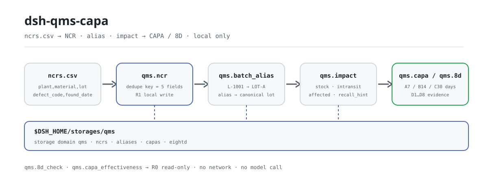
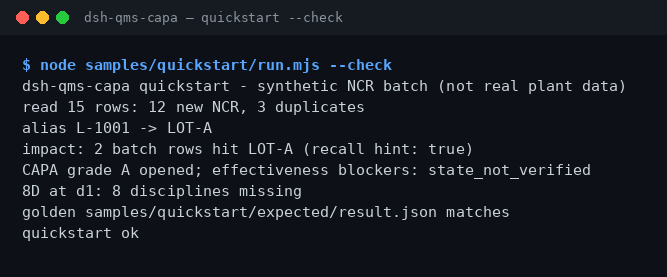

<div align="center">

<picture>
  <source media="(prefers-color-scheme: dark)" srcset="docs/assets/dsh-qms-capa-flow-dark.svg">
  
</picture>

# dsh-qms-capa

**Deduplica las filas de NCR en un almacén local, localiza los lotes afectados y abre una CAPA o un 8D.**

Un plugin local de eventos de calidad para DeepSeek Harness: lee un libro CSV con cabecera fija, deduplica filas, resuelve alias de lotes, evalúa el impacto en stock y en tránsito y avanza el estado de CAPA y D1–D8, sin red ni llamadas a un modelo.

[Instalar](#instalación-en-tres-pasos) · [Configuración](#configuración) · [FAQ](#faq) · [简体中文](README.md) · [English](README.en.md) · [Español](README.es.md) · [Português](README.pt.md) · [हिन्दी](README.hi.md)

[](LICENSE)
[](#compatibilidad)
[](https://www.npmjs.com/package/dsh-qms-capa)
[](https://github.com/PerryLink/dsh-qms-capa/actions/workflows/ci.yml)
[](#compatibilidad)

[](https://github.com/PerryLink/dsh-qms-capa/stargazers)
[](https://www.npmjs.com/package/dsh-qms-capa)
[](https://dshfind.com/plugins/PerryLink/dsh-qms-capa?ref=badge)
[](https://dsh.market/)
[](https://gitee.com/perrylink/dsh-qms-capa)

```sh
dsh plugin --profile <name> add dsh-qms-capa
```

</div>

<sub>Plugin de la comunidad, no afiliado a DeepSeek. Repositorio canónico: <https://github.com/PerryLink/dsh-qms-capa> (Gitee es un espejo). Alpha, solo público/sintético, parcial, no contabilizado, no GA; sin evidencia de clientes, datos de clientes ni promesa de producción.</sub>

## Qué es

`dsh-qms-capa` ejecuta una canalización de eventos de calidad totalmente local dentro de DeepSeek Harness: deduplica las filas de NCR en el almacén (la clave es que `plant`+`material`+`lot`+`defect_code`+`found_date` sean idénticos), resuelve los alias de lote a lotes canónicos, evalúa la superficie afectada contra las instantáneas de stock y tránsito, y luego abre una CAPA o un 8D y lo avanza por sus estados. Los nombres de herramienta son la API estable (`qms.*`): se llaman como ingesta → alias → impacto → CAPA/8D → revisión. La entrada y la salida se quedan en la máquina; no hay peticiones de red ni llamadas a un modelo.

**Encaja**: un libro de NCR (CSV) de esquema fijo con decenas o cientos de filas, cuando se quieren confirmar duplicados y lotes afectados antes de abrir una CAPA/8D. **No encaja**: registros manuscritos sin lote ni fecha; una conexión directa a MES/ERP (este paquete no habla con ningún sistema externo); sustituir el juicio de causa raíz de un ingeniero de calidad.

**Entrada**: CSV UTF-8 con la cabecera fija `plant,material,lot,defect_code,found_date,quantity,source,recurrence_of`; las fechas usan `YYYY-MM-DD`. Está pensado para lotes de hasta ~1 MB (la muestra incluida tiene 15 filas, unos 1 KB). Exporta desde MES o Excel y guarda como CSV; el archivo original nunca se modifica.

**Salida**: un resumen de terminal (filas leídas, NCR nuevas, duplicados, resolución de alias, lotes afectados, estado de CAPA/8D) y registros en `$DSH_HOME/storages/qms/` (tablas separadas de NCR/CAPA/8D); los archivos originales no se tocan. El archivo dorado de la muestra es `samples/quickstart/expected/result.json`, producido por una ejecución real.

En DSH puedes decir directamente:

> Tengo un lote de registros de defectos NCR; ingéstalos y deduplica, y luego dime cuántas filas de stock y en tránsito golpea este lote.

## Instalación en tres pasos

1. **Instala** (elige un canal; npm es el recomendado):

   ```sh
   # npm (recomendado, 0.1.1 publicado)
   dsh plugin --profile <name> add dsh-qms-capa
   # canal git (sigue main; lib/ es un artefacto de build y no está en el repo: ejecuta antes pnpm install && pnpm build en el checkout)
   dsh plugin --profile <name> add github:PerryLink/dsh-qms-capa
   # canal tarball: tras pnpm install && pnpm build && pnpm pack en el checkout
   dsh plugin --profile <name> add ./dsh-qms-capa-<version>.tgz
   # canal de la tienda 1024
   npm i -g dsh1024
   dsh1024 plugin --profile <name> add dsh-qms-capa
   ```

2. **Configuración mínima** (no hay claves de configuración): el paquete de composición solo inserta una fila; el perfil del host debe ofrecer los servicios `tools` y `storageDomain`, y los datos caen en `$DSH_HOME/storages/qms/`.

   ```yaml
   - insert:
       - id: dsh-qms-capa
         name: dsh-qms-capa
   ```

3. **Verifica que está activo**:

   ```sh
   dsh --profile <name> --dump-config | grep dsh-qms-capa
   ```

Después ejecuta la muestra incluida desde el checkout (antes `pnpm install && pnpm build`):

```sh
node samples/quickstart/run.mjs --check
```

```text
dsh-qms-capa quickstart - synthetic NCR batch (not real plant data)
read 15 rows: 12 new NCR, 3 duplicates
alias L-1001 -> LOT-A
impact: 2 batch rows hit LOT-A (recall hint: true)
CAPA grade A opened; effectiveness blockers: state_not_verified
8D at d1: 8 disciplines missing
golden samples/quickstart/expected/result.json matches
quickstart ok
```

**Desinstalar**: `dsh plugin --profile <name> remove dsh-qms-capa` (o borra la fila del patch del perfil).

## Capacidades clave

- **Ingesta y deduplicación de NCR** — `qms.ncr` valida que `plant`/`material`/`lot`/`defect_code`/`found_date` no estén vacíos y deduplica por la clave formada por esos cinco campos; un duplicado devuelve el `ncr_id` existente y nunca sobrescribe ni cambia la cantidad. Una llamada devuelve los ids nuevos, los duplicados y `field_f1`.
- **Alias de lote** — `qms.batch_alias` apunta un lote temporal del MES (como `L-1001`) a un lote canónico (como `LOT-A`); `set` exige `canonical`, `resolve` devuelve el alias sin cambios si no acierta. La evaluación de impacto sigue los alias automáticamente.
- **Evaluación de impacto** — `qms.impact` lee las listas `stock` e `intransit`, las fusiona mediante los alias y devuelve `affected` y `recall_hint`; el SHA-256 del JSON de instantáneas queda como `evidence_sha256`. Si falta una instantánea, falla con `E_QMS_IMPACT_INCOMPLETE`.
- **Ciclo de vida CAPA** — `qms.capa` admite `open`/`classify`/`advance`; los grados A/B/C fijan `due_date` a 7/14/30 días, y el estado avanza `opened → contained → root_cause → corrective → verified → closed`. `classify` recalcula el plazo con el nuevo grado.
- **8D con puerta de evidencia** — `qms.8d` admite `open`/`update`/`advance` y registra evidencia D1–D8 por disciplina; avanzar sin contenido en la disciplina actual se rechaza (`E_QMS_STEP_ILLEGAL`), sin saltarse pasos.
- **Revisiones de solo lectura** — `qms.8d_check` informa disciplinas D1–D8 faltantes o demasiado finas y `ready_to_close`; `qms.capa_effectiveness` informa la puerta de estado, el vencimiento y el bloqueo por reincidencia. Ninguna escribe el almacén ni aprueba nada.
- **Totalmente local** — sin red, sin llamadas a modelo, sin subidas; solo lee y escribe su propio dominio de almacenamiento `qms` y nunca modifica el CSV que aportas.

### Superficie de herramientas

| Herramienta | Propósito | Riesgo |
|---|---|---|
| `qms.ncr` | Ingerir y deduplicar filas de NCR (plant/material/lot/defect_code/found_date) | R1 local write |
| `qms.batch_alias` | Definir o resolver un alias de lote a un lote canónico | R1 local write |
| `qms.impact` | Evaluar lotes afectados contra instantáneas de stock/tránsito y dar una pista de retirada | R0 |
| `qms.capa` | Abrir/clasificar/avanzar una CAPA y calcular el vencimiento según el grado | R1 local write |
| `qms.8d` | Seguir la evidencia y el estado de D1–D8 | R1 local write |
| `qms.8d_check` | Prechequeo de completitud del 8D: disciplinas faltantes/finas y `ready_to_close` | R0 |
| `qms.capa_effectiveness` | Revisión de preparación para cerrar una CAPA: puerta de estado, vencimiento, reincidencia | R0 |

R0 = solo lectura; R1 = escribe solo el dominio local `qms`, nunca la red.

### Ejemplo

La entrada es la tabla pública de NCR redactada con licencia MIT [`fixtures/public/mit/ncr_register.redacted.csv`](https://github.com/PerryLink/dsh-qms-capa/blob/main/fixtures/public/mit/ncr_register.redacted.csv); `test/public-ncr.test.mjs` la convierte en 3 filas de NCR y comprueba que todas se ingestan con 0 duplicados. La suite completa se ejecuta con `pnpm test`. Una fila de aceptación:

| req_id | metric | threshold | actual | pass | source | counted |
|---|---|---|---|---|---|---|
| SKU-08-A01 | Ingesta de NCR (30) | 30/30 | 30 | true | public/synthetic | false |

*Es una fila de aceptación respaldada por fixture, no una ejecución de cliente; no se inventa salida.*

## Datos medidos

El repositorio incluye una ejecución dorada de quickstart realmente ejecutada: 15 filas de NCR sintéticas de entrada, 12 nuevas y 3 duplicadas; alias `L-1001` → `LOT-A`; 2 filas de impacto golpean `LOT-A` (`recall_hint=true`); una CAPA de grado A abierta con el bloqueo de efectividad `state_not_verified`; el 8D se queda en D1 con 8 disciplinas faltantes. El archivo dorado `samples/quickstart/expected/result.json` es la salida real de `--json`, no está escrito a mano; repite con `node samples/quickstart/run.mjs --check`.

El registro de aceptación está en `ACCEPTANCE.csv`: las 9 comprobaciones públicas/sintéticas tienen `pass=true`; 8 filas SKU-08 son `counted=false` (`source=public/synthetic`) y 1 comprobación dorada de quickstart es `counted=true` (`source=synthetic/quickstart`). `EVIDENCE.md` registra 0 plantas reales y 0 NCR reales.

| req_id | metric | threshold | actual | pass | source | counted |
|---|---|---|---|---|---|---|
| SKU-08-A01 | Ingesta de NCR (30) | 30/30 | 30 | true | public/synthetic | false |
| SKU-08-A02 | Detección de duplicados (3) | 3/3 | 3 | true | public/synthetic | false |
| SKU-08-A03 | Alias de lote | 1/1 | 1 | true | public/synthetic | false |
| SKU-08-A04 | Acierto de impacto | 1/1 | 1 | true | public/synthetic | false |
| SKU-08-A05 | Apertura de CAPA | 1/1 | 1 | true | public/synthetic | false |
| SKU-08-A06 | Apertura de 8D | 1/1 | 1 | true | public/synthetic | false |
| SKU-08-A07 | Prechequeo de completitud del 8D | 8 | 8 | true | public/synthetic | false |
| SKU-08-A08 | Revisión de efectividad de CAPA | 1 | 1 | true | public/synthetic | false |
| PS1-QS01 | La muestra quickstart coincide con el archivo dorado | 1/1 | 1 | true | synthetic/quickstart | true |



*Captura real de `node samples/quickstart/run.mjs --check` (2026-11-02); el contenido coincide con el archivo dorado.*

## Configuración

Este plugin no tiene campos `Config` de Schemastery; `cordis.patch.yml` solo inserta una fila. Los ajustes son el entorno del host, la cabecera de entrada y los argumentos de las herramientas.

| Ajuste | Valor por defecto | Significado |
|---|---|---|
| `DSH_HOME` | sin definir | Home del host; determina la raíz de datos por defecto `$DSH_HOME/storages/qms/` |
| Raíz de datos | `$DSH_HOME/storages/qms/` | Dónde vive el dominio `qms`; lo decide la pila de almacenamiento del host |
| Servicios del host | obligatorios | `inject = ['tools', 'storageDomain']`; un perfil bare sin storage nunca se aplica |
| Cabecera CSV | fija, ocho columnas | `plant,material,lot,defect_code,found_date,quantity,source,recurrence_of`; fechas `YYYY-MM-DD` |
| Clave de deduplicación | cinco campos | `plant+material+lot+defect_code+found_date` idénticos significa duplicado |
| Vencimiento CAPA | A=7 / B=14 / C=30 días | `open`/`classify` calcula `due_date` según el grado |
| Puerta de avance 8D | disciplina actual no vacía | Avanzar sin evidencia en el paso actual se rechaza (`E_QMS_STEP_ILLEGAL`) |
| Tamaño de lote | ~1 MB recomendado | La muestra incluida tiene 15 filas, unos 1 KB; divide archivos mayores |

<details>
<summary>Modelo de datos (dominio de almacenamiento qms v1, 4 tablas)</summary>

| Tabla | Clave | Campos |
|---|---|---|
| ncrs | `ncr_id` | plant, material, lot, defect_code, found_date, quantity, source, recurrence_of, created_at |
| aliases | `alias` | alias, canonical |
| capas | `capa_id` | ncr_id, grade (A/B/C), owner, due_date, state, created_at, updated_at |
| eightd | `eightd_id` | ncr_id, state (d1…d8/closed), data (evidencia D1–D8), created_at, updated_at |

</details>

<details>
<summary>Formato de error y códigos habituales</summary>

Todo error es «una frase clara (`E_QMS_*`) | Siguiente: una acción»; los detalles técnicos solo van al log, nunca al texto visible. El diagnóstico paso a paso está en [`TROUBLESHOOTING.md`](TROUBLESHOOTING.md).

| Código | Significado |
|---|---|
| `E_QMS_NCR_FIELD_MISSING` | Al registro de NCR le falta un campo obligatorio |
| `E_QMS_NCR_DUPLICATE` | Este NCR ya está en el almacén |
| `E_QMS_LOT_UNRESOLVED` | El alias de lote no tiene lote canónico |
| `E_QMS_IMPACT_INCOMPLETE` | Falta la instantánea de stock o de tránsito para evaluar el impacto |
| `E_QMS_STEP_ILLEGAL` | Este paso no se permite en el estado actual del registro |
| `E_QMS_NCR_NOT_FOUND` | No hay ningún NCR con ese id |
| `E_QMS_RECORD_NOT_FOUND` | No hay ninguna CAPA u 8D con ese id |

</details>

## FAQ

<details>
<summary>¿Dónde se guardan los datos? ¿Modifica mi libro?</summary>

Los registros van al dominio de almacenamiento `qms`, raíz por defecto `$DSH_HOME/storages/qms/` (cuatro tablas: NCR, alias, CAPA y 8D). El CSV que aportas es de solo lectura; no se sube nada y no hay telemetría. Las filas entran en el almacén solo después de que `qms.ncr` las ingiera.

</details>

<details>
<summary>¿Cómo se detectan los duplicados? ¿Por qué no surtió efecto mi cambio de cantidad?</summary>

La clave es que `plant`+`material`+`lot`+`defect_code`+`found_date` sean idénticos. Un duplicado devuelve el `ncr_id` existente y nunca sobrescribe el registro, así que reimportar con otra cantidad no hace nada; actualiza el registro original o cambia `found_date` y vuelve a importar. Es también la «siguiente acción» de `E_QMS_NCR_DUPLICATE`.

</details>

<details>
<summary>¿Y si el resultado no cuadra?</summary>

Primero ejecuta `node samples/quickstart/run.mjs --check` contra el archivo dorado; después revisa la cabecera del CSV, el formato de fecha y las mayúsculas del lote. Una cabecera en otro idioma o con mayúsculas incoherentes como `Plant` falla con `E_QMS_NCR_FIELD_MISSING`; una instantánea `stock`/`intransit` ausente falla con `E_QMS_IMPACT_INCOMPLETE`. Ver los puntos 1–3 de `TROUBLESHOOTING.md`.

</details>

<details>
<summary>¿Llama a la red o a un modelo? ¿Cuánto pesa?</summary>

No. Todo es aritmética local más lecturas/escrituras del almacén: sin llamadas a modelo, sin peticiones de red, sin subidas. Las herramientas procesan filas de forma lineal y se recomiendan lotes de hasta ~1 MB; el paso más pesado es la fusión de impacto (un filtro lineal sobre las listas de stock y tránsito).

</details>

<details>
<summary>¿Sirve para un QMS formal o una auditoría de cliente?</summary>

No. El paquete es alpha / parcial / no contabilizado, solo usa datos públicos/sintéticos, no incluye evidencia ni datos de clientes y no promete GA ni producción; `qms.8d_check` y `qms.capa_effectiveness` son revisiones de preparación de solo lectura, no aprobaciones. No pegues datos reales de planta en un issue.

</details>

## Límites de seguridad

- **Ejecución local.** Sin peticiones de red, sin llamadas a modelo, sin subidas; el alcance de lectura se limita al CSV de NCR y a las instantáneas de stock/tránsito que aporta el usuario.
- **Escribe solo en su ubicación.** Solo el dominio de almacenamiento `qms` (`$DSH_HOME/storages/qms/`); el CSV y las instantáneas del usuario nunca se modifican.
- **Errores legibles que no filtran datos.** El texto visible es «una frase clara + código de error + siguiente acción»; los detalles técnicos solo van al log. No pegues datos reales de planta en un issue (ver `PRIVACY.md`, `SECURITY.md`).
- **Frontera de datos.** Solo datos públicos/sintéticos; sin datos de clientes, evidencia de clientes ni telemetría; `EVIDENCE.md` lo deja escrito.
- **Sin credenciales ni sistemas externos.** No lee credenciales ni se conecta a MES/ERP/nube.
- **Graduación de escritura.** R1 escriben: `qms.ncr`, `qms.batch_alias`, `qms.capa`, `qms.8d`; R0 solo lectura: `qms.impact`, `qms.8d_check`, `qms.capa_effectiveness`.

## Limitaciones conocidas

- **alpha / parcial / no contabilizado.** Sin evidencia de clientes, datos de clientes ni promesa de producción; `EVIDENCE.md` registra 0 plantas reales y 0 NCR reales.
- **Solo muestras públicas/sintéticas.** `fixtures/` contiene una muestra pública MIT redactada y un quickstart sintético; sin datos ni evidencia de clientes.
- **Sin conexión a MES/ERP.** No se contacta ningún sistema externo; el CSV se exporta a mano desde MES o Excel y la corrección de lote/fecha es responsabilidad del operador.
- **CSV estricto.** Cabecera fija de ocho columnas; `plant`/`material`/`lot`/`defect_code`/`found_date` no vacíos; fechas `YYYY-MM-DD`; no se reescribe ni se adivina nada.
- **Sin OCR ni manuscritos.** Los registros sin lote o fecha no se pueden procesar; convierte antes los escaneos a CSV a mano.
- **Tamaño de lote acotado.** Pensado para ~1 MB; divide lotes mayores en varios archivos.
- **Requiere servicios del host.** El plugin inyecta `tools` y `storageDomain`; un perfil bare sin storage nunca se aplica.
- **Las revisiones no son aprobaciones.** `qms.8d_check` solo mira disciplinas D1–D8 faltantes o finas y `qms.capa_effectiveness` solo la puerta de estado, el vencimiento y la reincidencia; ninguna sustituye el juicio de causa raíz ni la firma de un ingeniero de calidad.
- **La importación duplicada no actualiza.** Un duplicado solo devuelve el id existente; no hay upsert. Actualiza el registro original o cambia `found_date`.
- **Sin UI.** Superficie de herramientas puramente host: sin mitad de navegador ni interfaz.
- **Rango de Node estrecho.** Solo `>=24.9.0 <25`.

## Interoperabilidad con otros plugins DSH

Verificado contra el código (`src/plugin/index.ts`, `src/plugin/tools.ts`, `src/plugin/storage.ts`); el plugin no tiene superficie de colisión con comandos, herramientas, slots, rutas HTTP ni dominios de almacenamiento:

- **Nombres de herramienta con espacio de nombres.** Las 7 herramientas empiezan por `qms.` y no ocupan ningún nombre desnudo de una herramienta integrada u otro plugin.
- **Consume servicios, no ofrece ninguno.** `inject` es solo `['tools', 'storageDomain']`; no registra comandos, slots de cliente, prefijos `webServer` ni claves de servicio.
- **Dominio de almacenamiento propio.** Usa solo las cuatro tablas de su dominio `qms` v1 (ncrs, aliases, capas, eightd) y no lee ni escribe otros dominios.
- **Sin mutación global.** No parchea prototipos, no reescribe `process.env` ni reemplaza el fetch global.
- **Sin eventos de sesión.** El paquete no escribe eventos de sesión `*/applied`; su cadena de evidencia es `evidence_sha256`, `created_at` y la columna de hash de `ACCEPTANCE.csv`.
- **Herramientas de solo lectura reentrantes.** `qms.impact`, `qms.8d_check` y `qms.capa_effectiveness` no escriben estado y se pueden llamar repetidamente.

## Compatibilidad

| Superficie | Estado |
|---|---|
| Harness | `dsh >=0.2.1-rc.3 <0.4.0` (`engines.dsh` de `package.json`; las dependencias de desarrollo y prueba están fijadas a la línea `0.2.1-rc.3`) |
| Node | `>=24.9.0 <25` |
| Servicios del host | Requiere `tools` y `storageDomain` (ver `inject` en `src/plugin/index.ts`) |
| Plataformas | Donde corra DSH; solo archivos locales, sin mitad de navegador |
| Modelo | No hace falta; no se llama a ningún modelo |
| Datos | Sin red ni subidas; solo escribe `$DSH_HOME/storages/qms` |
| Mantenimiento | Activo (desde 2026-11-01; funciones y endurecimiento en versiones alpha) |

## Ecosistema y calidad

- [Página de dshfind](https://dshfind.com/plugins/PerryLink/dsh-qms-capa) (instalaciones y ranking)
- [DSH Market](https://dsh.market/) (listado)
- [Espejo de Gitee](https://gitee.com/perrylink/dsh-qms-capa) (espejo sincronizado; GitHub es canónico) · [espejo agregado de la familia](https://gitee.com/perrylink/dsh-plugins)
- [Índice de dominio](https://perrylink.github.io/dsh-plugins/) · [Familia de checkers](https://perrylink.github.io/zh/checkers/) · [Familia principal](https://github.com/PerryLink/dsh-kit)
- **Canal de la tienda 1024**: `npm i -g dsh1024` una vez y luego `dsh1024 plugin --profile <name> add dsh-qms-capa` (cuenta para el ranking de [deepseek1024.com](https://deepseek1024.com))
- Paquetes hermanos: [`dsh-ghg`](https://github.com/PerryLink/dsh-ghg), [`dsh-policy-ledger`](https://github.com/PerryLink/dsh-policy-ledger)

Checkers relacionados (cada uno es un paquete aparte; instala solo los que necesites):

| Paquete | Por qué es relevante |
|---|---|
| [`dsh-fmea-table-check`](https://github.com/PerryLink/dsh-fmea-table-check) | Completitud de la hoja FMEA y coherencia del RPN. |
| [`dsh-ppap-check`](https://github.com/PerryLink/dsh-ppap-check) | Completitud de los elementos del envío PPAP. |
| [`dsh-spc-gbt-adapter`](https://github.com/PerryLink/dsh-spc-gbt-adapter) | Constantes de cartas de control y coherencia de Cp/Cpk. |
| [`dsh-sop-sync-check`](https://github.com/PerryLink/dsh-sop-sync-check) | Sincronización de versiones instrucción / PFMEA / plan de control. |

## Desarrollo

```sh
pnpm install --frozen-lockfile
pnpm build && pnpm lint && pnpm typecheck && pnpm test   # 15 pruebas
node samples/quickstart/run.mjs --check                  # repetición del dorado
pnpm run gate:sku08                                      # puerta de aceptación (escribe evidence/ y ACCEPTANCE.csv)
pnpm run pack:check                                      # comprobación del tarball de publicación
```

Versión actual `0.1.1`.

Estructura de directorios:

| Ruta | Contenido |
|---|---|
| `src/core/` | Funciones puras: `qms.ts` (códigos de error, clave de deduplicación, validación de campos obligatorios) |
| `src/plugin/` | `index.ts` (apply), `tools.ts` (7 herramientas), `storage.ts` (dominio `qms` v1) |
| `test/` | Casos de `node --test` (qms, capa, eightd, las herramientas de chequeo, plugin-smoke, quickstart, public-ncr) |
| `scripts/` | Puertas mecánicas: lint, acceptance, gate-sku08, check-pack, sbom y el nuevo `gen-readme-assets.py` |
| `fixtures/public/mit/` | Muestra pública de NCR redactada con licencia MIT (con `SOURCE.md` y el `LICENSE` original) |
| `samples/quickstart/` | 15 filas de NCR sintéticas, entradas de alias/instantáneas y el dorado `expected/result.json` |
| `docs/assets/` | Imágenes del README |
| `evidence/` | Instantáneas de ejecución de aceptación (`sku08-*/result.json`) |

Las imágenes del README las genera por programa [`scripts/gen-readme-assets.py`](scripts/gen-readme-assets.py) (Python; la ruta SVG no necesita Pillow). Volver a ejecutar `python scripts/gen-readme-assets.py` reescribe `docs/assets/dsh-qms-capa-flow-{light,dark}.svg`; el diagrama solo usa tokens de comando/contabilidad y lo comparten los cinco idiomas. El antiguo `docs/assets/dsh-qms-capa-flow.svg` de una sola versión se conserva para que los enlaces externos sigan resolviendo.

Temas: `dsh`, `dsh-plugin`, `deepseek-harness`, `deepseek`, `cordis`, `qms`, `ncr`, `capa`, `8d`, `manufacturing`

## Familia y agradecimientos

Este proyecto forma parte de la familia de plugins de DeepSeek Harness de [PerryLink](https://github.com/PerryLink) (todos Apache-2.0). Si te resulta útil, **una estrella ayuda a que la siguiente persona lo encuentre**; nada está bloqueado tras ella.

- [@PerryLink](https://github.com/PerryLink) — creador y mantenedor: ingesta y deduplicación de NCR, alias de lotes, evaluación de impacto, las máquinas de estado de CAPA y 8D, las herramientas de revisión de solo lectura y la documentación en cinco idiomas.

<details>
<summary>Desplegar la familia de plugins de dominio DSH (15 paquetes + 2 suites)</summary>

| Plugin | npm | Estado |
|---|---|---|
| **[dsh-einvoice](https://github.com/PerryLink/dsh-einvoice)** | [npm](https://www.npmjs.com/package/dsh-einvoice) |  |
| **[dsh-docx-redline](https://github.com/PerryLink/dsh-docx-redline)** | [npm](https://www.npmjs.com/package/dsh-docx-redline) |  |
| **[dsh-policy-ledger](https://github.com/PerryLink/dsh-policy-ledger)** | [npm](https://www.npmjs.com/package/dsh-policy-ledger) |  |
| **[dsh-ghg](https://github.com/PerryLink/dsh-ghg)** | [npm](https://www.npmjs.com/package/dsh-ghg) |  |
| **[dsh-bankrec](https://github.com/PerryLink/dsh-bankrec)** | [npm](https://www.npmjs.com/package/dsh-bankrec) |  |
| **[dsh-ap-three-way](https://github.com/PerryLink/dsh-ap-three-way)** | [npm](https://www.npmjs.com/package/dsh-ap-three-way) |  |
| **[dsh-ifc-qto](https://github.com/PerryLink/dsh-ifc-qto)** | [npm](https://www.npmjs.com/package/dsh-ifc-qto) |  |
| **[dsh-qms-capa](https://github.com/PerryLink/dsh-qms-capa)** | [npm](https://www.npmjs.com/package/dsh-qms-capa) |  |
| **[dsh-legal-intake](https://github.com/PerryLink/dsh-legal-intake)** | [npm](https://www.npmjs.com/package/dsh-legal-intake) |  |
| **[dsh-legal-clause](https://github.com/PerryLink/dsh-legal-clause)** | [npm](https://www.npmjs.com/package/dsh-legal-clause) |  |
| **[dsh-freight-audit](https://github.com/PerryLink/dsh-freight-audit)** | [npm](https://www.npmjs.com/package/dsh-freight-audit) |  |
| **[dsh-hs-candidate](https://github.com/PerryLink/dsh-hs-candidate)** | [npm](https://www.npmjs.com/package/dsh-hs-candidate) |  |
| **[dsh-travel-recon](https://github.com/PerryLink/dsh-travel-recon)** | [npm](https://www.npmjs.com/package/dsh-travel-recon) |  |
| **[dsh-pim-lint](https://github.com/PerryLink/dsh-pim-lint)** | [npm](https://www.npmjs.com/package/dsh-pim-lint) |  |
| **[dsh-eval-pack](https://github.com/PerryLink/dsh-eval-pack)** | [npm](https://www.npmjs.com/package/dsh-eval-pack) |  |
| **[dsh-finops-suite](https://github.com/PerryLink/dsh-finops-suite)** | [npm](https://www.npmjs.com/package/dsh-finops-suite) |  |
| **[dsh-contract-suite](https://github.com/PerryLink/dsh-contract-suite)** | [npm](https://www.npmjs.com/package/dsh-contract-suite) |  |

</details>

<details>
<summary>Desplegar la familia principal (87 specs de instalación actuales)</summary>

| Plugin | npm | Estado |
|---|---|---|
| **[dsh-aqua-input-check](https://github.com/PerryLink/dsh-aqua-input-check)** | [npm](https://www.npmjs.com/package/dsh-aqua-input-check) |  |
| **[dsh-archive-check](https://github.com/PerryLink/dsh-archive-check)** | [npm](https://www.npmjs.com/package/dsh-archive-check) |  |
| **[dsh-bid-ca-precheck](https://github.com/PerryLink/dsh-bid-ca-precheck)** | [npm](https://www.npmjs.com/package/dsh-bid-ca-precheck) |  |
| **[dsh-bid-qual-check](https://github.com/PerryLink/dsh-bid-qual-check)** | [npm](https://www.npmjs.com/package/dsh-bid-qual-check) |  |
| **[dsh-contract-stance](https://github.com/PerryLink/dsh-contract-stance)** | [npm](https://www.npmjs.com/package/dsh-contract-stance) |  |
| **[dsh-customs-doc-check](https://github.com/PerryLink/dsh-customs-doc-check)** | [npm](https://www.npmjs.com/package/dsh-customs-doc-check) |  |
| **[dsh-demurrage-ledger](https://github.com/PerryLink/dsh-demurrage-ledger)** | [npm](https://www.npmjs.com/package/dsh-demurrage-ledger) |  |
| **[dsh-drill-script-check](https://github.com/PerryLink/dsh-drill-script-check)** | [npm](https://www.npmjs.com/package/dsh-drill-script-check) |  |
| **[dsh-eia-guide-check](https://github.com/PerryLink/dsh-eia-guide-check)** | [npm](https://www.npmjs.com/package/dsh-eia-guide-check) |  |
| **[dsh-emergency-plan](https://github.com/PerryLink/dsh-emergency-plan)** | [npm](https://www.npmjs.com/package/dsh-emergency-plan) |  |
| **[dsh-essay-rubric-check](https://github.com/PerryLink/dsh-essay-rubric-check)** | [npm](https://www.npmjs.com/package/dsh-essay-rubric-check) |  |
| **[dsh-evidence-check](https://github.com/PerryLink/dsh-evidence-check)** | [npm](https://www.npmjs.com/package/dsh-evidence-check) |  |
| **[dsh-export-ctl-check](https://github.com/PerryLink/dsh-export-ctl-check)** | [npm](https://www.npmjs.com/package/dsh-export-ctl-check) |  |
| **[dsh-fmea-table-check](https://github.com/PerryLink/dsh-fmea-table-check)** | [npm](https://www.npmjs.com/package/dsh-fmea-table-check) |  |
| **[dsh-forecast-penalty](https://github.com/PerryLink/dsh-forecast-penalty)** | [npm](https://www.npmjs.com/package/dsh-forecast-penalty) |  |
| **[dsh-gongwen-flow-check](https://github.com/PerryLink/dsh-gongwen-flow-check)** | [npm](https://www.npmjs.com/package/dsh-gongwen-flow-check) |  |
| **[dsh-gongwen-word-check](https://github.com/PerryLink/dsh-gongwen-word-check)** | [npm](https://www.npmjs.com/package/dsh-gongwen-word-check) |  |
| **[dsh-guard-plan-qc](https://github.com/PerryLink/dsh-guard-plan-qc)** | [npm](https://www.npmjs.com/package/dsh-guard-plan-qc) |  |
| **[dsh-hazchem-check](https://github.com/PerryLink/dsh-hazchem-check)** | [npm](https://www.npmjs.com/package/dsh-hazchem-check) |  |
| **[dsh-hazplan-check](https://github.com/PerryLink/dsh-hazplan-check)** | [npm](https://www.npmjs.com/package/dsh-hazplan-check) |  |
| **[dsh-hidden-risk-map](https://github.com/PerryLink/dsh-hidden-risk-map)** | [npm](https://www.npmjs.com/package/dsh-hidden-risk-map) |  |
| **[dsh-hs-classify](https://github.com/PerryLink/dsh-hs-classify)** | [npm](https://www.npmjs.com/package/dsh-hs-classify) |  |
| **[dsh-icd-rule-check](https://github.com/PerryLink/dsh-icd-rule-check)** | [npm](https://www.npmjs.com/package/dsh-icd-rule-check) |  |
| **[dsh-lawcite-adapter](https://github.com/PerryLink/dsh-lawcite-adapter)** | [npm](https://www.npmjs.com/package/dsh-lawcite-adapter) |  |
| **[dsh-lc-doc-check](https://github.com/PerryLink/dsh-lc-doc-check)** | [npm](https://www.npmjs.com/package/dsh-lc-doc-check) |  |
| **[dsh-learning-gap-check](https://github.com/PerryLink/dsh-learning-gap-check)** | [npm](https://www.npmjs.com/package/dsh-learning-gap-check) |  |
| **[dsh-medrec-qc](https://github.com/PerryLink/dsh-medrec-qc)** | [npm](https://www.npmjs.com/package/dsh-medrec-qc) |  |
| **[dsh-nsfc-form-check](https://github.com/PerryLink/dsh-nsfc-form-check)** | [npm](https://www.npmjs.com/package/dsh-nsfc-form-check) |  |
| **[dsh-nurse-record-check](https://github.com/PerryLink/dsh-nurse-record-check)** | [npm](https://www.npmjs.com/package/dsh-nurse-record-check) |  |
| **[dsh-origin-rvc-check](https://github.com/PerryLink/dsh-origin-rvc-check)** | [npm](https://www.npmjs.com/package/dsh-origin-rvc-check) |  |
| **[dsh-ota-review-check](https://github.com/PerryLink/dsh-ota-review-check)** | [npm](https://www.npmjs.com/package/dsh-ota-review-check) |  |
| **[dsh-paper-doc-adapter](https://github.com/PerryLink/dsh-paper-doc-adapter)** | [npm](https://www.npmjs.com/package/dsh-paper-doc-adapter) |  |
| **[dsh-permit-report-check](https://github.com/PerryLink/dsh-permit-report-check)** | [npm](https://www.npmjs.com/package/dsh-permit-report-check) |  |
| **[dsh-pipeline-check](https://github.com/PerryLink/dsh-pipeline-check)** | [npm](https://www.npmjs.com/package/dsh-pipeline-check) |  |
| **[dsh-pleading-draft](https://github.com/PerryLink/dsh-pleading-draft)** | [npm](https://www.npmjs.com/package/dsh-pleading-draft) |  |
| **[dsh-policy-brief-draft](https://github.com/PerryLink/dsh-policy-brief-draft)** | [npm](https://www.npmjs.com/package/dsh-policy-brief-draft) |  |
| **[dsh-power-loss-split](https://github.com/PerryLink/dsh-power-loss-split)** | [npm](https://www.npmjs.com/package/dsh-power-loss-split) |  |
| **[dsh-power-ticket-check](https://github.com/PerryLink/dsh-power-ticket-check)** | [npm](https://www.npmjs.com/package/dsh-power-ticket-check) |  |
| **[dsh-ppap-check](https://github.com/PerryLink/dsh-ppap-check)** | [npm](https://www.npmjs.com/package/dsh-ppap-check) |  |
| **[dsh-protest-deadline](https://github.com/PerryLink/dsh-protest-deadline)** | [npm](https://www.npmjs.com/package/dsh-protest-deadline) |  |
| **[dsh-railway-window](https://github.com/PerryLink/dsh-railway-window)** | [npm](https://www.npmjs.com/package/dsh-railway-window) |  |
| **[dsh-repair-order-qc](https://github.com/PerryLink/dsh-repair-order-qc)** | [npm](https://www.npmjs.com/package/dsh-repair-order-qc) |  |
| **[dsh-review-reply-check](https://github.com/PerryLink/dsh-review-reply-check)** | [npm](https://www.npmjs.com/package/dsh-review-reply-check) |  |
| **[dsh-rulefile-check](https://github.com/PerryLink/dsh-rulefile-check)** | [npm](https://www.npmjs.com/package/dsh-rulefile-check) |  |
| **[dsh-safety-brief-check](https://github.com/PerryLink/dsh-safety-brief-check)** | [npm](https://www.npmjs.com/package/dsh-safety-brief-check) |  |
| **[dsh-site-log-check](https://github.com/PerryLink/dsh-site-log-check)** | [npm](https://www.npmjs.com/package/dsh-site-log-check) |  |
| **[dsh-soe-decision-check](https://github.com/PerryLink/dsh-soe-decision-check)** | [npm](https://www.npmjs.com/package/dsh-soe-decision-check) |  |
| **[dsh-soilwater-check](https://github.com/PerryLink/dsh-soilwater-check)** | [npm](https://www.npmjs.com/package/dsh-soilwater-check) |  |
| **[dsh-sop-sync-check](https://github.com/PerryLink/dsh-sop-sync-check)** | [npm](https://www.npmjs.com/package/dsh-sop-sync-check) |  |
| **[dsh-spc-gbt-adapter](https://github.com/PerryLink/dsh-spc-gbt-adapter)** | [npm](https://www.npmjs.com/package/dsh-spc-gbt-adapter) |  |
| **[dsh-tender-extract](https://github.com/PerryLink/dsh-tender-extract)** | [npm](https://www.npmjs.com/package/dsh-tender-extract) |  |
| **[dsh-tender-matrix](https://github.com/PerryLink/dsh-tender-matrix)** | [npm](https://www.npmjs.com/package/dsh-tender-matrix) |  |
| **[dsh-warranty-calc](https://github.com/PerryLink/dsh-warranty-calc)** | [npm](https://www.npmjs.com/package/dsh-warranty-calc) |  |
| **[dsh-auto-review](https://github.com/PerryLink/dsh-auto-review)** | [npm](https://www.npmjs.com/package/dsh-auto-review) |  |
| **[dsh-autotier](https://github.com/PerryLink/dsh-autotier)** | [npm](https://www.npmjs.com/package/dsh-autotier) | 🧊 CONGELADO — ver el README del repo |
| **[dsh-budget](https://github.com/PerryLink/dsh-budget)** | [npm](https://www.npmjs.com/package/dsh-budget) |  |
| **[dsh-cert-mcp](https://github.com/PerryLink/dsh-cert-mcp)** | [npm](https://www.npmjs.com/package/dsh-cert-mcp) | 🧊 CONGELADO — ver el README del repo |
| **[dsh-checkpoint-rewind](https://github.com/PerryLink/dsh-checkpoint-rewind)** | [npm](https://www.npmjs.com/package/dsh-checkpoint-rewind) |  |
| **[dsh-claude-move](https://github.com/PerryLink/dsh-claude-move)** | [npm](https://www.npmjs.com/package/dsh-claude-move) |  |
| **[dsh-click](https://github.com/PerryLink/dsh-click)** | [npm](https://www.npmjs.com/package/dsh-click) |  |
| **[dsh-composer-history](https://github.com/PerryLink/dsh-composer-history)** | [npm](https://www.npmjs.com/package/dsh-composer-history) |  |
| **[dsh-data-quality](https://github.com/PerryLink/dsh-data-quality)** | [npm](https://www.npmjs.com/package/dsh-data-quality) | 🧊 CONGELADO — ver el README del repo |
| **[dsh-defend](https://github.com/PerryLink/dsh-defend)** | [npm](https://www.npmjs.com/package/dsh-defend) |  |
| **[dsh-doublecheck](https://github.com/PerryLink/dsh-doublecheck)** | [npm](https://www.npmjs.com/package/dsh-doublecheck) |  |
| **[dsh-draw](https://github.com/PerryLink/dsh-draw)** | [npm](https://www.npmjs.com/package/dsh-draw) | 🧊 CONGELADO — ver el README del repo |
| **[dsh-fast](https://github.com/PerryLink/dsh-fast)** | [npm](https://www.npmjs.com/package/dsh-fast) |  |
| **[dsh-fund-research](https://github.com/PerryLink/dsh-fund-research)** | [npm](https://www.npmjs.com/package/dsh-fund-research) |  |
| **[dsh-industry-research](https://github.com/PerryLink/dsh-industry-research)** | [npm](https://www.npmjs.com/package/dsh-industry-research) |  |
| **[dsh-laya](https://github.com/PerryLink/dsh-laya)** | [npm](https://www.npmjs.com/package/dsh-laya) |  |
| **[dsh-library](https://github.com/PerryLink/dsh-library)** | [npm](https://www.npmjs.com/package/dsh-library) |  |
| **[dsh-local-ai](https://github.com/PerryLink/dsh-local-ai)** | [npm](https://www.npmjs.com/package/dsh-local-ai) |  |
| **[dsh-lsp-actions](https://github.com/PerryLink/dsh-lsp-actions)** | [npm](https://www.npmjs.com/package/dsh-lsp-actions) |  |
| **[dsh-mask](https://github.com/PerryLink/dsh-mask)** | [npm](https://www.npmjs.com/package/dsh-mask) |  |
| **[dsh-mcp-panel](https://github.com/PerryLink/dsh-mcp-panel)** | [npm](https://www.npmjs.com/package/dsh-mcp-panel) |  |
| **[dsh-memento](https://github.com/PerryLink/dsh-memento)** | [npm](https://www.npmjs.com/package/dsh-memento) | 🧊 CONGELADO — ver el README del repo |
| **[dsh-observe](https://github.com/PerryLink/dsh-observe)** | [npm](https://www.npmjs.com/package/dsh-observe) |  |
| **[dsh-output-styles](https://github.com/PerryLink/dsh-output-styles)** | [npm](https://www.npmjs.com/package/dsh-output-styles) |  |
| **[dsh-permission-rules](https://github.com/PerryLink/dsh-permission-rules)** | [npm](https://www.npmjs.com/package/dsh-permission-rules) |  |
| **[dsh-plugin-guide](https://github.com/PerryLink/dsh-plugin-guide)** | [npm](https://www.npmjs.com/package/dsh-plugin-guide) |  |
| **[dsh-plugin-upgrade](https://github.com/PerryLink/dsh-plugin-upgrade)** | [npm](https://www.npmjs.com/package/dsh-plugin-upgrade) | 🚫 RETIRADO (repo archivado) |
| **[dsh-reach](https://github.com/PerryLink/dsh-reach)** | [npm](https://www.npmjs.com/package/dsh-reach) |  |
| **[dsh-research-report](https://github.com/PerryLink/dsh-research-report)** | [npm](https://www.npmjs.com/package/dsh-research-report) |  |
| **[dsh-score](https://github.com/PerryLink/dsh-score)** | [npm](https://www.npmjs.com/package/dsh-score) | 🧊 CONGELADO — ver el README del repo |
| **[dsh-session-sync](https://github.com/PerryLink/dsh-session-sync)** | [npm](https://www.npmjs.com/package/dsh-session-sync) |  |
| **[dsh-talk](https://github.com/PerryLink/dsh-talk)** | [npm](https://www.npmjs.com/package/dsh-talk) |  |
| **[dsh-test-drive](https://github.com/PerryLink/dsh-test-drive)** | [npm](https://www.npmjs.com/package/dsh-test-drive) |  |
| **[dsh-translate](https://github.com/PerryLink/dsh-translate)** | [npm](https://www.npmjs.com/package/dsh-translate) |  |

</details>

## Licencia

[LICENSE](LICENSE) (Apache License 2.0) © 2026 dsh-qms-capa contributors; ver también `NOTICE`, `THIRD-PARTY-NOTICES`.

<p align="center"><sub>Apache-2.0 · Plugin de la comunidad, no afiliado a DeepSeek.</sub></p>
