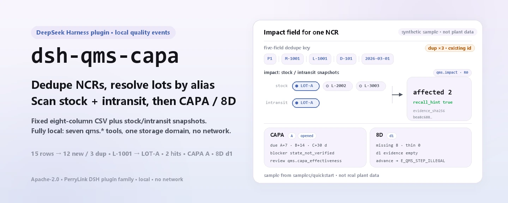
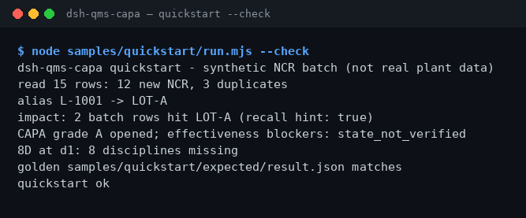

<div align="center">

<picture>
  <source media="(prefers-color-scheme: dark)" srcset="docs/assets/dsh-qms-capa-hero-en-dark.webp">
  
</picture>

# dsh-qms-capa

**NCR पंक्तियों को स्थानीय स्टोर में डुप्लिकेट-रहित करें, प्रभावित लॉट खोजें, फिर एक CAPA या 8D खोलें।**

DeepSeek Harness के लिए स्थानीय गुणवत्ता-घटना प्लगइन: निश्चित हेडर वाला CSV लेजर पढ़ता है, पंक्तियाँ डुप्लिकेट-रहित करता है, बैच alias हल करता है, स्टॉक और ट्रांज़िट प्रभाव का आकलन करता है, और CAPA तथा D1–D8 स्थिति आगे बढ़ाता है — कोई नेटवर्क नहीं, कोई मॉडल कॉल नहीं।

[इंस्टॉल](#तीन-चरणों-में-शुरुआत) · [कॉन्फ़िगरेशन](#कॉन्फ़िगरेशन) · [FAQ](#faq) · [简体中文](README.md) · [English](README.en.md) · [Español](README.es.md) · [Português](README.pt.md) · [हिन्दी](README.hi.md)

[](LICENSE)
[](#अनुकूलता)
[](https://www.npmjs.com/package/dsh-qms-capa)
[](https://github.com/PerryLink/dsh-qms-capa/actions/workflows/ci.yml)
[](#अनुकूलता)

[](https://github.com/PerryLink/dsh-qms-capa/stargazers)
[](https://www.npmjs.com/package/dsh-qms-capa)
[](https://dshfind.com/plugins/PerryLink/dsh-qms-capa?ref=badge)
[](https://dsh.market/)
[](https://gitee.com/perrylink/dsh-qms-capa)

```sh
dsh plugin --profile <name> add dsh-qms-capa
```

</div>

<sub>समुदाय प्लगइन, DeepSeek से संबद्ध नहीं। एकमात्र रेपो: <https://github.com/PerryLink/dsh-qms-capa> (Gitee एक मिरर है)। alpha / सार्वजनिक या सिंथेटिक डेटा / आंशिक / गिना नहीं गया / GA नहीं; कोई ग्राहक साक्ष्य या ग्राहक डेटा नहीं, उत्पादन-तैयारी का दावा नहीं।</sub>

## यह क्या है

`dsh-qms-capa` DeepSeek Harness के भीतर पूरी तरह स्थानीय गुणवत्ता-घटना पाइपलाइन चलाता है: NCR पंक्तियों को स्टोर में डुप्लिकेट-रहित करता है (कुंजी है `plant`+`material`+`lot`+`defect_code`+`found_date` का बिल्कुल समान होना), बैच alias को कैनोनिकल लॉट में हल करता है, स्टॉक और ट्रांज़िट स्नैपशॉट के आधार पर प्रभावित सतह का आकलन करता है, और फिर एक CAPA या 8D खोलकर उसे स्थितियों में आगे बढ़ाता है। टूल के नाम ही स्थिर API हैं (`qms.*`): क्रम है इनजेस्ट → alias → impact → CAPA/8D → समीक्षा। इनपुट और आउटपुट आपकी मशीन पर ही रहते हैं; कोई नेटवर्क अनुरोध नहीं, कोई मॉडल कॉल नहीं।

<picture>
  <source media="(prefers-color-scheme: dark)" srcset="docs/assets/dsh-qms-capa-flow-v5-dark.svg">
  
</picture>

**उपयुक्त**: निश्चित स्कीमा वाला NCR लेजर (CSV), जिसमें दर्जनों से सैकड़ों पंक्तियाँ हों और CAPA/8D खोलने से पहले डुप्लिकेट पंक्तियों तथा प्रभावित लॉट की पुष्टि करनी हो। **उपयुक्त नहीं**: बिना लॉट या तारीख वाले हस्तलिखित रिकॉर्ड; सीधा MES/ERP कनेक्शन (यह पैकेज किसी बाहरी सिस्टम से नहीं जुड़ता); क्वालिटी इंजीनियर के मूल-कारण निर्णय का स्थान लेना।

**इनपुट**: UTF-8 CSV, निश्चित हेडर `plant,material,lot,defect_code,found_date,quantity,source,recurrence_of`; तारीखें `YYYY-MM-DD` में। लगभग 1 MB तक के बैच के लिए बनाया गया (साथ दी गई नमूना फ़ाइल 15 पंक्तियाँ, लगभग 1 KB)। MES या Excel से निर्यात करके CSV के रूप में सहेजें; स्रोत फ़ाइल कभी नहीं बदली जाती।

**आउटपुट**: टर्मिनल सारांश (पढ़ी गई पंक्तियाँ, नए NCR, डुप्लिकेट, alias समाधान, प्रभावित लॉट, CAPA/8D स्थिति) और `$DSH_HOME/storages/qms/` के अंतर्गत स्टोर रिकॉर्ड (NCR/CAPA/8D की अलग तालिकाएँ); स्रोत फ़ाइलें अछूती रहती हैं। नमूने की गोल्डन फ़ाइल `samples/quickstart/expected/result.json` है, जो वास्तविक रन से बनी है।

DSH में आप सीधे कह सकते हैं:

> मेरे पास NCR खराबी रिकॉर्ड का एक बैच है; इन्हें इनजेस्ट और डुप्लिकेट-रहित करें, फिर बताएँ कि यह लॉट स्टॉक और ट्रांज़िट में कितनी पंक्तियों से टकराता है।

## तीन चरणों में शुरुआत

1. **इंस्टॉल करें** (एक चैनल चुनें; npm अनुशंसित है):

   ```sh
   # npm (अनुशंसित, 0.1.1 प्रकाशित)
   dsh plugin --profile <name> add dsh-qms-capa
   # git चैनल (main का अनुसरण; lib/ बिल्ड आर्टिफ़ैक्ट है और रेपो में नहीं है, इसलिए checkout में पहले pnpm install && pnpm build चलाएँ)
   dsh plugin --profile <name> add github:PerryLink/dsh-qms-capa
   # tarball चैनल: checkout में pnpm install && pnpm build && pnpm pack के बाद
   dsh plugin --profile <name> add ./dsh-qms-capa-<version>.tgz
   # 1024 स्टोर चैनल
   npm i -g dsh1024
   dsh1024 plugin --profile <name> add dsh-qms-capa
   ```

2. **न्यूनतम कॉन्फ़िगरेशन** (कोई समायोज्य कॉन्फ़िगरेशन कुंजी नहीं): बंडल केवल एक पंक्ति जोड़ता है; होस्ट प्रोफ़ाइल में `tools` और `storageDomain` सेवाएँ होनी चाहिए, और डेटा `$DSH_HOME/storages/qms/` में रहता है।

   ```yaml
   - insert:
       - id: dsh-qms-capa
         name: dsh-qms-capa
   ```

3. **जाँचें कि माउंट हुआ**:

   ```sh
   dsh --profile <name> --dump-config | grep dsh-qms-capa
   ```

फिर checkout से साथ दी गई नमूना चलाएँ (`pnpm install && pnpm build` के बाद):

```sh
node samples/quickstart/run.mjs --check
```

```text
dsh-qms-capa quickstart - synthetic NCR batch (not real plant data)
read 15 rows: 12 new NCR, 3 duplicates
alias L-1001 -> LOT-A
impact: 2 batch rows hit LOT-A (recall hint: true)
CAPA grade A opened; effectiveness blockers: state_not_verified
8D at d1: 8 disciplines missing
golden samples/quickstart/expected/result.json matches
quickstart ok
```

**अनइंस्टॉल**: `dsh plugin --profile <name> remove dsh-qms-capa` (या प्रोफ़ाइल पैच से पंक्ति हटा दें)।

## मुख्य क्षमताएँ

- **NCR इनजेस्ट और डुप्लिकेट-निवारण** — `qms.ncr` पहले जाँचता है कि `plant`/`material`/`lot`/`defect_code`/`found_date` खाली नहीं हैं, फिर इन पाँच फ़ील्ड से बनी कुंजी पर डुप्लिकेट हटाता है; डुप्लिकेट पंक्ति केवल मौजूदा `ncr_id` लौटाती है और कभी ओवरराइट या मात्रा नहीं बदलती। एक कॉल नए आईडी, डुप्लिकेट आईडी और `field_f1` लौटाती है।
- **बैच alias** — `qms.batch_alias` MES-पक्ष के अस्थायी लॉट (जैसे `L-1001`) को कैनोनिकल लॉट (जैसे `LOT-A`) से जोड़ता है; `set` में `canonical` ज़रूरी है, और `resolve` बिना मेल के alias जैसा है वैसा ही लौटाता है। प्रभाव आकलन alias का स्वतः पालन करता है।
- **प्रभाव आकलन** — `qms.impact` दोनों लॉट सूचियाँ, `stock` और `intransit`, पढ़ता है, alias समाधान से उन्हें मिलाता है, और `affected` तथा `recall_hint` लौटाता है; स्नैपशॉट JSON का SHA-256 `evidence_sha256` के रूप में दर्ज होता है। कोई स्नैपशॉट न हो तो `E_QMS_IMPACT_INCOMPLETE` के साथ विफल होता है।
- **CAPA जीवनचक्र** — `qms.capa` में `open`/`classify`/`advance` हैं; ग्रेड A/B/C `due_date` को क्रमशः 7/14/30 दिन आगे रखते हैं, और स्थिति `opened → contained → root_cause → corrective → verified → closed` क्रम में बढ़ती है। `classify` नए ग्रेड के लिए समय-सीमा दोबारा गिनता है।
- **8D और साक्ष्य-द्वार** — `qms.8d` में `open`/`update`/`advance` हैं और यह प्रत्येक discipline के लिए D1–D8 साक्ष्य दर्ज करता है; वर्तमान discipline में सामग्री न हो तो आगे बढ़ाना अस्वीकार होता है (`E_QMS_STEP_ILLEGAL`), इसलिए कोई चरण नहीं छूटता।
- **केवल-पढ़ने वाली समीक्षाएँ** — `qms.8d_check` अनुपस्थित/पतले D1–D8 और `ready_to_close` बताता है; `qms.capa_effectiveness` स्थिति-द्वार, अतिदेय और पुनरावृत्ति अवरोध बताता है। दोनों में से कोई स्टोर नहीं लिखता और कोई स्वीकृति नहीं देता।
- **पूरी तरह स्थानीय** — कोई नेटवर्क नहीं, कोई मॉडल कॉल नहीं, कोई अपलोड नहीं; केवल अपने `qms` स्टोरेज डोमेन को पढ़ता-लिखता है और आपकी दी हुई CSV कभी नहीं बदलता।

### टूल सतह

| टूल | उद्देश्य | जोखिम |
|---|---|---|
| `qms.ncr` | NCR पंक्तियाँ इनजेस्ट और डुप्लिकेट-रहित करें (plant/material/lot/defect_code/found_date) | R1 local write |
| `qms.batch_alias` | बैच alias को कैनोनिकल लॉट पर सेट या हल करें | R1 local write |
| `qms.impact` | स्टॉक/ट्रांज़िट स्नैपशॉट के विरुद्ध प्रभावित लॉट का आकलन करें और recall संकेत दें | R0 |
| `qms.capa` | CAPA खोलें/वर्गीकृत करें/आगे बढ़ाएँ और ग्रेड से देय तिथि गिनें | R1 local write |
| `qms.8d` | D1–D8 साक्ष्य और स्थिति ट्रैक करें | R1 local write |
| `qms.8d_check` | 8D पूर्णता की पूर्व-जाँच: अनुपस्थित/पतले discipline और `ready_to_close` | R0 |
| `qms.capa_effectiveness` | CAPA बंद करने की तैयारी की समीक्षा: स्थिति-द्वार, अतिदेय, पुनरावृत्ति अवरोध | R0 |

R0 = केवल पढ़ना; R1 = केवल स्थानीय `qms` स्टोरेज डोमेन में लिखना, कभी नेटवर्क नहीं।

### उदाहरण

इनपुट MIT की सार्वजनिक, अनामित NCR तालिका [`fixtures/public/mit/ncr_register.redacted.csv`](https://github.com/PerryLink/dsh-qms-capa/blob/main/fixtures/public/mit/ncr_register.redacted.csv) है; `test/public-ncr.test.mjs` इसे 3 NCR पंक्तियों में बदलकर जाँचता है कि सभी स्टोर में 0 डुप्लिकेट के साथ जाती हैं। पूरा सूट `pnpm test` से चलता है। एक स्वीकृति पंक्ति:

| req_id | metric | threshold | actual | pass | source | counted |
|---|---|---|---|---|---|---|
| SKU-08-A01 | NCR इनजेस्ट (30) | 30/30 | 30 | true | public/synthetic | false |

*यह fixture-आधारित स्वीकृति पंक्ति है, ग्राहक रन नहीं; कोई आउटपुट नहीं गढ़ा गया।*

## मापा गया डेटा

रिपॉज़िटरी में एक वास्तव में चलाया गया quickstart गोल्डन रन है: 15 सिंथेटिक NCR पंक्तियाँ अंदर, 12 नई और 3 डुप्लिकेट; alias `L-1001` → `LOT-A`; 2 प्रभाव पंक्तियाँ `LOT-A` से टकराती हैं (`recall_hint=true`); ग्रेड-A CAPA खुली जिसका प्रभावशीलता अवरोध `state_not_verified` है; 8D D1 पर है और 8 discipline अनुपस्थित हैं। गोल्डन फ़ाइल `samples/quickstart/expected/result.json` `--json` का वास्तविक stdout है, हाथ से लिखा नहीं; `node samples/quickstart/run.mjs --check` से दोबारा चलाएँ।

स्वीकृति रिकॉर्ड `ACCEPTANCE.csv` में है: सभी 9 सार्वजनिक/सिंथेटिक जाँचें `pass=true` हैं; 8 SKU-08 पंक्तियाँ `counted=false` (`source=public/synthetic`) और 1 quickstart गोल्डन जाँच `counted=true` (`source=synthetic/quickstart`) है। `EVIDENCE.md` 0 वास्तविक फ़ैक्टरी और 0 वास्तविक NCR दर्ज करता है।

| req_id | metric | threshold | actual | pass | source | counted |
|---|---|---|---|---|---|---|
| SKU-08-A01 | NCR इनजेस्ट (30) | 30/30 | 30 | true | public/synthetic | false |
| SKU-08-A02 | डुप्लिकेट पहचान (3) | 3/3 | 3 | true | public/synthetic | false |
| SKU-08-A03 | बैच alias | 1/1 | 1 | true | public/synthetic | false |
| SKU-08-A04 | प्रभाव हिट | 1/1 | 1 | true | public/synthetic | false |
| SKU-08-A05 | CAPA खोलना | 1/1 | 1 | true | public/synthetic | false |
| SKU-08-A06 | 8D खोलना | 1/1 | 1 | true | public/synthetic | false |
| SKU-08-A07 | 8D पूर्णता पूर्व-जाँच | 8 | 8 | true | public/synthetic | false |
| SKU-08-A08 | CAPA प्रभावशीलता समीक्षा | 1 | 1 | true | public/synthetic | false |
| PS1-QS01 | quickstart नमूना गोल्डन से मेल | 1/1 | 1 | true | synthetic/quickstart | true |



*वास्तविक `node samples/quickstart/run.mjs --check` टर्मिनल रन (2026-11-02) से कैप्चर; सामग्री गोल्डन फ़ाइल से मेल खाती है।*

## कॉन्फ़िगरेशन

इस प्लगइन में कोई Schemastery `Config` फ़ील्ड नहीं है; `cordis.patch.yml` केवल एक पंक्ति जोड़ता है। समायोज्य चीज़ें होस्ट परिवेश, इनपुट हेडर और टूल तर्क हैं।

| समायोज्य | डिफ़ॉल्ट | अर्थ |
|---|---|---|
| `DSH_HOME` | सेट नहीं | होस्ट home; डिफ़ॉल्ट डेटा रूट `$DSH_HOME/storages/qms/` तय करता है |
| डेटा रूट | `$DSH_HOME/storages/qms/` | `qms` स्टोरेज डोमेन कहाँ रहता है; होस्ट स्टोरेज स्टैक तय करता है |
| होस्ट सेवाएँ | आवश्यक | `inject = ['tools', 'storageDomain']`; स्टोरेज के बिना सादी प्रोफ़ाइल लागू नहीं होगी |
| CSV हेडर | निश्चित, आठ कॉलम | `plant,material,lot,defect_code,found_date,quantity,source,recurrence_of`; तारीखें `YYYY-MM-DD` |
| डुप्लिकेट कुंजी | पाँच फ़ील्ड | `plant+material+lot+defect_code+found_date` समान हों तो डुप्लिकेट |
| CAPA देय तिथि | A=7 / B=14 / C=30 दिन | `open`/`classify` ग्रेड से `due_date` गिनता है |
| 8D आगे बढ़ने का द्वार | वर्तमान discipline खाली न हो | वर्तमान चरण के साक्ष्य के बिना आगे बढ़ाना अस्वीकार (`E_QMS_STEP_ILLEGAL`) |
| बैच आकार | ~1 MB अनुशंसित | साथ दी गई नमूना 15 पंक्तियाँ, लगभग 1 KB; बड़ी फ़ाइलें बाँटें |

<details>
<summary>डेटा मॉडल (स्टोरेज डोमेन qms v1, 4 तालिकाएँ)</summary>

| तालिका | कुंजी | फ़ील्ड |
|---|---|---|
| ncrs | `ncr_id` | plant, material, lot, defect_code, found_date, quantity, source, recurrence_of, created_at |
| aliases | `alias` | alias, canonical |
| capas | `capa_id` | ncr_id, grade (A/B/C), owner, due_date, state, created_at, updated_at |
| eightd | `eightd_id` | ncr_id, state (d1…d8/closed), data (D1–D8 साक्ष्य), created_at, updated_at |

</details>

<details>
<summary>त्रुटि प्रारूप और सामान्य कोड</summary>

हर त्रुटि "एक सीधा वाक्य (`E_QMS_*`) | अगला: एक कार्य" है; तकनीकी विवरण केवल लॉग में जाते हैं, उपयोगकर्ता के पाठ में कभी नहीं। चरण-दर-चरण निदान [`TROUBLESHOOTING.md`](TROUBLESHOOTING.md) में है।

| कोड | अर्थ |
|---|---|
| `E_QMS_NCR_FIELD_MISSING` | NCR रिकॉर्ड में कोई अनिवार्य फ़ील्ड छूटी है |
| `E_QMS_NCR_DUPLICATE` | यह NCR पहले से स्टोर में है |
| `E_QMS_LOT_UNRESOLVED` | बैच alias का कोई कैनोनिकल लॉट नहीं है |
| `E_QMS_IMPACT_INCOMPLETE` | प्रभाव आकलन में स्टॉक या ट्रांज़िट स्नैपशॉट नहीं है |
| `E_QMS_STEP_ILLEGAL` | रिकॉर्ड की वर्तमान स्थिति में यह चरण अनुमत नहीं है |
| `E_QMS_NCR_NOT_FOUND` | उस आईडी वाला कोई NCR नहीं |
| `E_QMS_RECORD_NOT_FOUND` | उस आईडी वाला कोई CAPA या 8D नहीं |

</details>

## FAQ

<details>
<summary>डेटा कहाँ रहता है? क्या यह मेरा लेजर बदलेगा?</summary>

स्टोर रिकॉर्ड `qms` स्टोरेज डोमेन में जाते हैं, डिफ़ॉल्ट रूट `$DSH_HOME/storages/qms/` (चार तालिकाएँ: NCR, alias, CAPA, 8D)। आपकी दी हुई CSV केवल पढ़ी जाती है; कुछ अपलोड नहीं होता और कोई टेलीमेट्री नहीं है। पंक्तियाँ स्टोर में तभी जाती हैं जब `qms.ncr` उन्हें इनजेस्ट करता है।

</details>

<details>
<summary>डुप्लिकेट कैसे पहचाने जाते हैं? मेरी मात्रा का बदलाव क्यों लागू नहीं हुआ?</summary>

कुंजी है `plant`+`material`+`lot`+`defect_code`+`found_date` का समान होना। डुप्लिकेट मौजूदा `ncr_id` लौटाता है और रिकॉर्ड कभी ओवरराइट नहीं करता, इसलिए नई मात्रा के साथ दोबारा आयात करने से कुछ नहीं होता; मूल रिकॉर्ड अपडेट करें या `found_date` बदलकर फिर आयात करें। `E_QMS_NCR_DUPLICATE` में भी यही "अगला कार्य" है।

</details>

<details>
<summary>नतीजा गलत लगे तो क्या करें?</summary>

पहले गोल्डन के विरुद्ध `node samples/quickstart/run.mjs --check` चलाएँ, फिर CSV हेडर, तारीख का प्रारूप और लॉट का केस जाँचें। चीनी हेडर या `Plant` जैसा असंगत केस `E_QMS_NCR_FIELD_MISSING` के साथ विफल होता है; `stock`/`intransit` स्नैपशॉट न हो तो `E_QMS_IMPACT_INCOMPLETE` आता है। विवरण `TROUBLESHOOTING.md` के मद 1–3 में है।

</details>

<details>
<summary>क्या यह नेटवर्क या मॉडल कॉल करता है? कितना भारी है?</summary>

नहीं। सब कुछ स्थानीय अंकगणित और स्टोरेज पढ़ना-लिखना है: कोई मॉडल कॉल नहीं, कोई नेटवर्क अनुरोध नहीं, कोई अपलोड नहीं। टूल पंक्तियों को रैखिक रूप से संसाधित करते हैं, और लगभग 1 MB तक के बैच अनुशंसित हैं; सबसे भारी चरण प्रभाव समेकन है (स्टॉक और ट्रांज़िट सूचियों पर एक रैखिक फ़िल्टर)।

</details>

<details>
<summary>क्या इसे औपचारिक QMS या ग्राहक ऑडिट में उपयोग किया जा सकता है?</summary>

नहीं। यह पैकेज alpha / आंशिक / गिना नहीं गया है, केवल सार्वजनिक/सिंथेटिक डेटा उपयोग करता है, कोई ग्राहक साक्ष्य या ग्राहक डेटा नहीं देता, और GA या उत्पादन-तैयारी का दावा नहीं करता; `qms.8d_check` और `qms.capa_effectiveness` केवल-पढ़ने वाली तैयारी समीक्षाएँ हैं, स्वीकृतियाँ नहीं। वास्तविक फ़ैक्टरी डेटा कभी issue में न डालें।

</details>

## सुरक्षा सीमाएँ

- **स्थानीय रन।** कोई नेटवर्क अनुरोध नहीं, कोई मॉडल कॉल नहीं, कोई अपलोड नहीं; पढ़ने का दायरा उपयोगकर्ता द्वारा दिए गए NCR CSV और स्टॉक/ट्रांज़िट स्नैपशॉट तक सीमित है।
- **लेखन केवल अपनी जगह।** केवल `qms` स्टोरेज डोमेन (`$DSH_HOME/storages/qms/`); उपयोगकर्ता की CSV और स्नैपशॉट कभी नहीं बदलते।
- **पढ़ने योग्य त्रुटियाँ जो डेटा नहीं लीक करतीं।** उपयोगकर्ता के लिए पाठ "एक सीधा वाक्य + त्रुटि कोड + अगला कार्य" है; तकनीकी विवरण केवल लॉग में। वास्तविक फ़ैक्टरी डेटा कभी issue में न डालें (`PRIVACY.md`, `SECURITY.md` देखें)।
- **डेटा सीमा।** केवल सार्वजनिक/सिंथेटिक डेटा; कोई ग्राहक डेटा, ग्राहक साक्ष्य या टेलीमेट्री नहीं; `EVIDENCE.md` इसे स्पष्ट रूप से लिखता है।
- **कोई क्रेडेंशियल नहीं, कोई बाहरी सिस्टम नहीं।** क्रेडेंशियल नहीं पढ़ता और MES/ERP या क्लाउड सेवा से नहीं जुड़ता।
- **लेखन सतह का वर्गीकरण।** R1 लेखक: `qms.ncr`, `qms.batch_alias`, `qms.capa`, `qms.8d`; R0 केवल-पढ़ने: `qms.impact`, `qms.8d_check`, `qms.capa_effectiveness`।

## ज्ञात सीमाएँ

- **alpha / आंशिक / गिना नहीं गया।** कोई ग्राहक साक्ष्य, ग्राहक डेटा या उत्पादन-तैयारी का दावा नहीं; `EVIDENCE.md` 0 वास्तविक फ़ैक्टरी और 0 वास्तविक NCR दर्ज करता है।
- **केवल सार्वजनिक/सिंथेटिक नमूने।** `fixtures/` में MIT की सार्वजनिक अनामित नमूना और एक सिंथेटिक quickstart है; कोई ग्राहक डेटा नहीं, कोई ग्राहक साक्ष्य नहीं।
- **MES/ERP से कोई कनेक्शन नहीं।** किसी बाहरी सिस्टम से संपर्क नहीं होता; CSV को MES या Excel से हाथ से निर्यात किया जाता है, और लॉट/तारीख की शुद्धता संचालक की ज़िम्मेदारी है।
- **सख्त CSV।** निश्चित आठ-कॉलम हेडर; `plant`/`material`/`lot`/`defect_code`/`found_date` खाली नहीं होने चाहिए; तारीखें `YYYY-MM-DD`; कुछ भी दोबारा नहीं लिखा या अनुमानित नहीं होता।
- **कोई OCR नहीं, कोई हस्तलेख नहीं।** बिना लॉट या तारीख वाले रिकॉर्ड संसाधित नहीं हो सकते; स्कैन को पहले हाथ से CSV में बदलें।
- **सीमित बैच आकार।** लगभग 1 MB के लिए बनाया गया; बड़े बैच कई फ़ाइलों में बाँटें।
- **होस्ट सेवाएँ आवश्यक।** प्लगइन `tools` और `storageDomain` इंजेक्ट करता है; बिना स्टोरेज वाली सादी प्रोफ़ाइल लागू नहीं होगी।
- **समीक्षा स्वीकृति नहीं है।** `qms.8d_check` केवल अनुपस्थित/पतले D1–D8 देखता है और `qms.capa_effectiveness` केवल स्थिति-द्वार, अतिदेय और पुनरावृत्ति अवरोध; कोई भी क्वालिटी इंजीनियर के मूल-कारण निर्णय या हस्ताक्षर का स्थान नहीं लेता।
- **डुप्लिकेट आयात अपडेट नहीं करता।** डुप्लिकेट केवल मौजूदा आईडी लौटाता है; कोई upsert नहीं। मूल रिकॉर्ड अपडेट करें या `found_date` बदलें।
- **कोई UI नहीं।** पूर्णतः होस्ट टूल सतह: कोई ब्राउज़र-आधा नहीं, कोई इंटरफ़ेस नहीं।
- **संकीर्ण Node रेंज।** केवल `>=24.9.0 <25`।

## अन्य DSH प्लगइन के साथ अंतर-संचालनीयता

स्रोत के विरुद्ध जाँचा गया (`src/plugin/index.ts`, `src/plugin/tools.ts`, `src/plugin/storage.ts`); कमांड, टूल, स्लॉट, HTTP रूट या स्टोरेज डोमेन के साथ इसकी कोई टकराव सतह नहीं है:

- **नेमस्पेस वाले टूल नाम।** सभी 7 टूल `qms.` से शुरू होते हैं और किसी अंतर्निहित टूल या दूसरे प्लगइन का खुला नाम नहीं लेते।
- **उपभोग करता है, प्रदान नहीं करता।** `inject` केवल `['tools', 'storageDomain']` है; कोई कमांड, क्लाइंट स्लॉट, `webServer` प्रीफ़िक्स या सेवा कुंजी पंजीकृत नहीं करता।
- **अपना स्टोरेज डोमेन।** केवल अपने `qms` v1 डोमेन की चार तालिकाएँ (ncrs, aliases, capas, eightd) उपयोग करता है, दूसरे डोमेन नहीं पढ़ता/लिखता।
- **कोई वैश्विक बदलाव नहीं।** प्रोटोटाइप नहीं बदलता, `process.env` नहीं लिखता, वैश्विक fetch नहीं बदलता।
- **कोई सत्र ईवेंट नहीं।** पैकेज कोई `*/applied` सत्र ईवेंट नहीं लिखता; इसकी साक्ष्य श्रृंखला `evidence_sha256`, `created_at` और `ACCEPTANCE.csv` का हैश कॉलम है।
- **केवल-पढ़ने वाले टूल सुरक्षित रूप से दोबारा चलते हैं।** `qms.impact`, `qms.8d_check` और `qms.capa_effectiveness` कोई स्थिति नहीं लिखते और बार-बार बुलाए जा सकते हैं।

## अनुकूलता

| सतह | स्थिति |
|---|---|
| Harness | `dsh >=0.2.1-rc.3 <0.4.0` (`package.json` का `engines.dsh`; विकास और परीक्षण निर्भरताएँ `0.2.1-rc.3` लाइन पर पिन हैं) |
| Node | `>=24.9.0 <25` |
| होस्ट सेवाएँ | `tools` और `storageDomain` दोनों चाहिए (`src/plugin/index.ts` का `inject` देखें) |
| प्लेटफ़ॉर्म | जहाँ DSH चलता है; केवल स्थानीय फ़ाइलें, कोई ब्राउज़र-आधा नहीं |
| मॉडल | आवश्यक नहीं; कोई मॉडल कॉल नहीं |
| डेटा | कोई नेटवर्क नहीं, कोई अपलोड नहीं; केवल `$DSH_HOME/storages/qms` लिखता है |
| रखरखाव | सक्रिय (2026-11-01 से; सुविधाएँ और सुदृढ़ीकरण alpha रिलीज़ में आते हैं) |

## पारिस्थितिकी और गुणवत्ता

- [dshfind प्लगइन पेज](https://dshfind.com/plugins/PerryLink/dsh-qms-capa) (इंस्टॉल और रैंकिंग)
- [DSH Market](https://dsh.market/) (सूचीबद्ध)
- [Gitee मिरर](https://gitee.com/perrylink/dsh-qms-capa) (सिंक मिरर; GitHub प्रामाणिक है) · [परिवार का एग्रीगेट मिरर](https://gitee.com/perrylink/dsh-plugins)
- [डोमेन सूचकांक](https://perrylink.github.io/dsh-plugins/) · [चेकर परिवार](https://perrylink.github.io/zh/checkers/) · [मुख्य परिवार](https://github.com/PerryLink/dsh-kit)
- **1024 स्टोर चैनल**: एक बार `npm i -g dsh1024`, फिर `dsh1024 plugin --profile <name> add dsh-qms-capa` ([deepseek1024.com](https://deepseek1024.com) की इंस्टॉल रैंकिंग में गिना जाता है)
- सहोदर पैकेज: [`dsh-ghg`](https://github.com/PerryLink/dsh-ghg), [`dsh-policy-ledger`](https://github.com/PerryLink/dsh-policy-ledger)

संबंधित चेकर (हर एक अलग पैकेज है; केवल ज़रूरी वाले इंस्टॉल करें):

| पैकेज | क्यों प्रासंगिक है |
|---|---|
| [`dsh-fmea-table-check`](https://github.com/PerryLink/dsh-fmea-table-check) | FMEA वर्कशीट की पूर्णता और RPN की संगति। |
| [`dsh-ppap-check`](https://github.com/PerryLink/dsh-ppap-check) | PPAP सबमिशन तत्वों की पूर्णता। |
| [`dsh-spc-gbt-adapter`](https://github.com/PerryLink/dsh-spc-gbt-adapter) | कंट्रोल चार्ट स्थिरांक और Cp/Cpk की संगति। |
| [`dsh-sop-sync-check`](https://github.com/PerryLink/dsh-sop-sync-check) | वर्क इंस्ट्रक्शन / PFMEA / कंट्रोल प्लान के वर्ज़न की सिंक। |

## विकास

```sh
pnpm install --frozen-lockfile
pnpm build && pnpm lint && pnpm typecheck && pnpm test   # 15 टेस्ट
node samples/quickstart/run.mjs --check                  # गोल्डन रीप्ले
pnpm run gate:sku08                                      # स्वीकृति गेट (evidence/ और ACCEPTANCE.csv लिखता है)
pnpm run pack:check                                      # प्रकाशित tarball सामग्री की जाँच
```

वर्तमान संस्करण `0.1.1`।

निर्देशिका लेआउट:

| पथ | सामग्री |
|---|---|
| `src/core/` | शुद्ध फ़ंक्शन: `qms.ts` (त्रुटि कोड, डुप्लिकेट कुंजी, अनिवार्य-फ़ील्ड सत्यापन) |
| `src/plugin/` | `index.ts` (apply), `tools.ts` (7 टूल), `storage.ts` (स्टोरेज डोमेन `qms` v1) |
| `test/` | `node --test` केस (qms, capa, eightd, चेक टूल, plugin-smoke, quickstart, public-ncr) |
| `scripts/` | यांत्रिक गेट: lint, acceptance, gate-sku08, check-pack, sbom, और नया `gen-readme-assets.py` |
| `fixtures/public/mit/` | MIT की सार्वजनिक अनामित NCR नमूना (`SOURCE.md` और अपस्ट्रीम `LICENSE` के साथ) |
| `samples/quickstart/` | 15 सिंथेटिक NCR पंक्तियाँ, alias/स्नैपशॉट इनपुट और गोल्डन `expected/result.json` |
| `docs/assets/` | README की छवियाँ |
| `evidence/` | स्वीकृति रन के स्नैपशॉट (`sku08-*/result.json`) |

README की छवियाँ [`scripts/gen-readme-assets.py`](scripts/gen-readme-assets.py) से कार्यक्रम द्वारा बनती हैं (hero के लिए Pillow, संरचना चित्र के लिए हाथ से लिखा SVG) और स्क्रिप्ट दोबारा चलाई जा सकती है: `python scripts/gen-readme-assets.py` `docs/assets/dsh-qms-capa-hero-{zh,en}-{light,dark}.webp` और `docs/assets/dsh-qms-capa-flow-v5-{light,dark}.svg` को फिर से लिखती है। चित्र में केवल कमांड/लेखा टोकन हैं, इसलिए पाँचों भाषाएँ एक ही जोड़ी साझा करती हैं; पुराने `docs/assets/dsh-qms-capa-flow.svg` और `docs/assets/dsh-qms-capa-flow-{light,dark}.svg` बाहरी लिंक के लिए रखे गए हैं।

Topics: `dsh`, `dsh-plugin`, `deepseek-harness`, `deepseek`, `cordis`, `qms`, `ncr`, `capa`, `8d`, `manufacturing`

## परिवार और आभार

यह परियोजना [PerryLink](https://github.com/PerryLink) द्वारा अनुरक्षित DeepSeek Harness प्लगइन परिवार का हिस्सा है (सभी Apache-2.0)। अगर यह उपयोगी हो, तो **एक स्टार अगले व्यक्ति को इसे खोजने में मदद करता है** — स्टार से कोई सुविधा अनलॉक नहीं होती।

- [@PerryLink](https://github.com/PerryLink) — निर्माता और अनुरक्षक: NCR इनजेस्ट और डुप्लिकेट-निवारण, बैच alias, प्रभाव आकलन, CAPA और 8D स्टेट मशीन, केवल-पढ़ने वाले समीक्षा टूल और पाँच-भाषा दस्तावेज़।

<details>
<summary>DSH डोमेन प्लगइन परिवार खोलें (15 पैकेज + 2 सूट)</summary>

| Plugin | npm | स्थिति |
|---|---|---|
| **[dsh-einvoice](https://github.com/PerryLink/dsh-einvoice)** | [npm](https://www.npmjs.com/package/dsh-einvoice) |  |
| **[dsh-docx-redline](https://github.com/PerryLink/dsh-docx-redline)** | [npm](https://www.npmjs.com/package/dsh-docx-redline) |  |
| **[dsh-policy-ledger](https://github.com/PerryLink/dsh-policy-ledger)** | [npm](https://www.npmjs.com/package/dsh-policy-ledger) |  |
| **[dsh-ghg](https://github.com/PerryLink/dsh-ghg)** | [npm](https://www.npmjs.com/package/dsh-ghg) |  |
| **[dsh-bankrec](https://github.com/PerryLink/dsh-bankrec)** | [npm](https://www.npmjs.com/package/dsh-bankrec) |  |
| **[dsh-ap-three-way](https://github.com/PerryLink/dsh-ap-three-way)** | [npm](https://www.npmjs.com/package/dsh-ap-three-way) |  |
| **[dsh-ifc-qto](https://github.com/PerryLink/dsh-ifc-qto)** | [npm](https://www.npmjs.com/package/dsh-ifc-qto) |  |
| **[dsh-qms-capa](https://github.com/PerryLink/dsh-qms-capa)** | [npm](https://www.npmjs.com/package/dsh-qms-capa) |  |
| **[dsh-legal-intake](https://github.com/PerryLink/dsh-legal-intake)** | [npm](https://www.npmjs.com/package/dsh-legal-intake) |  |
| **[dsh-legal-clause](https://github.com/PerryLink/dsh-legal-clause)** | [npm](https://www.npmjs.com/package/dsh-legal-clause) |  |
| **[dsh-freight-audit](https://github.com/PerryLink/dsh-freight-audit)** | [npm](https://www.npmjs.com/package/dsh-freight-audit) |  |
| **[dsh-hs-candidate](https://github.com/PerryLink/dsh-hs-candidate)** | [npm](https://www.npmjs.com/package/dsh-hs-candidate) |  |
| **[dsh-travel-recon](https://github.com/PerryLink/dsh-travel-recon)** | [npm](https://www.npmjs.com/package/dsh-travel-recon) |  |
| **[dsh-pim-lint](https://github.com/PerryLink/dsh-pim-lint)** | [npm](https://www.npmjs.com/package/dsh-pim-lint) |  |
| **[dsh-eval-pack](https://github.com/PerryLink/dsh-eval-pack)** | [npm](https://www.npmjs.com/package/dsh-eval-pack) |  |
| **[dsh-finops-suite](https://github.com/PerryLink/dsh-finops-suite)** | [npm](https://www.npmjs.com/package/dsh-finops-suite) |  |
| **[dsh-contract-suite](https://github.com/PerryLink/dsh-contract-suite)** | [npm](https://www.npmjs.com/package/dsh-contract-suite) |  |

</details>

<details>
<summary>मुख्य परिवार खोलें (87 वर्तमान इंस्टॉल स्पेक)</summary>

| Plugin | npm | स्थिति |
|---|---|---|
| **[dsh-aqua-input-check](https://github.com/PerryLink/dsh-aqua-input-check)** | [npm](https://www.npmjs.com/package/dsh-aqua-input-check) |  |
| **[dsh-archive-check](https://github.com/PerryLink/dsh-archive-check)** | [npm](https://www.npmjs.com/package/dsh-archive-check) |  |
| **[dsh-bid-ca-precheck](https://github.com/PerryLink/dsh-bid-ca-precheck)** | [npm](https://www.npmjs.com/package/dsh-bid-ca-precheck) |  |
| **[dsh-bid-qual-check](https://github.com/PerryLink/dsh-bid-qual-check)** | [npm](https://www.npmjs.com/package/dsh-bid-qual-check) |  |
| **[dsh-contract-stance](https://github.com/PerryLink/dsh-contract-stance)** | [npm](https://www.npmjs.com/package/dsh-contract-stance) |  |
| **[dsh-customs-doc-check](https://github.com/PerryLink/dsh-customs-doc-check)** | [npm](https://www.npmjs.com/package/dsh-customs-doc-check) |  |
| **[dsh-demurrage-ledger](https://github.com/PerryLink/dsh-demurrage-ledger)** | [npm](https://www.npmjs.com/package/dsh-demurrage-ledger) |  |
| **[dsh-drill-script-check](https://github.com/PerryLink/dsh-drill-script-check)** | [npm](https://www.npmjs.com/package/dsh-drill-script-check) |  |
| **[dsh-eia-guide-check](https://github.com/PerryLink/dsh-eia-guide-check)** | [npm](https://www.npmjs.com/package/dsh-eia-guide-check) |  |
| **[dsh-emergency-plan](https://github.com/PerryLink/dsh-emergency-plan)** | [npm](https://www.npmjs.com/package/dsh-emergency-plan) |  |
| **[dsh-essay-rubric-check](https://github.com/PerryLink/dsh-essay-rubric-check)** | [npm](https://www.npmjs.com/package/dsh-essay-rubric-check) |  |
| **[dsh-evidence-check](https://github.com/PerryLink/dsh-evidence-check)** | [npm](https://www.npmjs.com/package/dsh-evidence-check) |  |
| **[dsh-export-ctl-check](https://github.com/PerryLink/dsh-export-ctl-check)** | [npm](https://www.npmjs.com/package/dsh-export-ctl-check) |  |
| **[dsh-fmea-table-check](https://github.com/PerryLink/dsh-fmea-table-check)** | [npm](https://www.npmjs.com/package/dsh-fmea-table-check) |  |
| **[dsh-forecast-penalty](https://github.com/PerryLink/dsh-forecast-penalty)** | [npm](https://www.npmjs.com/package/dsh-forecast-penalty) |  |
| **[dsh-gongwen-flow-check](https://github.com/PerryLink/dsh-gongwen-flow-check)** | [npm](https://www.npmjs.com/package/dsh-gongwen-flow-check) |  |
| **[dsh-gongwen-word-check](https://github.com/PerryLink/dsh-gongwen-word-check)** | [npm](https://www.npmjs.com/package/dsh-gongwen-word-check) |  |
| **[dsh-guard-plan-qc](https://github.com/PerryLink/dsh-guard-plan-qc)** | [npm](https://www.npmjs.com/package/dsh-guard-plan-qc) |  |
| **[dsh-hazchem-check](https://github.com/PerryLink/dsh-hazchem-check)** | [npm](https://www.npmjs.com/package/dsh-hazchem-check) |  |
| **[dsh-hazplan-check](https://github.com/PerryLink/dsh-hazplan-check)** | [npm](https://www.npmjs.com/package/dsh-hazplan-check) |  |
| **[dsh-hidden-risk-map](https://github.com/PerryLink/dsh-hidden-risk-map)** | [npm](https://www.npmjs.com/package/dsh-hidden-risk-map) |  |
| **[dsh-hs-classify](https://github.com/PerryLink/dsh-hs-classify)** | [npm](https://www.npmjs.com/package/dsh-hs-classify) |  |
| **[dsh-icd-rule-check](https://github.com/PerryLink/dsh-icd-rule-check)** | [npm](https://www.npmjs.com/package/dsh-icd-rule-check) |  |
| **[dsh-lawcite-adapter](https://github.com/PerryLink/dsh-lawcite-adapter)** | [npm](https://www.npmjs.com/package/dsh-lawcite-adapter) |  |
| **[dsh-lc-doc-check](https://github.com/PerryLink/dsh-lc-doc-check)** | [npm](https://www.npmjs.com/package/dsh-lc-doc-check) |  |
| **[dsh-learning-gap-check](https://github.com/PerryLink/dsh-learning-gap-check)** | [npm](https://www.npmjs.com/package/dsh-learning-gap-check) |  |
| **[dsh-medrec-qc](https://github.com/PerryLink/dsh-medrec-qc)** | [npm](https://www.npmjs.com/package/dsh-medrec-qc) |  |
| **[dsh-nsfc-form-check](https://github.com/PerryLink/dsh-nsfc-form-check)** | [npm](https://www.npmjs.com/package/dsh-nsfc-form-check) |  |
| **[dsh-nurse-record-check](https://github.com/PerryLink/dsh-nurse-record-check)** | [npm](https://www.npmjs.com/package/dsh-nurse-record-check) |  |
| **[dsh-origin-rvc-check](https://github.com/PerryLink/dsh-origin-rvc-check)** | [npm](https://www.npmjs.com/package/dsh-origin-rvc-check) |  |
| **[dsh-ota-review-check](https://github.com/PerryLink/dsh-ota-review-check)** | [npm](https://www.npmjs.com/package/dsh-ota-review-check) |  |
| **[dsh-paper-doc-adapter](https://github.com/PerryLink/dsh-paper-doc-adapter)** | [npm](https://www.npmjs.com/package/dsh-paper-doc-adapter) |  |
| **[dsh-permit-report-check](https://github.com/PerryLink/dsh-permit-report-check)** | [npm](https://www.npmjs.com/package/dsh-permit-report-check) |  |
| **[dsh-pipeline-check](https://github.com/PerryLink/dsh-pipeline-check)** | [npm](https://www.npmjs.com/package/dsh-pipeline-check) |  |
| **[dsh-pleading-draft](https://github.com/PerryLink/dsh-pleading-draft)** | [npm](https://www.npmjs.com/package/dsh-pleading-draft) |  |
| **[dsh-policy-brief-draft](https://github.com/PerryLink/dsh-policy-brief-draft)** | [npm](https://www.npmjs.com/package/dsh-policy-brief-draft) |  |
| **[dsh-power-loss-split](https://github.com/PerryLink/dsh-power-loss-split)** | [npm](https://www.npmjs.com/package/dsh-power-loss-split) |  |
| **[dsh-power-ticket-check](https://github.com/PerryLink/dsh-power-ticket-check)** | [npm](https://www.npmjs.com/package/dsh-power-ticket-check) |  |
| **[dsh-ppap-check](https://github.com/PerryLink/dsh-ppap-check)** | [npm](https://www.npmjs.com/package/dsh-ppap-check) |  |
| **[dsh-protest-deadline](https://github.com/PerryLink/dsh-protest-deadline)** | [npm](https://www.npmjs.com/package/dsh-protest-deadline) |  |
| **[dsh-railway-window](https://github.com/PerryLink/dsh-railway-window)** | [npm](https://www.npmjs.com/package/dsh-railway-window) |  |
| **[dsh-repair-order-qc](https://github.com/PerryLink/dsh-repair-order-qc)** | [npm](https://www.npmjs.com/package/dsh-repair-order-qc) |  |
| **[dsh-review-reply-check](https://github.com/PerryLink/dsh-review-reply-check)** | [npm](https://www.npmjs.com/package/dsh-review-reply-check) |  |
| **[dsh-rulefile-check](https://github.com/PerryLink/dsh-rulefile-check)** | [npm](https://www.npmjs.com/package/dsh-rulefile-check) |  |
| **[dsh-safety-brief-check](https://github.com/PerryLink/dsh-safety-brief-check)** | [npm](https://www.npmjs.com/package/dsh-safety-brief-check) |  |
| **[dsh-site-log-check](https://github.com/PerryLink/dsh-site-log-check)** | [npm](https://www.npmjs.com/package/dsh-site-log-check) |  |
| **[dsh-soe-decision-check](https://github.com/PerryLink/dsh-soe-decision-check)** | [npm](https://www.npmjs.com/package/dsh-soe-decision-check) |  |
| **[dsh-soilwater-check](https://github.com/PerryLink/dsh-soilwater-check)** | [npm](https://www.npmjs.com/package/dsh-soilwater-check) |  |
| **[dsh-sop-sync-check](https://github.com/PerryLink/dsh-sop-sync-check)** | [npm](https://www.npmjs.com/package/dsh-sop-sync-check) |  |
| **[dsh-spc-gbt-adapter](https://github.com/PerryLink/dsh-spc-gbt-adapter)** | [npm](https://www.npmjs.com/package/dsh-spc-gbt-adapter) |  |
| **[dsh-tender-extract](https://github.com/PerryLink/dsh-tender-extract)** | [npm](https://www.npmjs.com/package/dsh-tender-extract) |  |
| **[dsh-tender-matrix](https://github.com/PerryLink/dsh-tender-matrix)** | [npm](https://www.npmjs.com/package/dsh-tender-matrix) |  |
| **[dsh-warranty-calc](https://github.com/PerryLink/dsh-warranty-calc)** | [npm](https://www.npmjs.com/package/dsh-warranty-calc) |  |
| **[dsh-auto-review](https://github.com/PerryLink/dsh-auto-review)** | [npm](https://www.npmjs.com/package/dsh-auto-review) |  |
| **[dsh-autotier](https://github.com/PerryLink/dsh-autotier)** | [npm](https://www.npmjs.com/package/dsh-autotier) | 🧊 फ़्रोज़न — रेपो README देखें |
| **[dsh-budget](https://github.com/PerryLink/dsh-budget)** | [npm](https://www.npmjs.com/package/dsh-budget) |  |
| **[dsh-cert-mcp](https://github.com/PerryLink/dsh-cert-mcp)** | [npm](https://www.npmjs.com/package/dsh-cert-mcp) | 🧊 फ़्रोज़न — रेपो README देखें |
| **[dsh-checkpoint-rewind](https://github.com/PerryLink/dsh-checkpoint-rewind)** | [npm](https://www.npmjs.com/package/dsh-checkpoint-rewind) |  |
| **[dsh-claude-move](https://github.com/PerryLink/dsh-claude-move)** | [npm](https://www.npmjs.com/package/dsh-claude-move) |  |
| **[dsh-click](https://github.com/PerryLink/dsh-click)** | [npm](https://www.npmjs.com/package/dsh-click) |  |
| **[dsh-composer-history](https://github.com/PerryLink/dsh-composer-history)** | [npm](https://www.npmjs.com/package/dsh-composer-history) |  |
| **[dsh-data-quality](https://github.com/PerryLink/dsh-data-quality)** | [npm](https://www.npmjs.com/package/dsh-data-quality) | 🧊 फ़्रोज़न — रेपो README देखें |
| **[dsh-defend](https://github.com/PerryLink/dsh-defend)** | [npm](https://www.npmjs.com/package/dsh-defend) |  |
| **[dsh-doublecheck](https://github.com/PerryLink/dsh-doublecheck)** | [npm](https://www.npmjs.com/package/dsh-doublecheck) |  |
| **[dsh-draw](https://github.com/PerryLink/dsh-draw)** | [npm](https://www.npmjs.com/package/dsh-draw) | 🧊 फ़्रोज़न — रेपो README देखें |
| **[dsh-fast](https://github.com/PerryLink/dsh-fast)** | [npm](https://www.npmjs.com/package/dsh-fast) |  |
| **[dsh-fund-research](https://github.com/PerryLink/dsh-fund-research)** | [npm](https://www.npmjs.com/package/dsh-fund-research) |  |
| **[dsh-industry-research](https://github.com/PerryLink/dsh-industry-research)** | [npm](https://www.npmjs.com/package/dsh-industry-research) |  |
| **[dsh-laya](https://github.com/PerryLink/dsh-laya)** | [npm](https://www.npmjs.com/package/dsh-laya) |  |
| **[dsh-library](https://github.com/PerryLink/dsh-library)** | [npm](https://www.npmjs.com/package/dsh-library) |  |
| **[dsh-local-ai](https://github.com/PerryLink/dsh-local-ai)** | [npm](https://www.npmjs.com/package/dsh-local-ai) |  |
| **[dsh-lsp-actions](https://github.com/PerryLink/dsh-lsp-actions)** | [npm](https://www.npmjs.com/package/dsh-lsp-actions) |  |
| **[dsh-mask](https://github.com/PerryLink/dsh-mask)** | [npm](https://www.npmjs.com/package/dsh-mask) |  |
| **[dsh-mcp-panel](https://github.com/PerryLink/dsh-mcp-panel)** | [npm](https://www.npmjs.com/package/dsh-mcp-panel) |  |
| **[dsh-memento](https://github.com/PerryLink/dsh-memento)** | [npm](https://www.npmjs.com/package/dsh-memento) | 🧊 फ़्रोज़न — रेपो README देखें |
| **[dsh-observe](https://github.com/PerryLink/dsh-observe)** | [npm](https://www.npmjs.com/package/dsh-observe) |  |
| **[dsh-output-styles](https://github.com/PerryLink/dsh-output-styles)** | [npm](https://www.npmjs.com/package/dsh-output-styles) |  |
| **[dsh-permission-rules](https://github.com/PerryLink/dsh-permission-rules)** | [npm](https://www.npmjs.com/package/dsh-permission-rules) |  |
| **[dsh-plugin-guide](https://github.com/PerryLink/dsh-plugin-guide)** | [npm](https://www.npmjs.com/package/dsh-plugin-guide) |  |
| **[dsh-plugin-upgrade](https://github.com/PerryLink/dsh-plugin-upgrade)** | [npm](https://www.npmjs.com/package/dsh-plugin-upgrade) | 🚫 रिटायर्ड (रेपो संग्रहीत) |
| **[dsh-reach](https://github.com/PerryLink/dsh-reach)** | [npm](https://www.npmjs.com/package/dsh-reach) |  |
| **[dsh-research-report](https://github.com/PerryLink/dsh-research-report)** | [npm](https://www.npmjs.com/package/dsh-research-report) |  |
| **[dsh-score](https://github.com/PerryLink/dsh-score)** | [npm](https://www.npmjs.com/package/dsh-score) | 🧊 फ़्रोज़न — रेपो README देखें |
| **[dsh-session-sync](https://github.com/PerryLink/dsh-session-sync)** | [npm](https://www.npmjs.com/package/dsh-session-sync) |  |
| **[dsh-talk](https://github.com/PerryLink/dsh-talk)** | [npm](https://www.npmjs.com/package/dsh-talk) |  |
| **[dsh-test-drive](https://github.com/PerryLink/dsh-test-drive)** | [npm](https://www.npmjs.com/package/dsh-test-drive) |  |
| **[dsh-translate](https://github.com/PerryLink/dsh-translate)** | [npm](https://www.npmjs.com/package/dsh-translate) |  |

</details>

## लाइसेंस

[LICENSE](LICENSE) (Apache License 2.0) © 2026 dsh-qms-capa contributors; `NOTICE` और `THIRD-PARTY-NOTICES` भी देखें।

<p align="center"><sub>Apache-2.0 · समुदाय प्लगइन, DeepSeek से संबद्ध नहीं।</sub></p>
