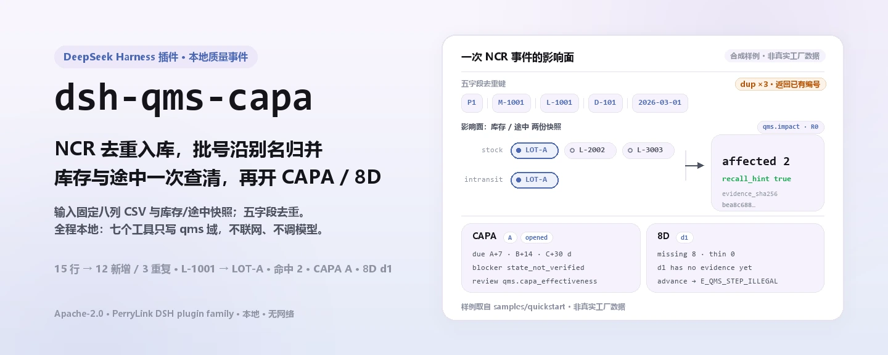
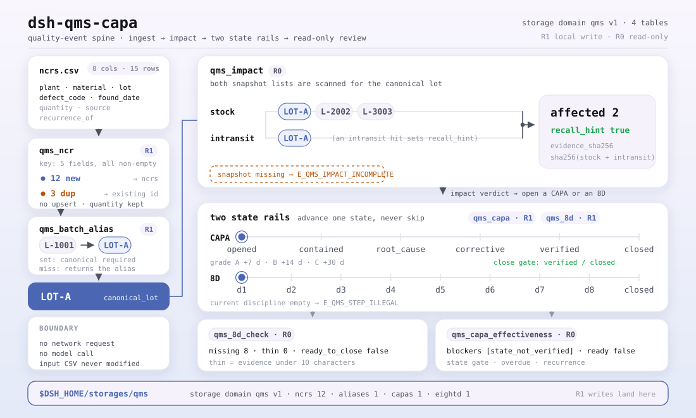
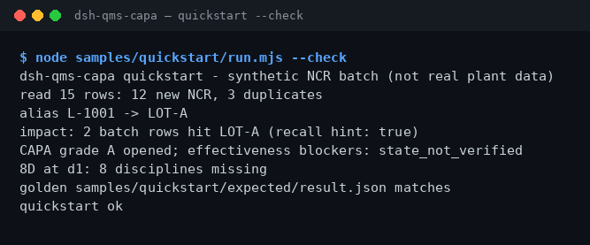

<div align="center">

<picture>
  <source media="(prefers-color-scheme: dark)" srcset="docs/assets/dsh-qms-capa-hero-zh-dark.webp">
  
</picture>

# dsh-qms-capa

**把 NCR 不良记录去重入库，查出受影响批次，再开出一张 CAPA 或 8D。**

面向 DeepSeek Harness 的本地质量事件插件：读固定表头的 CSV 台账，去重、解析批次别名、评估库存/途中影响，按 D1–D8 与 CAPA 状态推进；全程不联网、不调用模型。

[安装](#三步上手) · [配置](#配置) · [FAQ](#faq) · [简体中文](README.md) · [English](README.en.md) · [Español](README.es.md) · [Português](README.pt.md) · [हिन्दी](README.hi.md)

[](LICENSE)
[](#兼容性)
[](https://www.npmjs.com/package/dsh-qms-capa)
[](https://github.com/PerryLink/dsh-qms-capa/actions/workflows/ci.yml)
[](#兼容性)

[](https://github.com/PerryLink/dsh-qms-capa/stargazers)
[](https://www.npmjs.com/package/dsh-qms-capa)
[](https://dshfind.com/plugins/PerryLink/dsh-qms-capa?ref=badge)
[](https://dsh.market/)
[](https://gitee.com/perrylink/dsh-qms-capa)

```sh
dsh plugin --profile <name> add dsh-qms-capa
```

</div>

<sub>社区插件，与 DeepSeek 官方无关。唯一仓库：<https://github.com/PerryLink/dsh-qms-capa>（Gitee 为镜像）。alpha、仅公开/合成数据、partial、not counted、非 GA；不含客户证据与客户数据，不作生产可用声明。</sub>

## 它是什么

`dsh-qms-capa` 在 DeepSeek Harness 里跑一条纯本地的质量事件流水线：把 NCR 不良记录去重入库（判据是 `plant`+`material`+`lot`+`defect_code`+`found_date` 五字段完全相同），把批次别名解析到正式批号，对照库存/途中快照评估影响面，再开出 CAPA 或 8D 并按状态推进。工具名就是稳定 API（`qms_*`），按「入库 → 别名 → 影响面 → CAPA/8D → 复核」调用即可。输入与输出都留在本机，没有联网请求，也没有模型调用。

<picture>
  <source media="(prefers-color-scheme: dark)" srcset="docs/assets/dsh-qms-capa-flow-v5-dark.svg">
  
</picture>

**适合**：几十到几百行、字段固定的 NCR 台账（CSV）；要在开 CAPA/8D 前先确认重复单和受影响批次。**不适合**：没有批号或日期的手写记录；直连 MES/ERP（本包不连外部系统）；替代质量工程师做根因判断。

**输入**：UTF-8 CSV，表头固定为 `plant,material,lot,defect_code,found_date,quantity,source,recurrence_of`；日期用 `YYYY-MM-DD`。单批按 ≤ 1 MB 设计（自带样例 15 行，约 1 KB）。从 MES 或 Excel 导出后另存为 CSV；原文件不会被修改。

**输出**：终端摘要（读入行数、新增 NCR、重复单、别名解析、受影响批次、CAPA/8D 状态），以及落在 `$DSH_HOME/storages/qms/` 的库记录（NCR/CAPA/8D 分表存储）；原文件不改。样例金标在 `samples/quickstart/expected/result.json`，由真实运行产生。

在 DSH 里可以直接说：

> 我有一批 NCR 不良记录，帮我入库去重，再查出这个批次在库存和途中命中了多少。

## 三步上手

1. **安装**（四选一；npm 是推荐通道）：

   ```sh
   # npm（推荐，已发布 0.2.0）
   dsh plugin --profile <name> add dsh-qms-capa
   # git 通道（跟随 main；lib/ 是构建产物、不入库，需在 checkout 内先 pnpm install && pnpm build）
   dsh plugin --profile <name> add github:PerryLink/dsh-qms-capa
   # tarball 通道：在 checkout 内 pnpm install && pnpm build && pnpm pack 之后
   dsh plugin --profile <name> add ./dsh-qms-capa-<version>.tgz
   # 1024 商店通道
   npm i -g dsh1024
   dsh1024 plugin --profile <name> add dsh-qms-capa
   ```

2. **最小配置**（没有可调配置键）：组合包只插入一行；宿主 profile 必须提供 `tools` 与 `storageDomain` 两个服务，数据落在 `$DSH_HOME/storages/qms/`。

   ```yaml
   - insert:
       - id: dsh-qms-capa
         name: dsh-qms-capa
   ```

3. **验证已生效**：

   ```sh
   dsh --profile <name> --dump-config | grep dsh-qms-capa
   ```

再在 checkout 内跑自带样例（先 `pnpm install && pnpm build`）：

```sh
node samples/quickstart/run.mjs --check
```

```text
dsh-qms-capa quickstart - synthetic NCR batch (not real plant data)
read 15 rows: 12 new NCR, 3 duplicates
alias L-1001 -> LOT-A
impact: 2 batch rows hit LOT-A (recall hint: true)
CAPA grade A opened; effectiveness blockers: state_not_verified
8D at d1: 8 disciplines missing
golden samples/quickstart/expected/result.json matches
quickstart ok
```

**卸载**：`dsh plugin --profile <name> remove dsh-qms-capa`（或删掉 profile patch 里对应的一行）。

## 核心能力

- **NCR 入库与去重** —— `qms_ncr` 先校验 `plant`/`material`/`lot`/`defect_code`/`found_date` 五列非空，再按这五字段拼成的 key 去重；重复行只返回已有 `ncr_id`，不覆盖、不改数量。单次调用返回新增编号、重复编号与 `field_f1`。
- **批次别名** —— `qms_batch_alias` 把 MES 侧的临时批号（如 `L-1001`）指向正式批号（如 `LOT-A`）；`set` 必须给 `canonical`，`resolve` 未命中时原样返回。影响面评估会自动沿别名归并。
- **影响面评估** —— `qms_impact` 同时读库存 `stock` 与途中 `intransit` 两个批次清单，按正式批号归并后返回 `affected`、`recall_hint`，并把快照 JSON 的 SHA-256 记为 `evidence_sha256`。缺任一份快照直接报 `E_QMS_IMPACT_INCOMPLETE`。
- **CAPA 生命周期** —— `qms_capa` 支持 `open`/`classify`/`advance`；等级 A/B/C 分别把 `due_date` 定在 7/14/30 天后，状态按 `opened → contained → root_cause → corrective → verified → closed` 推进。`classify` 会按新等级重算期限。
- **8D 与证据门槛** —— `qms_8d` 支持 `open`/`update`/`advance`，按 D1–D8 记录每步证据；当前 discipline 没有内容时拒绝推进（`E_QMS_STEP_ILLEGAL`），不会跳步。
- **只读复核** —— `qms_8d_check` 报缺失/过薄的 D1–D8 与 `ready_to_close`；`qms_capa_effectiveness` 报状态门槛、超期与重复单阻断项。两者都不写库、不做批准。
- **全程本地** —— 不联网、不调模型、不上传；只读写自己的 storage 域 `qms`，不改你给的 CSV。

### 工具面

| 工具 | 用途 | 风险 |
|---|---|---|
| `qms_ncr` | 导入并去重 NCR 行（plant/material/lot/defect_code/found_date） | R1 local write |
| `qms_batch_alias` | 设置/解析批次别名到正式批号 | R1 local write |
| `qms_impact` | 对照库存/途中快照评估受影响批次，给出召回提示 | R0 |
| `qms_capa` | 创建/分级/推进 CAPA，按等级算到期日 | R1 local write |
| `qms_8d` | 跟踪 D1–D8 证据与状态 | R1 local write |
| `qms_8d_check` | 8D 完整性预检：缺失/过薄 discipline 与 `ready_to_close` | R0 |
| `qms_capa_effectiveness` | CAPA 关闭就绪度复核：状态门槛、超期、重复单阻断 | R0 |

R0 = 只读；R1 = 只写本机 storage 域 `qms`，从不联网。

### 示例

输入是公开 MIT 脱敏 NCR 表 [`fixtures/public/mit/ncr_register.redacted.csv`](https://github.com/PerryLink/dsh-qms-capa/blob/main/fixtures/public/mit/ncr_register.redacted.csv)；`test/public-ncr.test.mjs` 把它映射成 3 条 NCR，断言全部入库、0 重复。全量测试用 `pnpm test` 跑。一条验收行：

| req_id | metric | threshold | actual | pass | source | counted |
|---|---|---|---|---|---|---|
| SKU-08-A01 | NCR 入库（30） | 30/30 | 30 | true | public/synthetic | false |

*这是 fixture 支撑的验收行，不是客户运行；没有编造输出。*

## 实测数据

仓库自带一条真实跑通的 quickstart 金标：15 行合成 NCR，新增 12 条、重复 3 条；别名 `L-1001` → `LOT-A`；影响面 2 条命中 `LOT-A`（`recall_hint=true`）；CAPA 等级 A 开单，有效性复核阻断项 `state_not_verified`；8D 停在 D1、8 个 discipline 缺失。金标文件 `samples/quickstart/expected/result.json` 是 `--json` 的真实 stdout，不是手写；复跑 `node samples/quickstart/run.mjs --check`。

验收记录在 `ACCEPTANCE.csv`：9 条公开/合成检查全部 `pass=true`；其中 8 条 SKU-08 为 `counted=false`（`source=public/synthetic`），1 条 quickstart 金标为 `counted=true`（`source=synthetic/quickstart`）。`EVIDENCE.md` 记 0 个真实工厂、0 条真实 NCR。

| req_id | metric | threshold | actual | pass | source | counted |
|---|---|---|---|---|---|---|
| SKU-08-A01 | NCR 入库（30） | 30/30 | 30 | true | public/synthetic | false |
| SKU-08-A02 | 重复开单识别（3） | 3/3 | 3 | true | public/synthetic | false |
| SKU-08-A03 | 批次别名 | 1/1 | 1 | true | public/synthetic | false |
| SKU-08-A04 | 影响面命中 | 1/1 | 1 | true | public/synthetic | false |
| SKU-08-A05 | CAPA 开启 | 1/1 | 1 | true | public/synthetic | false |
| SKU-08-A06 | 8D 开启 | 1/1 | 1 | true | public/synthetic | false |
| SKU-08-A07 | 8D 完整性预检 | 8 | 8 | true | public/synthetic | false |
| SKU-08-A08 | CAPA 有效性复核 | 1 | 1 | true | public/synthetic | false |
| PS1-QS01 | quickstart 样例与金标一致 | 1/1 | 1 | true | synthetic/quickstart | true |



*截图是 `node samples/quickstart/run.mjs --check` 的真实终端捕获（2026-11-02），内容与金标一致。*

## 配置

本插件没有 Schemastery `Config` 字段，`cordis.patch.yml` 只插入一行；可调项是宿主环境、输入表头与工具参数。

| 可调项 | 默认值 | 含义 |
|---|---|---|
| `DSH_HOME` | 未设置 | 宿主 home；决定默认数据根目录 `$DSH_HOME/storages/qms/` |
| 数据根目录 | `$DSH_HOME/storages/qms/` | storage domain `qms` 的落点，由宿主的 storage 栈决定 |
| 宿主服务 | 必需 | `inject = ['tools', 'storageDomain']`；bare profile 不组合 storage 时不会 apply |
| CSV 表头 | 固定八列 | `plant,material,lot,defect_code,found_date,quantity,source,recurrence_of`；日期 `YYYY-MM-DD` |
| 去重判据 | 五字段 | `plant+material+lot+defect_code+found_date` 完全相同即视为重复 |
| CAPA 到期日 | A=7 / B=14 / C=30 天 | `open`/`classify` 时按等级计算 `due_date` |
| 8D 推进门槛 | 当前 discipline 非空 | 当前步骤没有证据时拒绝推进（`E_QMS_STEP_ILLEGAL`） |
| 单批规模 | 建议 ≤ 1 MB | 自带样例 15 行约 1 KB；大文件请分批 |

<details>
<summary>数据模型（storage domain qms v1，4 张表）</summary>

| 表 | 键 | 字段 |
|---|---|---|
| ncrs | `ncr_id` | plant、material、lot、defect_code、found_date、quantity、source、recurrence_of、created_at |
| aliases | `alias` | alias、canonical |
| capas | `capa_id` | ncr_id、grade（A/B/C）、owner、due_date、state、created_at、updated_at |
| eightd | `eightd_id` | ncr_id、state（d1…d8/closed）、data（D1–D8 证据）、created_at、updated_at |

</details>

<details>
<summary>错误格式与常见错误码</summary>

报错统一是「一句人话（`E_QMS_*`）｜下一步：一个动作」；技术细节只进日志，不展示给用户。逐条排查见 [`TROUBLESHOOTING.md`](TROUBLESHOOTING.md)。

| 错误码 | 含义 |
|---|---|
| `E_QMS_NCR_FIELD_MISSING` | NCR 记录缺少必填字段 |
| `E_QMS_NCR_DUPLICATE` | 这条 NCR 已经在库里了 |
| `E_QMS_LOT_UNRESOLVED` | 批次别名没有对应的正式批号 |
| `E_QMS_IMPACT_INCOMPLETE` | 影响面评估缺少库存或途中快照 |
| `E_QMS_STEP_ILLEGAL` | 这一步在记录当前状态下不能做 |
| `E_QMS_NCR_NOT_FOUND` | 找不到这个 NCR 编号 |
| `E_QMS_RECORD_NOT_FOUND` | 找不到这条 CAPA 或 8D 记录 |

</details>

## FAQ

<details>
<summary>数据存在哪？会改我的台账吗？</summary>

库记录写进 storage domain `qms`，默认根目录 `$DSH_HOME/storages/qms/`（NCR、别名、CAPA、8D 四张表）。你给的 CSV 只读不改；没有任何上传，也没有遥测。原文件里的行只有在被 `qms_ncr` 导入后才进库。

</details>

<details>
<summary>重复单是怎么判的？为什么我改了数量没生效？</summary>

判据是 `plant`+`material`+`lot`+`defect_code`+`found_date` 五字段完全相同。重复行只返回已有 `ncr_id`，不会覆盖原记录，所以改数量再导入不会生效；要改数量请在原记录上更新，或换一个 `found_date` 再导入。这也是 `E_QMS_NCR_DUPLICATE` 的下一步提示。

</details>

<details>
<summary>结果不对怎么办？</summary>

先跑 `node samples/quickstart/run.mjs --check` 对照金标；再检查 CSV 表头、日期格式和批号大小写。表头写成中文或 `Plant` 这类大小写不一致会报 `E_QMS_NCR_FIELD_MISSING`；影响面缺 `stock`/`intransit` 会报 `E_QMS_IMPACT_INCOMPLETE`。逐条见 `TROUBLESHOOTING.md` 第 1–3 条。

</details>

<details>
<summary>会联网、调用模型吗？开销多大？</summary>

不会。全程本地算术与 storage 读写，没有模型调用、没有网络请求、没有上传。工具按行线性处理，单批建议 ≤ 1 MB；最重的步骤是影响面归并（库存 + 途中两个清单的线性过滤）。

</details>

<details>
<summary>能用于正式 QMS 或客户审核吗？</summary>

不能。本包是 alpha / partial / not counted，只用公开/合成数据，没有客户证据、客户数据，也不作 GA 或生产可用声明；`qms_8d_check` 与 `qms_capa_effectiveness` 只是只读的就绪度复核，不是批准。真实工厂数据不要贴进 issue。

</details>

## 安全边界

- **本地运行。** 无网络请求、无模型调用、无上传；读取范围仅限用户指定的 NCR CSV 与库存/途中快照。
- **只写自己的落点。** 只写 storage domain `qms`（`$DSH_HOME/storages/qms/`）；用户给的 CSV 与快照不改。
- **错误可读且不泄密。** 面向用户的文本是「一句人话 + 错误码 + 下一步」，技术细节只进日志；真实工厂数据不要贴进 issue（见 `PRIVACY.md`、`SECURITY.md`）。
- **数据边界。** 只用公开/合成数据；不含客户数据、客户证据或遥测；`EVIDENCE.md` 把这条写死。
- **无凭据、无外部系统。** 不读凭据、不连 MES/ERP/云服务。
- **写面分级。** R1 写工具：`qms_ncr`、`qms_batch_alias`、`qms_capa`、`qms_8d`；R0 只读：`qms_impact`、`qms_8d_check`、`qms_capa_effectiveness`。

## 已知限制

- **alpha / partial / not counted。** 没有客户证据、客户数据或生产可用声明；`EVIDENCE.md` 记录 0 个真实工厂、0 条真实 NCR。
- **仅公开/合成样例。** `fixtures/` 里是公开 MIT 脱敏样例与合成 quickstart；不含客户数据，也不做客户证据。
- **不连 MES/ERP。** 不直连任何外部系统；CSV 从 MES 或 Excel 导出后手工另存，批号与日期要自己保证正确。
- **CSV 严格。** 表头固定八列，`plant`/`material`/`lot`/`defect_code`/`found_date` 必须非空；日期用 `YYYY-MM-DD`；不改写、不猜列。
- **无 OCR、无手写识别。** 没有批号或日期的手写记录处理不了；扫描件请先人工转成 CSV。
- **单批规模有限。** 按 ≤ 1 MB 设计；更大批量请拆文件分批导入。
- **需要宿主服务。** 插件 `inject` 了 `tools` 与 `storageDomain`；bare profile 不组合 storage 时不会 apply。
- **复核不是批准。** `qms_8d_check` 只看 D1–D8 是否缺失/过薄，`qms_capa_effectiveness` 只看状态门槛、超期与重复单；两者都不替代质量工程师的根因判断或签署。
- **重复导入不更新。** 重复单只返回已有编号，不做 upsert；要改数量请在原记录上更新或换 `found_date`。
- **无 UI。** 纯 host 工具面，没有浏览器半，也没有界面。
- **Node 区间窄。** 只支持 `>=24.9.0 <25`。

## 与其他 DSH 插件的互操作性

按源码核对（`src/plugin/index.ts`、`src/plugin/tools.ts`、`src/plugin/storage.ts`），本插件与命令、工具、slot、HTTP 路由、storage 域均无冲突面：

- **工具名带命名空间。** 7 个工具全部以 `qms_` 开头，不占用内置工具或其他插件的裸名。
- **只消费、不提供服务。** `inject` 只有 `['tools', 'storageDomain']`；不注册命令、客户端 slot、`webServer` 前缀或服务键。
- **独立 storage 域。** 只用自建 `qms` v1 域的四张表（ncrs、aliases、capas、eightd），不读写其他域。
- **无全局改写。** 不改原型、不改写 `process.env`、不替换全局 fetch。
- **无会话事件。** 本包不写 `*/applied` 会话事件；证据链是 `evidence_sha256`、`created_at` 与 `ACCEPTANCE.csv` 的哈希列。
- **只读工具可重入。** `qms_impact`、`qms_8d_check`、`qms_capa_effectiveness` 不写状态，可安全重复调用。

## 兼容性

| 维度 | 状态 |
|---|---|
| Harness | `dsh >=0.2.1-rc.3 <0.4.0`（`package.json` 的 `engines.dsh`；开发与测试依赖固定在 `0.2.1-rc.3` 线） |
| Node | `>=24.9.0 <25` |
| 工具名 | 0.2.0 起为 `qms_*`（下划线）；0.1.x 的点号名已移除——provider 对 `tools[].name` 校验 `^[a-zA-Z0-9_-]+$`，点号会让整个 tools 数组被拒 |
| 宿主服务 | 需组合 `tools` 与 `storageDomain`（见 `src/plugin/index.ts` 的 `inject`） |
| 平台 | 任何 DSH 可运行处；纯本地文件，无浏览器半 |
| 模型 | 不需要；不调用模型 |
| 数据 | 不联网、不上传；只写 `$DSH_HOME/storages/qms` |
| 维护状态 | 活跃（2026-11-01 起；新功能与加固随 alpha 版本发布） |

## 生态与质量

- [dshfind 插件页](https://dshfind.com/plugins/PerryLink/dsh-qms-capa)（安装量与排名）
- [DSH Market](https://dsh.market/)（已上架）
- [Gitee 镜像](https://gitee.com/perrylink/dsh-qms-capa)（同步镜像，以 GitHub 为准）· [家族聚合镜像](https://gitee.com/perrylink/dsh-plugins)
- [领域索引](https://perrylink.github.io/dsh-plugins/) · [Checker 家族](https://perrylink.github.io/zh/checkers/) · [主线家族](https://github.com/PerryLink/dsh-kit)
- **1024 商店渠道**：先 `npm i -g dsh1024`，再 `dsh1024 plugin --profile <name> add dsh-qms-capa`（计入 [deepseek1024.com](https://deepseek1024.com) 安装排行）
- 兄弟包：[`dsh-ghg`](https://github.com/PerryLink/dsh-ghg)、[`dsh-policy-ledger`](https://github.com/PerryLink/dsh-policy-ledger)

相关核查器（各自独立发包，只装需要的）：

| 包 | 为什么相关 |
|---|---|
| [`dsh-fmea-table-check`](https://github.com/PerryLink/dsh-fmea-table-check) | FMEA 工作表完整性与 RPN 一致性。 |
| [`dsh-ppap-check`](https://github.com/PerryLink/dsh-ppap-check) | PPAP 提交要素完整性。 |
| [`dsh-spc-gbt-adapter`](https://github.com/PerryLink/dsh-spc-gbt-adapter) | 控制图常数与 Cp/Cpk 一致性。 |
| [`dsh-sop-sync-check`](https://github.com/PerryLink/dsh-sop-sync-check) | 作业指导书 / PFMEA / 控制计划版本同步。 |

## 开发

```sh
pnpm install --frozen-lockfile
pnpm build && pnpm lint && pnpm typecheck && pnpm test   # 16 项测试
node samples/quickstart/run.mjs --check                  # 金标复跑
pnpm run gate:sku08                                      # 验收门禁（写 evidence/ 与 ACCEPTANCE.csv）
pnpm run pack:check                                      # 发布 tarball 内容检查
```

当前版本 `0.2.0`。

目录布局：

| 路径 | 内容 |
|---|---|
| `src/core/` | 纯函数：`qms.ts`（错误码、去重 key、必填字段校验） |
| `src/plugin/` | `index.ts`（apply）、`tools.ts`（7 个工具）、`storage.ts`（storage domain `qms` v1） |
| `test/` | `node --test` 用例（qms、capa、eightd、八项检查、plugin-smoke、quickstart、public-ncr） |
| `scripts/` | 机械门禁：lint、acceptance、gate-sku08、check-pack、sbom 等，以及本次新增的 `gen-readme-assets.py` |
| `fixtures/public/mit/` | 公开 MIT 脱敏 NCR 样例（含 `SOURCE.md` 与上游 `LICENSE`） |
| `samples/quickstart/` | 15 行合成 NCR、别名/快照输入与金标 `expected/result.json` |
| `docs/assets/` | README 配图 |
| `evidence/` | 验收运行快照（`sku08-*/result.json`） |

配图由 [`scripts/gen-readme-assets.py`](scripts/gen-readme-assets.py) 程序化生成（Pillow 画 hero、手写 SVG 画结构图），可重复执行：`python scripts/gen-readme-assets.py` 会重写 `docs/assets/dsh-qms-capa-hero-{zh,en}-{light,dark}.webp` 与 `docs/assets/dsh-qms-capa-flow-v5-{light,dark}.svg`。图内只有命令/记账 token，五语共用同一张结构图；旧的 `docs/assets/dsh-qms-capa-flow.svg` 与 `docs/assets/dsh-qms-capa-flow-{light,dark}.svg` 保留不删，避免外链 404。

Topics：`dsh`, `dsh-plugin`, `deepseek-harness`, `deepseek`, `cordis`, `qms`, `ncr`, `capa`, `8d`, `manufacturing`

## 家族与致谢

本项目是 [PerryLink](https://github.com/PerryLink) 维护的 DeepSeek Harness 插件家族成员（全部 Apache-2.0）。如果它帮到了你，**给个 star**——它不解锁任何功能，但会让下一个人更容易找到它。

- [@PerryLink](https://github.com/PerryLink) —— 创建者与维护者：NCR 入库去重、批次别名、影响面评估、CAPA 与 8D 状态机、只读复核工具与五语文档。

<details>
<summary>展开 DSH 领域插件家族（15 个包 + 2 个 suite）</summary>

| Plugin | npm | 状态 |
|---|---|---|
| **[dsh-einvoice](https://github.com/PerryLink/dsh-einvoice)** | [npm](https://www.npmjs.com/package/dsh-einvoice) |  |
| **[dsh-docx-redline](https://github.com/PerryLink/dsh-docx-redline)** | [npm](https://www.npmjs.com/package/dsh-docx-redline) |  |
| **[dsh-policy-ledger](https://github.com/PerryLink/dsh-policy-ledger)** | [npm](https://www.npmjs.com/package/dsh-policy-ledger) |  |
| **[dsh-ghg](https://github.com/PerryLink/dsh-ghg)** | [npm](https://www.npmjs.com/package/dsh-ghg) |  |
| **[dsh-bankrec](https://github.com/PerryLink/dsh-bankrec)** | [npm](https://www.npmjs.com/package/dsh-bankrec) |  |
| **[dsh-ap-three-way](https://github.com/PerryLink/dsh-ap-three-way)** | [npm](https://www.npmjs.com/package/dsh-ap-three-way) |  |
| **[dsh-ifc-qto](https://github.com/PerryLink/dsh-ifc-qto)** | [npm](https://www.npmjs.com/package/dsh-ifc-qto) |  |
| **[dsh-qms-capa](https://github.com/PerryLink/dsh-qms-capa)** | [npm](https://www.npmjs.com/package/dsh-qms-capa) |  |
| **[dsh-legal-intake](https://github.com/PerryLink/dsh-legal-intake)** | [npm](https://www.npmjs.com/package/dsh-legal-intake) |  |
| **[dsh-legal-clause](https://github.com/PerryLink/dsh-legal-clause)** | [npm](https://www.npmjs.com/package/dsh-legal-clause) |  |
| **[dsh-freight-audit](https://github.com/PerryLink/dsh-freight-audit)** | [npm](https://www.npmjs.com/package/dsh-freight-audit) |  |
| **[dsh-hs-candidate](https://github.com/PerryLink/dsh-hs-candidate)** | [npm](https://www.npmjs.com/package/dsh-hs-candidate) |  |
| **[dsh-travel-recon](https://github.com/PerryLink/dsh-travel-recon)** | [npm](https://www.npmjs.com/package/dsh-travel-recon) |  |
| **[dsh-pim-lint](https://github.com/PerryLink/dsh-pim-lint)** | [npm](https://www.npmjs.com/package/dsh-pim-lint) |  |
| **[dsh-eval-pack](https://github.com/PerryLink/dsh-eval-pack)** | [npm](https://www.npmjs.com/package/dsh-eval-pack) |  |
| **[dsh-finops-suite](https://github.com/PerryLink/dsh-finops-suite)** | [npm](https://www.npmjs.com/package/dsh-finops-suite) |  |
| **[dsh-contract-suite](https://github.com/PerryLink/dsh-contract-suite)** | [npm](https://www.npmjs.com/package/dsh-contract-suite) |  |

</details>

<details>
<summary>展开主线家族（87 个当前安装 spec）</summary>

| Plugin | npm | 状态 |
|---|---|---|
| **[dsh-aqua-input-check](https://github.com/PerryLink/dsh-aqua-input-check)** | [npm](https://www.npmjs.com/package/dsh-aqua-input-check) |  |
| **[dsh-archive-check](https://github.com/PerryLink/dsh-archive-check)** | [npm](https://www.npmjs.com/package/dsh-archive-check) |  |
| **[dsh-bid-ca-precheck](https://github.com/PerryLink/dsh-bid-ca-precheck)** | [npm](https://www.npmjs.com/package/dsh-bid-ca-precheck) |  |
| **[dsh-bid-qual-check](https://github.com/PerryLink/dsh-bid-qual-check)** | [npm](https://www.npmjs.com/package/dsh-bid-qual-check) |  |
| **[dsh-contract-stance](https://github.com/PerryLink/dsh-contract-stance)** | [npm](https://www.npmjs.com/package/dsh-contract-stance) |  |
| **[dsh-customs-doc-check](https://github.com/PerryLink/dsh-customs-doc-check)** | [npm](https://www.npmjs.com/package/dsh-customs-doc-check) |  |
| **[dsh-demurrage-ledger](https://github.com/PerryLink/dsh-demurrage-ledger)** | [npm](https://www.npmjs.com/package/dsh-demurrage-ledger) |  |
| **[dsh-drill-script-check](https://github.com/PerryLink/dsh-drill-script-check)** | [npm](https://www.npmjs.com/package/dsh-drill-script-check) |  |
| **[dsh-eia-guide-check](https://github.com/PerryLink/dsh-eia-guide-check)** | [npm](https://www.npmjs.com/package/dsh-eia-guide-check) |  |
| **[dsh-emergency-plan](https://github.com/PerryLink/dsh-emergency-plan)** | [npm](https://www.npmjs.com/package/dsh-emergency-plan) |  |
| **[dsh-essay-rubric-check](https://github.com/PerryLink/dsh-essay-rubric-check)** | [npm](https://www.npmjs.com/package/dsh-essay-rubric-check) |  |
| **[dsh-evidence-check](https://github.com/PerryLink/dsh-evidence-check)** | [npm](https://www.npmjs.com/package/dsh-evidence-check) |  |
| **[dsh-export-ctl-check](https://github.com/PerryLink/dsh-export-ctl-check)** | [npm](https://www.npmjs.com/package/dsh-export-ctl-check) |  |
| **[dsh-fmea-table-check](https://github.com/PerryLink/dsh-fmea-table-check)** | [npm](https://www.npmjs.com/package/dsh-fmea-table-check) |  |
| **[dsh-forecast-penalty](https://github.com/PerryLink/dsh-forecast-penalty)** | [npm](https://www.npmjs.com/package/dsh-forecast-penalty) |  |
| **[dsh-gongwen-flow-check](https://github.com/PerryLink/dsh-gongwen-flow-check)** | [npm](https://www.npmjs.com/package/dsh-gongwen-flow-check) |  |
| **[dsh-gongwen-word-check](https://github.com/PerryLink/dsh-gongwen-word-check)** | [npm](https://www.npmjs.com/package/dsh-gongwen-word-check) |  |
| **[dsh-guard-plan-qc](https://github.com/PerryLink/dsh-guard-plan-qc)** | [npm](https://www.npmjs.com/package/dsh-guard-plan-qc) |  |
| **[dsh-hazchem-check](https://github.com/PerryLink/dsh-hazchem-check)** | [npm](https://www.npmjs.com/package/dsh-hazchem-check) |  |
| **[dsh-hazplan-check](https://github.com/PerryLink/dsh-hazplan-check)** | [npm](https://www.npmjs.com/package/dsh-hazplan-check) |  |
| **[dsh-hidden-risk-map](https://github.com/PerryLink/dsh-hidden-risk-map)** | [npm](https://www.npmjs.com/package/dsh-hidden-risk-map) |  |
| **[dsh-hs-classify](https://github.com/PerryLink/dsh-hs-classify)** | [npm](https://www.npmjs.com/package/dsh-hs-classify) |  |
| **[dsh-icd-rule-check](https://github.com/PerryLink/dsh-icd-rule-check)** | [npm](https://www.npmjs.com/package/dsh-icd-rule-check) |  |
| **[dsh-lawcite-adapter](https://github.com/PerryLink/dsh-lawcite-adapter)** | [npm](https://www.npmjs.com/package/dsh-lawcite-adapter) |  |
| **[dsh-lc-doc-check](https://github.com/PerryLink/dsh-lc-doc-check)** | [npm](https://www.npmjs.com/package/dsh-lc-doc-check) |  |
| **[dsh-learning-gap-check](https://github.com/PerryLink/dsh-learning-gap-check)** | [npm](https://www.npmjs.com/package/dsh-learning-gap-check) |  |
| **[dsh-medrec-qc](https://github.com/PerryLink/dsh-medrec-qc)** | [npm](https://www.npmjs.com/package/dsh-medrec-qc) |  |
| **[dsh-nsfc-form-check](https://github.com/PerryLink/dsh-nsfc-form-check)** | [npm](https://www.npmjs.com/package/dsh-nsfc-form-check) |  |
| **[dsh-nurse-record-check](https://github.com/PerryLink/dsh-nurse-record-check)** | [npm](https://www.npmjs.com/package/dsh-nurse-record-check) |  |
| **[dsh-origin-rvc-check](https://github.com/PerryLink/dsh-origin-rvc-check)** | [npm](https://www.npmjs.com/package/dsh-origin-rvc-check) |  |
| **[dsh-ota-review-check](https://github.com/PerryLink/dsh-ota-review-check)** | [npm](https://www.npmjs.com/package/dsh-ota-review-check) |  |
| **[dsh-paper-doc-adapter](https://github.com/PerryLink/dsh-paper-doc-adapter)** | [npm](https://www.npmjs.com/package/dsh-paper-doc-adapter) |  |
| **[dsh-permit-report-check](https://github.com/PerryLink/dsh-permit-report-check)** | [npm](https://www.npmjs.com/package/dsh-permit-report-check) |  |
| **[dsh-pipeline-check](https://github.com/PerryLink/dsh-pipeline-check)** | [npm](https://www.npmjs.com/package/dsh-pipeline-check) |  |
| **[dsh-pleading-draft](https://github.com/PerryLink/dsh-pleading-draft)** | [npm](https://www.npmjs.com/package/dsh-pleading-draft) |  |
| **[dsh-policy-brief-draft](https://github.com/PerryLink/dsh-policy-brief-draft)** | [npm](https://www.npmjs.com/package/dsh-policy-brief-draft) |  |
| **[dsh-power-loss-split](https://github.com/PerryLink/dsh-power-loss-split)** | [npm](https://www.npmjs.com/package/dsh-power-loss-split) |  |
| **[dsh-power-ticket-check](https://github.com/PerryLink/dsh-power-ticket-check)** | [npm](https://www.npmjs.com/package/dsh-power-ticket-check) |  |
| **[dsh-ppap-check](https://github.com/PerryLink/dsh-ppap-check)** | [npm](https://www.npmjs.com/package/dsh-ppap-check) |  |
| **[dsh-protest-deadline](https://github.com/PerryLink/dsh-protest-deadline)** | [npm](https://www.npmjs.com/package/dsh-protest-deadline) |  |
| **[dsh-railway-window](https://github.com/PerryLink/dsh-railway-window)** | [npm](https://www.npmjs.com/package/dsh-railway-window) |  |
| **[dsh-repair-order-qc](https://github.com/PerryLink/dsh-repair-order-qc)** | [npm](https://www.npmjs.com/package/dsh-repair-order-qc) |  |
| **[dsh-review-reply-check](https://github.com/PerryLink/dsh-review-reply-check)** | [npm](https://www.npmjs.com/package/dsh-review-reply-check) |  |
| **[dsh-rulefile-check](https://github.com/PerryLink/dsh-rulefile-check)** | [npm](https://www.npmjs.com/package/dsh-rulefile-check) |  |
| **[dsh-safety-brief-check](https://github.com/PerryLink/dsh-safety-brief-check)** | [npm](https://www.npmjs.com/package/dsh-safety-brief-check) |  |
| **[dsh-site-log-check](https://github.com/PerryLink/dsh-site-log-check)** | [npm](https://www.npmjs.com/package/dsh-site-log-check) |  |
| **[dsh-soe-decision-check](https://github.com/PerryLink/dsh-soe-decision-check)** | [npm](https://www.npmjs.com/package/dsh-soe-decision-check) |  |
| **[dsh-soilwater-check](https://github.com/PerryLink/dsh-soilwater-check)** | [npm](https://www.npmjs.com/package/dsh-soilwater-check) |  |
| **[dsh-sop-sync-check](https://github.com/PerryLink/dsh-sop-sync-check)** | [npm](https://www.npmjs.com/package/dsh-sop-sync-check) |  |
| **[dsh-spc-gbt-adapter](https://github.com/PerryLink/dsh-spc-gbt-adapter)** | [npm](https://www.npmjs.com/package/dsh-spc-gbt-adapter) |  |
| **[dsh-tender-extract](https://github.com/PerryLink/dsh-tender-extract)** | [npm](https://www.npmjs.com/package/dsh-tender-extract) |  |
| **[dsh-tender-matrix](https://github.com/PerryLink/dsh-tender-matrix)** | [npm](https://www.npmjs.com/package/dsh-tender-matrix) |  |
| **[dsh-warranty-calc](https://github.com/PerryLink/dsh-warranty-calc)** | [npm](https://www.npmjs.com/package/dsh-warranty-calc) |  |
| **[dsh-auto-review](https://github.com/PerryLink/dsh-auto-review)** | [npm](https://www.npmjs.com/package/dsh-auto-review) |  |
| **[dsh-autotier](https://github.com/PerryLink/dsh-autotier)** | [npm](https://www.npmjs.com/package/dsh-autotier) | 🧊 已冻结 — 见仓库 README |
| **[dsh-budget](https://github.com/PerryLink/dsh-budget)** | [npm](https://www.npmjs.com/package/dsh-budget) |  |
| **[dsh-cert-mcp](https://github.com/PerryLink/dsh-cert-mcp)** | [npm](https://www.npmjs.com/package/dsh-cert-mcp) | 🧊 已冻结 — 见仓库 README |
| **[dsh-checkpoint-rewind](https://github.com/PerryLink/dsh-checkpoint-rewind)** | [npm](https://www.npmjs.com/package/dsh-checkpoint-rewind) |  |
| **[dsh-claude-move](https://github.com/PerryLink/dsh-claude-move)** | [npm](https://www.npmjs.com/package/dsh-claude-move) |  |
| **[dsh-click](https://github.com/PerryLink/dsh-click)** | [npm](https://www.npmjs.com/package/dsh-click) |  |
| **[dsh-composer-history](https://github.com/PerryLink/dsh-composer-history)** | [npm](https://www.npmjs.com/package/dsh-composer-history) |  |
| **[dsh-data-quality](https://github.com/PerryLink/dsh-data-quality)** | [npm](https://www.npmjs.com/package/dsh-data-quality) | 🧊 已冻结 — 见仓库 README |
| **[dsh-defend](https://github.com/PerryLink/dsh-defend)** | [npm](https://www.npmjs.com/package/dsh-defend) |  |
| **[dsh-doublecheck](https://github.com/PerryLink/dsh-doublecheck)** | [npm](https://www.npmjs.com/package/dsh-doublecheck) |  |
| **[dsh-draw](https://github.com/PerryLink/dsh-draw)** | [npm](https://www.npmjs.com/package/dsh-draw) | 🧊 已冻结 — 见仓库 README |
| **[dsh-fast](https://github.com/PerryLink/dsh-fast)** | [npm](https://www.npmjs.com/package/dsh-fast) |  |
| **[dsh-fund-research](https://github.com/PerryLink/dsh-fund-research)** | [npm](https://www.npmjs.com/package/dsh-fund-research) |  |
| **[dsh-industry-research](https://github.com/PerryLink/dsh-industry-research)** | [npm](https://www.npmjs.com/package/dsh-industry-research) |  |
| **[dsh-laya](https://github.com/PerryLink/dsh-laya)** | [npm](https://www.npmjs.com/package/dsh-laya) |  |
| **[dsh-library](https://github.com/PerryLink/dsh-library)** | [npm](https://www.npmjs.com/package/dsh-library) |  |
| **[dsh-local-ai](https://github.com/PerryLink/dsh-local-ai)** | [npm](https://www.npmjs.com/package/dsh-local-ai) |  |
| **[dsh-lsp-actions](https://github.com/PerryLink/dsh-lsp-actions)** | [npm](https://www.npmjs.com/package/dsh-lsp-actions) |  |
| **[dsh-mask](https://github.com/PerryLink/dsh-mask)** | [npm](https://www.npmjs.com/package/dsh-mask) |  |
| **[dsh-mcp-panel](https://github.com/PerryLink/dsh-mcp-panel)** | [npm](https://www.npmjs.com/package/dsh-mcp-panel) |  |
| **[dsh-memento](https://github.com/PerryLink/dsh-memento)** | [npm](https://www.npmjs.com/package/dsh-memento) | 🧊 已冻结 — 见仓库 README |
| **[dsh-observe](https://github.com/PerryLink/dsh-observe)** | [npm](https://www.npmjs.com/package/dsh-observe) |  |
| **[dsh-output-styles](https://github.com/PerryLink/dsh-output-styles)** | [npm](https://www.npmjs.com/package/dsh-output-styles) |  |
| **[dsh-permission-rules](https://github.com/PerryLink/dsh-permission-rules)** | [npm](https://www.npmjs.com/package/dsh-permission-rules) |  |
| **[dsh-plugin-guide](https://github.com/PerryLink/dsh-plugin-guide)** | [npm](https://www.npmjs.com/package/dsh-plugin-guide) |  |
| **[dsh-plugin-upgrade](https://github.com/PerryLink/dsh-plugin-upgrade)** | [npm](https://www.npmjs.com/package/dsh-plugin-upgrade) | 🚫 已退役（仓库已归档） |
| **[dsh-reach](https://github.com/PerryLink/dsh-reach)** | [npm](https://www.npmjs.com/package/dsh-reach) |  |
| **[dsh-research-report](https://github.com/PerryLink/dsh-research-report)** | [npm](https://www.npmjs.com/package/dsh-research-report) |  |
| **[dsh-score](https://github.com/PerryLink/dsh-score)** | [npm](https://www.npmjs.com/package/dsh-score) | 🧊 已冻结 — 见仓库 README |
| **[dsh-session-sync](https://github.com/PerryLink/dsh-session-sync)** | [npm](https://www.npmjs.com/package/dsh-session-sync) |  |
| **[dsh-talk](https://github.com/PerryLink/dsh-talk)** | [npm](https://www.npmjs.com/package/dsh-talk) |  |
| **[dsh-test-drive](https://github.com/PerryLink/dsh-test-drive)** | [npm](https://www.npmjs.com/package/dsh-test-drive) |  |
| **[dsh-translate](https://github.com/PerryLink/dsh-translate)** | [npm](https://www.npmjs.com/package/dsh-translate) |  |

</details>

## License

[LICENSE](LICENSE)（Apache License 2.0）© 2026 dsh-qms-capa contributors；另见 `NOTICE`、`THIRD-PARTY-NOTICES`。

<p align="center"><sub>Apache-2.0 · 社区插件，与 DeepSeek 无关。</sub></p>
