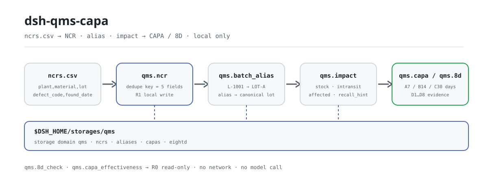
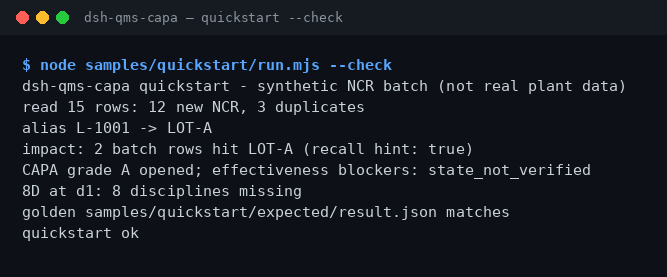

<div align="center">

<picture>
  <source media="(prefers-color-scheme: dark)" srcset="docs/assets/dsh-qms-capa-flow-dark.svg">
  
</picture>

# dsh-qms-capa

**Deduplique as linhas de NCR em um armazenamento local, encontre os lotes afetados e abra uma CAPA ou um 8D.**

Um plugin local de eventos de qualidade para o DeepSeek Harness: lê um livro CSV com cabeçalho fixo, deduplica linhas, resolve alias de lotes, avalia o impacto em estoque e em trânsito e avança o estado de CAPA e D1–D8 — sem rede, sem chamadas ao modelo.

[Instalar](#instalação-em-três-passos) · [Configuração](#configuração) · [FAQ](#faq) · [简体中文](README.md) · [English](README.en.md) · [Español](README.es.md) · [Português](README.pt.md) · [हिन्दी](README.hi.md)

[](LICENSE)
[](#compatibilidade)
[](https://www.npmjs.com/package/dsh-qms-capa)
[](https://github.com/PerryLink/dsh-qms-capa/actions/workflows/ci.yml)
[](#compatibilidade)

[](https://github.com/PerryLink/dsh-qms-capa/stargazers)
[](https://www.npmjs.com/package/dsh-qms-capa)
[](https://dshfind.com/plugins/PerryLink/dsh-qms-capa?ref=badge)
[](https://dsh.market/)
[](https://gitee.com/perrylink/dsh-qms-capa)

```sh
dsh plugin --profile <name> add dsh-qms-capa
```

</div>

<sub>Plugin da comunidade, não afiliado ao DeepSeek. Repositório canônico: <https://github.com/PerryLink/dsh-qms-capa> (Gitee é um espelho). alpha / dados públicos ou sintéticos / parcial / não contabilizado / não GA; sem evidência ou dados de clientes e sem promessa de produção.</sub>

## O que é

`dsh-qms-capa` executa um pipeline de eventos de qualidade totalmente local dentro do DeepSeek Harness: deduplica linhas de NCR no armazenamento (a chave é `plant`+`material`+`lot`+`defect_code`+`found_date` idênticos), resolve alias de lote para o lote canônico, avalia a superfície afetada contra snapshots de estoque e em trânsito, e então abre uma CAPA ou um 8D e o avança pelos estados. Os nomes das ferramentas são a API estável (`qms.*`): chame na ordem ingestão → alias → impacto → CAPA/8D → revisão. Entrada e saída ficam na máquina; não há requisições de rede nem chamadas ao modelo.

**Bom encaixe**: um livro de NCR com esquema fixo (CSV) de dezenas a centenas de linhas, em que as linhas duplicadas e os lotes afetados devem ser confirmados antes de abrir uma CAPA/8D. **Não encaixa**: registros manuscritos sem lote ou data; conexão direta com MES/ERP (este pacote não fala com nenhum sistema externo); substituir o julgamento de causa raiz de um engenheiro da qualidade.

**Entrada**: CSV UTF-8 com o cabeçalho fixo `plant,material,lot,defect_code,found_date,quantity,source,recurrence_of`; datas no formato `YYYY-MM-DD`. Projetado para lotes de até cerca de 1 MB (a amostra incluída tem 15 linhas, aproximadamente 1 KB). Exporte do MES ou do Excel e salve como CSV; o arquivo de origem nunca é modificado.

**Saída**: um resumo no terminal (linhas lidas, novos NCRs, duplicados, resolução de alias, lotes afetados, estado da CAPA/8D) mais registros no armazenamento em `$DSH_HOME/storages/qms/` (tabelas separadas de NCR/CAPA/8D); os arquivos de origem não são tocados. O arquivo-ouro da amostra é `samples/quickstart/expected/result.json`, produzido por uma execução real.

No DSH você pode simplesmente dizer:

> Tenho um lote de registros de NCR; ingira e deduplique, depois diga quantas linhas de estoque e em trânsito este lote atinge.

## Instalação em três passos

1. **Instalar** (escolha um canal; npm é o recomendado):

   ```sh
   # npm (recomendado, 0.1.1 publicado)
   dsh plugin --profile <name> add dsh-qms-capa
   # canal git (segue a main; lib/ é artefato de build e não entra no repositório, então rode pnpm install && pnpm build no checkout primeiro)
   dsh plugin --profile <name> add github:PerryLink/dsh-qms-capa
   # canal tarball: depois de pnpm install && pnpm build && pnpm pack no checkout
   dsh plugin --profile <name> add ./dsh-qms-capa-<version>.tgz
   # canal da loja 1024
   npm i -g dsh1024
   dsh1024 plugin --profile <name> add dsh-qms-capa
   ```

2. **Configuração mínima** (não há chaves de configuração ajustáveis): o bundle insere uma linha; o perfil do host precisa fornecer os serviços `tools` e `storageDomain`, e os dados ficam em `$DSH_HOME/storages/qms/`.

   ```yaml
   - insert:
       - id: dsh-qms-capa
         name: dsh-qms-capa
   ```

3. **Verificar que montou**:

   ```sh
   dsh --profile <name> --dump-config | grep dsh-qms-capa
   ```

Depois rode a amostra incluída a partir do checkout (após `pnpm install && pnpm build`):

```sh
node samples/quickstart/run.mjs --check
```

```text
dsh-qms-capa quickstart - synthetic NCR batch (not real plant data)
read 15 rows: 12 new NCR, 3 duplicates
alias L-1001 -> LOT-A
impact: 2 batch rows hit LOT-A (recall hint: true)
CAPA grade A opened; effectiveness blockers: state_not_verified
8D at d1: 8 disciplines missing
golden samples/quickstart/expected/result.json matches
quickstart ok
```

**Desinstalar**: `dsh plugin --profile <name> remove dsh-qms-capa` (ou remova a linha do patch do perfil).

## Capacidades principais

- **Ingestão e deduplicação de NCR** — `qms.ncr` valida que `plant`/`material`/`lot`/`defect_code`/`found_date` não estão vazios e depois deduplica pela chave montada com esses cinco campos; uma linha duplicada devolve o `ncr_id` existente e nunca sobrescreve nem altera a quantidade. Uma chamada devolve os novos ids, os ids duplicados e `field_f1`.
- **Alias de lote** — `qms.batch_alias` aponta um lote temporário do lado do MES (como `L-1001`) para um lote canônico (como `LOT-A`); `set` exige `canonical` e `resolve` devolve o alias sem alteração quando não encontra. A avaliação de impacto segue os alias automaticamente.
- **Avaliação de impacto** — `qms.impact` lê as duas listas de lotes, `stock` e `intransit`, consolida pela resolução de alias e devolve `affected` e `recall_hint`; o SHA-256 do JSON do snapshot é registrado como `evidence_sha256`. Um snapshot ausente falha com `E_QMS_IMPACT_INCOMPLETE`.
- **Ciclo de vida da CAPA** — `qms.capa` aceita `open`/`classify`/`advance`; os graus A/B/C colocam `due_date` em 7/14/30 dias, e o estado avança `opened → contained → root_cause → corrective → verified → closed`. `classify` recalcula o prazo para o novo grau.
- **8D com porta de evidência** — `qms.8d` aceita `open`/`update`/`advance` e registra evidências de D1–D8 por disciplina; avançar enquanto a disciplina atual não tem conteúdo é recusado (`E_QMS_STEP_ILLEGAL`), então nenhum passo é pulado.
- **Revisões de somente leitura** — `qms.8d_check` relata disciplinas D1–D8 ausentes/rasas e `ready_to_close`; `qms.capa_effectiveness` relata a porta de estado, o atraso e o bloqueio de recorrência. Nenhuma das duas grava no armazenamento nem aprova nada.
- **Totalmente local** — sem rede, sem chamadas ao modelo, sem uploads; lê e grava apenas o próprio domínio de armazenamento `qms` e nunca modifica o CSV que você fornece.

### Superfície de ferramentas

| Ferramenta | Finalidade | Risco |
|---|---|---|
| `qms.ncr` | Ingere e deduplica linhas de NCR (plant/material/lot/defect_code/found_date) | R1 local write |
| `qms.batch_alias` | Define ou resolve um alias de lote para o lote canônico | R1 local write |
| `qms.impact` | Avalia os lotes afetados contra snapshots de estoque/em trânsito e informa o aviso de recall | R0 |
| `qms.capa` | Abre/classifica/avança uma CAPA e calcula o prazo pelo grau | R1 local write |
| `qms.8d` | Rastreia evidências e estado de D1–D8 | R1 local write |
| `qms.8d_check` | Pré-checagem de completude do 8D: disciplinas ausentes/rasas e `ready_to_close` | R0 |
| `qms.capa_effectiveness` | Revisão de prontidão para fechar a CAPA: porta de estado, atraso, bloqueio de recorrência | R0 |

R0 = somente leitura; R1 = grava apenas o domínio de armazenamento local `qms`, nunca a rede.

### Exemplo

A entrada é a tabela de NCR pública e desidentificada do MIT [`fixtures/public/mit/ncr_register.redacted.csv`](https://github.com/PerryLink/dsh-qms-capa/blob/main/fixtures/public/mit/ncr_register.redacted.csv); `test/public-ncr.test.mjs` a mapeia em 3 linhas de NCR e verifica que todas entram no armazenamento com 0 duplicadas. A suíte completa roda com `pnpm test`. Uma linha de aceitação:

| req_id | metric | threshold | actual | pass | source | counted |
|---|---|---|---|---|---|---|
| SKU-08-A01 | Ingestão de NCR (30) | 30/30 | 30 | true | public/synthetic | false |

*É uma linha de aceitação apoiada em fixture, não uma execução de cliente; nenhuma saída é inventada.*

## Dados medidos

O repositório traz um golden run de quickstart realmente executado: 15 linhas sintéticas de NCR na entrada, 12 novas e 3 duplicadas; alias `L-1001` → `LOT-A`; 2 linhas de impacto atingem `LOT-A` (`recall_hint=true`); uma CAPA de grau A aberta com o bloqueio de eficácia `state_not_verified`; o 8D fica em D1 com 8 disciplinas faltando. O arquivo-ouro `samples/quickstart/expected/result.json` é o stdout real de `--json`, não escrito à mão; repita com `node samples/quickstart/run.mjs --check`.

O registro de aceitação está em `ACCEPTANCE.csv`: todas as 9 verificações públicas/sintéticas têm `pass=true`; 8 linhas SKU-08 são `counted=false` (`source=public/synthetic`) e 1 verificação do golden de quickstart é `counted=true` (`source=synthetic/quickstart`). O `EVIDENCE.md` registra 0 fábricas reais e 0 NCRs reais.

| req_id | metric | threshold | actual | pass | source | counted |
|---|---|---|---|---|---|---|
| SKU-08-A01 | Ingestão de NCR (30) | 30/30 | 30 | true | public/synthetic | false |
| SKU-08-A02 | Detecção de duplicados (3) | 3/3 | 3 | true | public/synthetic | false |
| SKU-08-A03 | Alias de lote | 1/1 | 1 | true | public/synthetic | false |
| SKU-08-A04 | Acerto de impacto | 1/1 | 1 | true | public/synthetic | false |
| SKU-08-A05 | Abertura de CAPA | 1/1 | 1 | true | public/synthetic | false |
| SKU-08-A06 | Abertura de 8D | 1/1 | 1 | true | public/synthetic | false |
| SKU-08-A07 | Pré-checagem de completude do 8D | 8 | 8 | true | public/synthetic | false |
| SKU-08-A08 | Revisão de eficácia da CAPA | 1 | 1 | true | public/synthetic | false |
| PS1-QS01 | Amostra de quickstart igual ao golden | 1/1 | 1 | true | synthetic/quickstart | true |



*Capturada da execução real de `node samples/quickstart/run.mjs --check` (2026-11-02); o conteúdo confere com o arquivo-ouro.*

## Configuração

Este plugin não tem campos Schemastery `Config`; o `cordis.patch.yml` apenas insere uma linha. Os ajustes são o ambiente do host, o cabeçalho da entrada e os argumentos das ferramentas.

| Ajuste | Padrão | Significado |
|---|---|---|
| `DSH_HOME` | não definido | Home do host; define a raiz de dados padrão `$DSH_HOME/storages/qms/` |
| Raiz de dados | `$DSH_HOME/storages/qms/` | Onde vive o domínio de armazenamento `qms`; decidido pela pilha de storage do host |
| Serviços do host | obrigatórios | `inject = ['tools', 'storageDomain']`; um perfil enxuto sem storage nunca aplica |
| Cabeçalho do CSV | fixo, oito colunas | `plant,material,lot,defect_code,found_date,quantity,source,recurrence_of`; datas em `YYYY-MM-DD` |
| Chave de deduplicação | cinco campos | `plant+material+lot+defect_code+found_date` idênticos significa duplicado |
| Prazo da CAPA | A=7 / B=14 / C=30 dias | `open`/`classify` calcula `due_date` pelo grau |
| Porta de avanço do 8D | disciplina atual não vazia | Avançar sem evidência para o passo atual é recusado (`E_QMS_STEP_ILLEGAL`) |
| Tamanho do lote | ~1 MB recomendado | A amostra incluída tem 15 linhas, cerca de 1 KB; divida arquivos maiores |

<details>
<summary>Modelo de dados (domínio de armazenamento qms v1, 4 tabelas)</summary>

| Tabela | Chave | Campos |
|---|---|---|
| ncrs | `ncr_id` | plant, material, lot, defect_code, found_date, quantity, source, recurrence_of, created_at |
| aliases | `alias` | alias, canonical |
| capas | `capa_id` | ncr_id, grade (A/B/C), owner, due_date, state, created_at, updated_at |
| eightd | `eightd_id` | ncr_id, state (d1…d8/closed), data (evidências D1–D8), created_at, updated_at |

</details>

<details>
<summary>Formato de erro e códigos comuns</summary>

Todo erro é "uma frase direta (`E_QMS_*`) | Próximo: uma ação"; detalhes técnicos vão apenas para o log, nunca para o texto visível ao usuário. O passo a passo de triagem está em [`TROUBLESHOOTING.md`](TROUBLESHOOTING.md).

| Código | Significado |
|---|---|
| `E_QMS_NCR_FIELD_MISSING` | O registro de NCR está sem um campo obrigatório |
| `E_QMS_NCR_DUPLICATE` | Este NCR já está no armazenamento |
| `E_QMS_LOT_UNRESOLVED` | O alias de lote não tem lote canônico |
| `E_QMS_IMPACT_INCOMPLETE` | A avaliação de impacto está sem o snapshot de estoque ou de trânsito |
| `E_QMS_STEP_ILLEGAL` | Este passo não é permitido no estado atual do registro |
| `E_QMS_NCR_NOT_FOUND` | Nenhum NCR com esse id |
| `E_QMS_RECORD_NOT_FOUND` | Nenhuma CAPA ou 8D com esse id |

</details>

## FAQ

<details>
<summary>Onde os dados ficam? Isso vai alterar meu livro de registros?</summary>

Os registros vão para o domínio de armazenamento `qms`, raiz padrão `$DSH_HOME/storages/qms/` (quatro tabelas: NCRs, alias, CAPAs, 8D). O CSV que você fornece é somente leitura; nada é enviado e não há telemetria. As linhas só entram no armazenamento depois que `qms.ncr` as ingere.

</details>

<details>
<summary>Como os duplicados são detectados? Por que minha mudança de quantidade não teve efeito?</summary>

A chave é `plant`+`material`+`lot`+`defect_code`+`found_date` idênticos. Um duplicado devolve o `ncr_id` existente e nunca sobrescreve o registro, então reimportar com outra quantidade não faz nada; atualize o registro original ou mude `found_date` e importe de novo. Essa é também a "próxima ação" em `E_QMS_NCR_DUPLICATE`.

</details>

<details>
<summary>E se o resultado parecer errado?</summary>

Primeiro rode `node samples/quickstart/run.mjs --check` contra o arquivo-ouro, depois confira o cabeçalho do CSV, o formato da data e a caixa do lote. Um cabeçalho em chinês ou com caixa inconsistente, como `Plant`, falha com `E_QMS_NCR_FIELD_MISSING`; um snapshot `stock`/`intransit` ausente falha com `E_QMS_IMPACT_INCOMPLETE`. Veja os itens 1–3 de `TROUBLESHOOTING.md`.

</details>

<details>
<summary>Ele chama a rede ou um modelo? Quanto pesa?</summary>

Não. Tudo é aritmética local mais leituras/gravações de armazenamento: sem chamadas ao modelo, sem requisições de rede, sem uploads. As ferramentas processam as linhas linearmente, e lotes de até cerca de 1 MB são o recomendado; o passo mais pesado é a consolidação de impacto (um filtro linear sobre as listas de estoque e de trânsito).

</details>

<details>
<summary>Pode ser usado em um QMS formal ou em uma auditoria de cliente?</summary>

Não. O pacote é alpha / parcial / não contabilizado, usa apenas dados públicos/sintéticos, não traz evidência nem dados de clientes e não faz declaração de GA ou de prontidão para produção; `qms.8d_check` e `qms.capa_effectiveness` são revisões de prontidão de somente leitura, não aprovações. Nunca cole dados reais de fábrica em uma issue.

</details>

## Limites de segurança

- **Execução local.** Sem requisições de rede, sem chamadas ao modelo, sem uploads; o escopo de leitura é limitado ao CSV de NCR e aos snapshots de estoque/trânsito fornecidos pelo usuário.
- **Grava só na própria localização.** Apenas o domínio de armazenamento `qms` (`$DSH_HOME/storages/qms/`); o CSV e os snapshots do usuário nunca são modificados.
- **Erros legíveis que não vazam dados.** O texto visível é "uma frase direta + código de erro + próxima ação"; detalhes técnicos vão apenas para o log. Nunca cole dados reais de fábrica em uma issue (ver `PRIVACY.md`, `SECURITY.md`).
- **Fronteira de dados.** Apenas dados públicos/sintéticos; sem dados de clientes, evidência de clientes ou telemetria; o `EVIDENCE.md` declara isso explicitamente.
- **Sem credenciais, sem sistemas externos.** Não lê credenciais e não se conecta a MES/ERP nem a serviços de nuvem.
- **Graduação da superfície de escrita.** Gravam R1: `qms.ncr`, `qms.batch_alias`, `qms.capa`, `qms.8d`; somente leitura R0: `qms.impact`, `qms.8d_check`, `qms.capa_effectiveness`.

## Limitações conhecidas

- **alpha / parcial / não contabilizado.** Sem evidência de clientes, dados de clientes ou declaração de prontidão para produção; o `EVIDENCE.md` registra 0 fábricas reais e 0 NCRs reais.
- **Apenas amostras públicas/sintéticas.** `fixtures/` guarda uma amostra pública e desidentificada do MIT e um quickstart sintético; sem dados de clientes, sem evidência de clientes.
- **Sem conexão com MES/ERP.** Nenhum sistema externo é contatado; o CSV é exportado do MES ou do Excel à mão, e a correção de lote/data é responsabilidade do operador.
- **CSV estrito.** Cabeçalho fixo de oito colunas; `plant`/`material`/`lot`/`defect_code`/`found_date` devem estar preenchidos; datas em `YYYY-MM-DD`; nada é reescrito nem adivinhado.
- **Sem OCR, sem manuscrito.** Registros sem lote ou data não podem ser processados; converta digitalizações em CSV à mão primeiro.
- **Lote limitado.** Projetado para cerca de 1 MB; divida lotes maiores em vários arquivos.
- **Serviços do host necessários.** O plugin faz `inject` de `tools` e `storageDomain`; um perfil enxuto sem storage nunca aplica.
- **Revisões não são aprovações.** `qms.8d_check` só olha disciplinas D1–D8 ausentes/rasas e `qms.capa_effectiveness` só a porta de estado, o atraso e o bloqueio de recorrência; nenhuma substitui o julgamento de causa raiz ou a assinatura de um engenheiro da qualidade.
- **Importação duplicada não atualiza.** Um duplicado só devolve o id existente; não há upsert. Atualize o registro original ou mude `found_date`.
- **Sem UI.** Superfície de ferramentas puramente host: sem metade de navegador, sem interface.
- **Faixa estreita de Node.** Apenas `>=24.9.0 <25`.

## Interoperabilidade com outros plugins DSH

Verificado contra o código-fonte (`src/plugin/index.ts`, `src/plugin/tools.ts`, `src/plugin/storage.ts`); o plugin não tem superfície de colisão com comandos, ferramentas, slots, rotas HTTP ou domínios de armazenamento:

- **Nomes de ferramenta com namespace.** Todas as 7 ferramentas começam com `qms.` e não ocupam nenhum nome aberto de ferramenta embutida ou de outro plugin.
- **Consome serviços, não fornece nenhum.** `inject` é apenas `['tools', 'storageDomain']`; não registra comando, slot de cliente, prefixo `webServer` ou chave de serviço.
- **Domínio de armazenamento próprio.** Usa apenas as quatro tabelas do próprio domínio `qms` v1 (ncrs, aliases, capas, eightd) e não lê nem grava outro domínio.
- **Sem mutação global.** Não altera protótipo, não reescreve `process.env` e não substitui o fetch global.
- **Sem eventos de sessão.** O pacote não grava evento de sessão `*/applied`; sua cadeia de evidência é `evidence_sha256`, `created_at` e a coluna de hash em `ACCEPTANCE.csv`.
- **Ferramentas de leitura são reentrantes.** `qms.impact`, `qms.8d_check` e `qms.capa_effectiveness` não gravam estado e podem ser chamadas repetidamente com segurança.

## Compatibilidade

| Superfície | Estado |
|---|---|
| Harness | `dsh >=0.2.1-rc.3 <0.4.0` (`engines.dsh` do `package.json`; as dependências de desenvolvimento e teste estão fixadas na linha `0.2.1-rc.3`) |
| Node | `>=24.9.0 <25` |
| Serviços do host | Exige `tools` e `storageDomain` (ver `inject` em `src/plugin/index.ts`) |
| Plataformas | Onde o DSH roda; apenas arquivos locais, sem metade de navegador |
| Modelo | Não é necessário; sem chamadas ao modelo |
| Dados | Sem rede, sem uploads; grava apenas `$DSH_HOME/storages/qms` |
| Manutenção | Ativa (desde 2026-11-01; recursos e endurecimento saem em versões alpha) |

## Ecossistema e qualidade

- [Página do plugin no dshfind](https://dshfind.com/plugins/PerryLink/dsh-qms-capa) (instalações e ranking)
- [DSH Market](https://dsh.market/) (listado)
- [Espelho de Gitee](https://gitee.com/perrylink/dsh-qms-capa) (espelho sincronizado; GitHub é canônico) · [espelho agregado da família](https://gitee.com/perrylink/dsh-plugins)
- [Índice de domínio](https://perrylink.github.io/dsh-plugins/) · [família de checkers](https://perrylink.github.io/zh/checkers/) · [família principal](https://github.com/PerryLink/dsh-kit)
- **Canal da loja 1024**: `npm i -g dsh1024` uma vez, depois `dsh1024 plugin --profile <name> add dsh-qms-capa` (conta para o ranking de instalações de [deepseek1024.com](https://deepseek1024.com))
- Pacotes irmãos: [`dsh-ghg`](https://github.com/PerryLink/dsh-ghg), [`dsh-policy-ledger`](https://github.com/PerryLink/dsh-policy-ledger)

Checkers relacionados (cada um é um pacote separado; instale só os que precisar):

| Pacote | Por que é relevante |
|---|---|
| [`dsh-fmea-table-check`](https://github.com/PerryLink/dsh-fmea-table-check) | Completude da planilha FMEA e consistência de RPN. |
| [`dsh-ppap-check`](https://github.com/PerryLink/dsh-ppap-check) | Completude dos elementos de submissão PPAP. |
| [`dsh-spc-gbt-adapter`](https://github.com/PerryLink/dsh-spc-gbt-adapter) | Constantes de cartas de controle e consistência de Cp/Cpk. |
| [`dsh-sop-sync-check`](https://github.com/PerryLink/dsh-sop-sync-check) | Sincronia de versão entre instrução de trabalho / PFMEA / plano de controle. |

## Desenvolvimento

```sh
pnpm install --frozen-lockfile
pnpm build && pnpm lint && pnpm typecheck && pnpm test   # 15 testes
node samples/quickstart/run.mjs --check                  # replay do golden
pnpm run gate:sku08                                      # portão de aceitação (grava evidence/ e ACCEPTANCE.csv)
pnpm run pack:check                                      # checagem do conteúdo do tarball publicado
```

Versão atual `0.1.1`.

Layout do diretório:

| Caminho | Conteúdo |
|---|---|
| `src/core/` | Funções puras: `qms.ts` (códigos de erro, chave de deduplicação, validação de campos obrigatórios) |
| `src/plugin/` | `index.ts` (apply), `tools.ts` (7 ferramentas), `storage.ts` (domínio de armazenamento `qms` v1) |
| `test/` | Casos de `node --test` (qms, capa, eightd, as ferramentas de checagem, plugin-smoke, quickstart, public-ncr) |
| `scripts/` | Portões mecânicos: lint, acceptance, gate-sku08, check-pack, sbom, além do novo `gen-readme-assets.py` |
| `fixtures/public/mit/` | Amostra pública e desidentificada de NCR do MIT (com `SOURCE.md` e a `LICENSE` original) |
| `samples/quickstart/` | 15 linhas sintéticas de NCR, entradas de alias/snapshot e o golden `expected/result.json` |
| `docs/assets/` | Imagens do README |
| `evidence/` | Snapshots das execuções de aceitação (`sku08-*/result.json`) |

As imagens do README são geradas por programa por [`scripts/gen-readme-assets.py`](scripts/gen-readme-assets.py) (Python; o caminho SVG não precisa de Pillow). Rodar `python scripts/gen-readme-assets.py` de novo reescreve `docs/assets/dsh-qms-capa-flow-{light,dark}.svg`; o diagrama usa apenas tokens de comando/contabilidade e é compartilhado pelos cinco idiomas. O antigo `docs/assets/dsh-qms-capa-flow.svg` de uma única versão é mantido para que links externos antigos continuem resolvendo.

Topics: `dsh`, `dsh-plugin`, `deepseek-harness`, `deepseek`, `cordis`, `qms`, `ncr`, `capa`, `8d`, `manufacturing`

## Família e agradecimentos

Este projeto faz parte da família de plugins do DeepSeek Harness mantida pela [PerryLink](https://github.com/PerryLink) (todos Apache-2.0). Se for útil, **uma estrela ajuda a próxima pessoa a encontrá-lo** — nada fica bloqueado atrás dela.

- [@PerryLink](https://github.com/PerryLink) — criador e mantenedor: ingestão e deduplicação de NCR, alias de lotes, avaliação de impacto, as máquinas de estado de CAPA e 8D, as ferramentas de revisão de somente leitura e a documentação em cinco idiomas.

<details>
<summary>Expandir a família de plugins de domínio DSH (15 pacotes + 2 suítes)</summary>

| Plugin | npm | Status |
|---|---|---|
| **[dsh-einvoice](https://github.com/PerryLink/dsh-einvoice)** | [npm](https://www.npmjs.com/package/dsh-einvoice) |  |
| **[dsh-docx-redline](https://github.com/PerryLink/dsh-docx-redline)** | [npm](https://www.npmjs.com/package/dsh-docx-redline) |  |
| **[dsh-policy-ledger](https://github.com/PerryLink/dsh-policy-ledger)** | [npm](https://www.npmjs.com/package/dsh-policy-ledger) |  |
| **[dsh-ghg](https://github.com/PerryLink/dsh-ghg)** | [npm](https://www.npmjs.com/package/dsh-ghg) |  |
| **[dsh-bankrec](https://github.com/PerryLink/dsh-bankrec)** | [npm](https://www.npmjs.com/package/dsh-bankrec) |  |
| **[dsh-ap-three-way](https://github.com/PerryLink/dsh-ap-three-way)** | [npm](https://www.npmjs.com/package/dsh-ap-three-way) |  |
| **[dsh-ifc-qto](https://github.com/PerryLink/dsh-ifc-qto)** | [npm](https://www.npmjs.com/package/dsh-ifc-qto) |  |
| **[dsh-qms-capa](https://github.com/PerryLink/dsh-qms-capa)** | [npm](https://www.npmjs.com/package/dsh-qms-capa) |  |
| **[dsh-legal-intake](https://github.com/PerryLink/dsh-legal-intake)** | [npm](https://www.npmjs.com/package/dsh-legal-intake) |  |
| **[dsh-legal-clause](https://github.com/PerryLink/dsh-legal-clause)** | [npm](https://www.npmjs.com/package/dsh-legal-clause) |  |
| **[dsh-freight-audit](https://github.com/PerryLink/dsh-freight-audit)** | [npm](https://www.npmjs.com/package/dsh-freight-audit) |  |
| **[dsh-hs-candidate](https://github.com/PerryLink/dsh-hs-candidate)** | [npm](https://www.npmjs.com/package/dsh-hs-candidate) |  |
| **[dsh-travel-recon](https://github.com/PerryLink/dsh-travel-recon)** | [npm](https://www.npmjs.com/package/dsh-travel-recon) |  |
| **[dsh-pim-lint](https://github.com/PerryLink/dsh-pim-lint)** | [npm](https://www.npmjs.com/package/dsh-pim-lint) |  |
| **[dsh-eval-pack](https://github.com/PerryLink/dsh-eval-pack)** | [npm](https://www.npmjs.com/package/dsh-eval-pack) |  |
| **[dsh-finops-suite](https://github.com/PerryLink/dsh-finops-suite)** | [npm](https://www.npmjs.com/package/dsh-finops-suite) |  |
| **[dsh-contract-suite](https://github.com/PerryLink/dsh-contract-suite)** | [npm](https://www.npmjs.com/package/dsh-contract-suite) |  |

</details>

<details>
<summary>Expandir a família principal (87 specs de instalação atuais)</summary>

| Plugin | npm | Status |
|---|---|---|
| **[dsh-aqua-input-check](https://github.com/PerryLink/dsh-aqua-input-check)** | [npm](https://www.npmjs.com/package/dsh-aqua-input-check) |  |
| **[dsh-archive-check](https://github.com/PerryLink/dsh-archive-check)** | [npm](https://www.npmjs.com/package/dsh-archive-check) |  |
| **[dsh-bid-ca-precheck](https://github.com/PerryLink/dsh-bid-ca-precheck)** | [npm](https://www.npmjs.com/package/dsh-bid-ca-precheck) |  |
| **[dsh-bid-qual-check](https://github.com/PerryLink/dsh-bid-qual-check)** | [npm](https://www.npmjs.com/package/dsh-bid-qual-check) |  |
| **[dsh-contract-stance](https://github.com/PerryLink/dsh-contract-stance)** | [npm](https://www.npmjs.com/package/dsh-contract-stance) |  |
| **[dsh-customs-doc-check](https://github.com/PerryLink/dsh-customs-doc-check)** | [npm](https://www.npmjs.com/package/dsh-customs-doc-check) |  |
| **[dsh-demurrage-ledger](https://github.com/PerryLink/dsh-demurrage-ledger)** | [npm](https://www.npmjs.com/package/dsh-demurrage-ledger) |  |
| **[dsh-drill-script-check](https://github.com/PerryLink/dsh-drill-script-check)** | [npm](https://www.npmjs.com/package/dsh-drill-script-check) |  |
| **[dsh-eia-guide-check](https://github.com/PerryLink/dsh-eia-guide-check)** | [npm](https://www.npmjs.com/package/dsh-eia-guide-check) |  |
| **[dsh-emergency-plan](https://github.com/PerryLink/dsh-emergency-plan)** | [npm](https://www.npmjs.com/package/dsh-emergency-plan) |  |
| **[dsh-essay-rubric-check](https://github.com/PerryLink/dsh-essay-rubric-check)** | [npm](https://www.npmjs.com/package/dsh-essay-rubric-check) |  |
| **[dsh-evidence-check](https://github.com/PerryLink/dsh-evidence-check)** | [npm](https://www.npmjs.com/package/dsh-evidence-check) |  |
| **[dsh-export-ctl-check](https://github.com/PerryLink/dsh-export-ctl-check)** | [npm](https://www.npmjs.com/package/dsh-export-ctl-check) |  |
| **[dsh-fmea-table-check](https://github.com/PerryLink/dsh-fmea-table-check)** | [npm](https://www.npmjs.com/package/dsh-fmea-table-check) |  |
| **[dsh-forecast-penalty](https://github.com/PerryLink/dsh-forecast-penalty)** | [npm](https://www.npmjs.com/package/dsh-forecast-penalty) |  |
| **[dsh-gongwen-flow-check](https://github.com/PerryLink/dsh-gongwen-flow-check)** | [npm](https://www.npmjs.com/package/dsh-gongwen-flow-check) |  |
| **[dsh-gongwen-word-check](https://github.com/PerryLink/dsh-gongwen-word-check)** | [npm](https://www.npmjs.com/package/dsh-gongwen-word-check) |  |
| **[dsh-guard-plan-qc](https://github.com/PerryLink/dsh-guard-plan-qc)** | [npm](https://www.npmjs.com/package/dsh-guard-plan-qc) |  |
| **[dsh-hazchem-check](https://github.com/PerryLink/dsh-hazchem-check)** | [npm](https://www.npmjs.com/package/dsh-hazchem-check) |  |
| **[dsh-hazplan-check](https://github.com/PerryLink/dsh-hazplan-check)** | [npm](https://www.npmjs.com/package/dsh-hazplan-check) |  |
| **[dsh-hidden-risk-map](https://github.com/PerryLink/dsh-hidden-risk-map)** | [npm](https://www.npmjs.com/package/dsh-hidden-risk-map) |  |
| **[dsh-hs-classify](https://github.com/PerryLink/dsh-hs-classify)** | [npm](https://www.npmjs.com/package/dsh-hs-classify) |  |
| **[dsh-icd-rule-check](https://github.com/PerryLink/dsh-icd-rule-check)** | [npm](https://www.npmjs.com/package/dsh-icd-rule-check) |  |
| **[dsh-lawcite-adapter](https://github.com/PerryLink/dsh-lawcite-adapter)** | [npm](https://www.npmjs.com/package/dsh-lawcite-adapter) |  |
| **[dsh-lc-doc-check](https://github.com/PerryLink/dsh-lc-doc-check)** | [npm](https://www.npmjs.com/package/dsh-lc-doc-check) |  |
| **[dsh-learning-gap-check](https://github.com/PerryLink/dsh-learning-gap-check)** | [npm](https://www.npmjs.com/package/dsh-learning-gap-check) |  |
| **[dsh-medrec-qc](https://github.com/PerryLink/dsh-medrec-qc)** | [npm](https://www.npmjs.com/package/dsh-medrec-qc) |  |
| **[dsh-nsfc-form-check](https://github.com/PerryLink/dsh-nsfc-form-check)** | [npm](https://www.npmjs.com/package/dsh-nsfc-form-check) |  |
| **[dsh-nurse-record-check](https://github.com/PerryLink/dsh-nurse-record-check)** | [npm](https://www.npmjs.com/package/dsh-nurse-record-check) |  |
| **[dsh-origin-rvc-check](https://github.com/PerryLink/dsh-origin-rvc-check)** | [npm](https://www.npmjs.com/package/dsh-origin-rvc-check) |  |
| **[dsh-ota-review-check](https://github.com/PerryLink/dsh-ota-review-check)** | [npm](https://www.npmjs.com/package/dsh-ota-review-check) |  |
| **[dsh-paper-doc-adapter](https://github.com/PerryLink/dsh-paper-doc-adapter)** | [npm](https://www.npmjs.com/package/dsh-paper-doc-adapter) |  |
| **[dsh-permit-report-check](https://github.com/PerryLink/dsh-permit-report-check)** | [npm](https://www.npmjs.com/package/dsh-permit-report-check) |  |
| **[dsh-pipeline-check](https://github.com/PerryLink/dsh-pipeline-check)** | [npm](https://www.npmjs.com/package/dsh-pipeline-check) |  |
| **[dsh-pleading-draft](https://github.com/PerryLink/dsh-pleading-draft)** | [npm](https://www.npmjs.com/package/dsh-pleading-draft) |  |
| **[dsh-policy-brief-draft](https://github.com/PerryLink/dsh-policy-brief-draft)** | [npm](https://www.npmjs.com/package/dsh-policy-brief-draft) |  |
| **[dsh-power-loss-split](https://github.com/PerryLink/dsh-power-loss-split)** | [npm](https://www.npmjs.com/package/dsh-power-loss-split) |  |
| **[dsh-power-ticket-check](https://github.com/PerryLink/dsh-power-ticket-check)** | [npm](https://www.npmjs.com/package/dsh-power-ticket-check) |  |
| **[dsh-ppap-check](https://github.com/PerryLink/dsh-ppap-check)** | [npm](https://www.npmjs.com/package/dsh-ppap-check) |  |
| **[dsh-protest-deadline](https://github.com/PerryLink/dsh-protest-deadline)** | [npm](https://www.npmjs.com/package/dsh-protest-deadline) |  |
| **[dsh-railway-window](https://github.com/PerryLink/dsh-railway-window)** | [npm](https://www.npmjs.com/package/dsh-railway-window) |  |
| **[dsh-repair-order-qc](https://github.com/PerryLink/dsh-repair-order-qc)** | [npm](https://www.npmjs.com/package/dsh-repair-order-qc) |  |
| **[dsh-review-reply-check](https://github.com/PerryLink/dsh-review-reply-check)** | [npm](https://www.npmjs.com/package/dsh-review-reply-check) |  |
| **[dsh-rulefile-check](https://github.com/PerryLink/dsh-rulefile-check)** | [npm](https://www.npmjs.com/package/dsh-rulefile-check) |  |
| **[dsh-safety-brief-check](https://github.com/PerryLink/dsh-safety-brief-check)** | [npm](https://www.npmjs.com/package/dsh-safety-brief-check) |  |
| **[dsh-site-log-check](https://github.com/PerryLink/dsh-site-log-check)** | [npm](https://www.npmjs.com/package/dsh-site-log-check) |  |
| **[dsh-soe-decision-check](https://github.com/PerryLink/dsh-soe-decision-check)** | [npm](https://www.npmjs.com/package/dsh-soe-decision-check) |  |
| **[dsh-soilwater-check](https://github.com/PerryLink/dsh-soilwater-check)** | [npm](https://www.npmjs.com/package/dsh-soilwater-check) |  |
| **[dsh-sop-sync-check](https://github.com/PerryLink/dsh-sop-sync-check)** | [npm](https://www.npmjs.com/package/dsh-sop-sync-check) |  |
| **[dsh-spc-gbt-adapter](https://github.com/PerryLink/dsh-spc-gbt-adapter)** | [npm](https://www.npmjs.com/package/dsh-spc-gbt-adapter) |  |
| **[dsh-tender-extract](https://github.com/PerryLink/dsh-tender-extract)** | [npm](https://www.npmjs.com/package/dsh-tender-extract) |  |
| **[dsh-tender-matrix](https://github.com/PerryLink/dsh-tender-matrix)** | [npm](https://www.npmjs.com/package/dsh-tender-matrix) |  |
| **[dsh-warranty-calc](https://github.com/PerryLink/dsh-warranty-calc)** | [npm](https://www.npmjs.com/package/dsh-warranty-calc) |  |
| **[dsh-auto-review](https://github.com/PerryLink/dsh-auto-review)** | [npm](https://www.npmjs.com/package/dsh-auto-review) |  |
| **[dsh-autotier](https://github.com/PerryLink/dsh-autotier)** | [npm](https://www.npmjs.com/package/dsh-autotier) | 🧊 CONGELADO — ver o README do repo |
| **[dsh-budget](https://github.com/PerryLink/dsh-budget)** | [npm](https://www.npmjs.com/package/dsh-budget) |  |
| **[dsh-cert-mcp](https://github.com/PerryLink/dsh-cert-mcp)** | [npm](https://www.npmjs.com/package/dsh-cert-mcp) | 🧊 CONGELADO — ver o README do repo |
| **[dsh-checkpoint-rewind](https://github.com/PerryLink/dsh-checkpoint-rewind)** | [npm](https://www.npmjs.com/package/dsh-checkpoint-rewind) |  |
| **[dsh-claude-move](https://github.com/PerryLink/dsh-claude-move)** | [npm](https://www.npmjs.com/package/dsh-claude-move) |  |
| **[dsh-click](https://github.com/PerryLink/dsh-click)** | [npm](https://www.npmjs.com/package/dsh-click) |  |
| **[dsh-composer-history](https://github.com/PerryLink/dsh-composer-history)** | [npm](https://www.npmjs.com/package/dsh-composer-history) |  |
| **[dsh-data-quality](https://github.com/PerryLink/dsh-data-quality)** | [npm](https://www.npmjs.com/package/dsh-data-quality) | 🧊 CONGELADO — ver o README do repo |
| **[dsh-defend](https://github.com/PerryLink/dsh-defend)** | [npm](https://www.npmjs.com/package/dsh-defend) |  |
| **[dsh-doublecheck](https://github.com/PerryLink/dsh-doublecheck)** | [npm](https://www.npmjs.com/package/dsh-doublecheck) |  |
| **[dsh-draw](https://github.com/PerryLink/dsh-draw)** | [npm](https://www.npmjs.com/package/dsh-draw) | 🧊 CONGELADO — ver o README do repo |
| **[dsh-fast](https://github.com/PerryLink/dsh-fast)** | [npm](https://www.npmjs.com/package/dsh-fast) |  |
| **[dsh-fund-research](https://github.com/PerryLink/dsh-fund-research)** | [npm](https://www.npmjs.com/package/dsh-fund-research) |  |
| **[dsh-industry-research](https://github.com/PerryLink/dsh-industry-research)** | [npm](https://www.npmjs.com/package/dsh-industry-research) |  |
| **[dsh-laya](https://github.com/PerryLink/dsh-laya)** | [npm](https://www.npmjs.com/package/dsh-laya) |  |
| **[dsh-library](https://github.com/PerryLink/dsh-library)** | [npm](https://www.npmjs.com/package/dsh-library) |  |
| **[dsh-local-ai](https://github.com/PerryLink/dsh-local-ai)** | [npm](https://www.npmjs.com/package/dsh-local-ai) |  |
| **[dsh-lsp-actions](https://github.com/PerryLink/dsh-lsp-actions)** | [npm](https://www.npmjs.com/package/dsh-lsp-actions) |  |
| **[dsh-mask](https://github.com/PerryLink/dsh-mask)** | [npm](https://www.npmjs.com/package/dsh-mask) |  |
| **[dsh-mcp-panel](https://github.com/PerryLink/dsh-mcp-panel)** | [npm](https://www.npmjs.com/package/dsh-mcp-panel) |  |
| **[dsh-memento](https://github.com/PerryLink/dsh-memento)** | [npm](https://www.npmjs.com/package/dsh-memento) | 🧊 CONGELADO — ver o README do repo |
| **[dsh-observe](https://github.com/PerryLink/dsh-observe)** | [npm](https://www.npmjs.com/package/dsh-observe) |  |
| **[dsh-output-styles](https://github.com/PerryLink/dsh-output-styles)** | [npm](https://www.npmjs.com/package/dsh-output-styles) |  |
| **[dsh-permission-rules](https://github.com/PerryLink/dsh-permission-rules)** | [npm](https://www.npmjs.com/package/dsh-permission-rules) |  |
| **[dsh-plugin-guide](https://github.com/PerryLink/dsh-plugin-guide)** | [npm](https://www.npmjs.com/package/dsh-plugin-guide) |  |
| **[dsh-plugin-upgrade](https://github.com/PerryLink/dsh-plugin-upgrade)** | [npm](https://www.npmjs.com/package/dsh-plugin-upgrade) | 🚫 APOSENTADO (repo arquivado) |
| **[dsh-reach](https://github.com/PerryLink/dsh-reach)** | [npm](https://www.npmjs.com/package/dsh-reach) |  |
| **[dsh-research-report](https://github.com/PerryLink/dsh-research-report)** | [npm](https://www.npmjs.com/package/dsh-research-report) |  |
| **[dsh-score](https://github.com/PerryLink/dsh-score)** | [npm](https://www.npmjs.com/package/dsh-score) | 🧊 CONGELADO — ver o README do repo |
| **[dsh-session-sync](https://github.com/PerryLink/dsh-session-sync)** | [npm](https://www.npmjs.com/package/dsh-session-sync) |  |
| **[dsh-talk](https://github.com/PerryLink/dsh-talk)** | [npm](https://www.npmjs.com/package/dsh-talk) |  |
| **[dsh-test-drive](https://github.com/PerryLink/dsh-test-drive)** | [npm](https://www.npmjs.com/package/dsh-test-drive) |  |
| **[dsh-translate](https://github.com/PerryLink/dsh-translate)** | [npm](https://www.npmjs.com/package/dsh-translate) |  |

</details>

## Licença

[LICENSE](LICENSE) (Apache License 2.0) © 2026 dsh-qms-capa contributors; veja também `NOTICE` e `THIRD-PARTY-NOTICES`.

<p align="center"><sub>Apache-2.0 · Plugin da comunidade, não afiliado ao DeepSeek.</sub></p>
